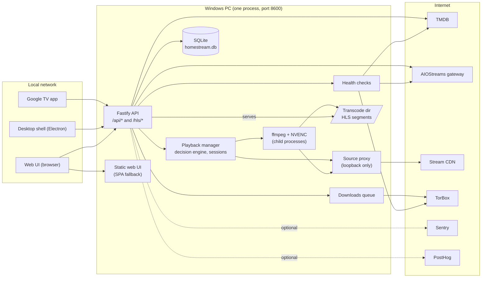
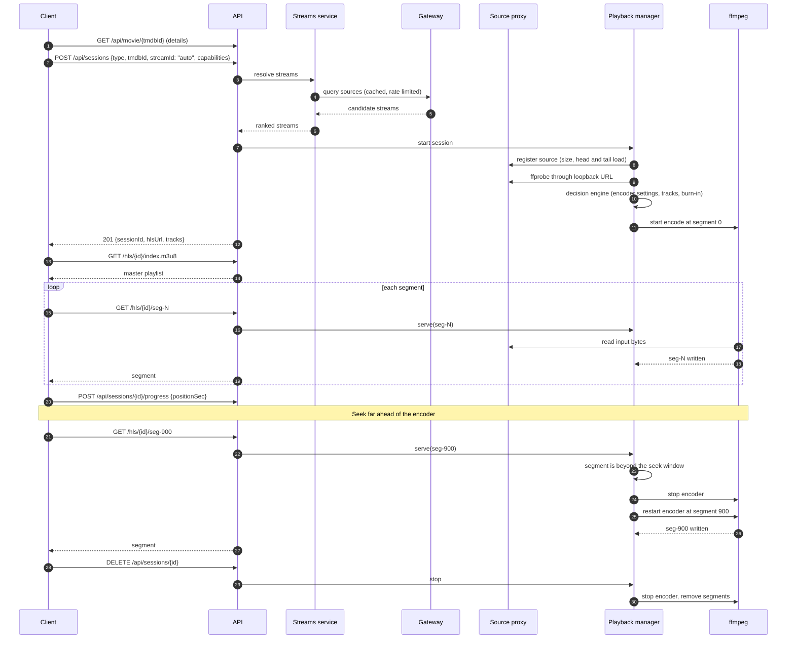
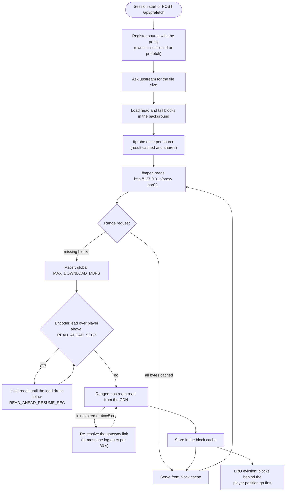
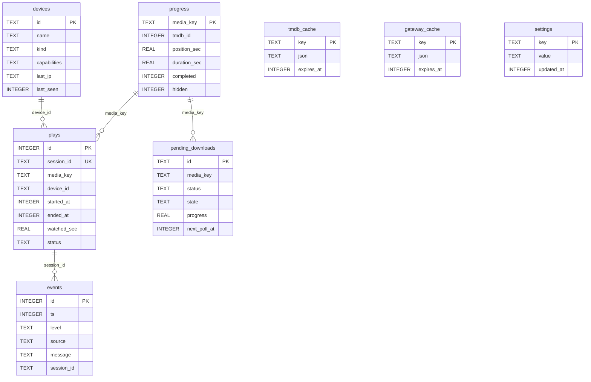
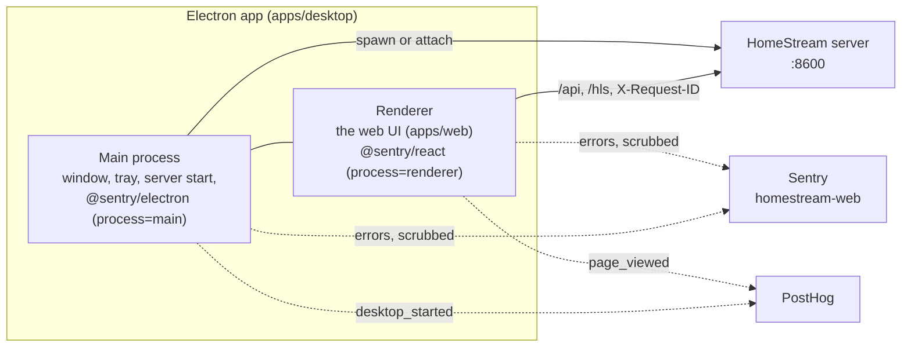
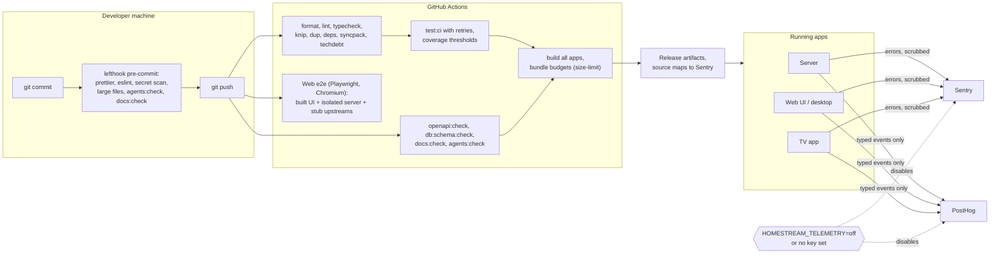

# Architecture

HomeStream is one Node.js process on a Windows PC (the server) plus thin clients on the local network. The server finds a source stream, re-encodes it with ffmpeg and NVENC, and serves HLS. Clients never talk to TMDB, the gateway or TorBox directly.

This document has six views: [components and deployment](#components-and-deployment), [playback](#playback-sequence), [source proxy and prefetch](#source-proxy-and-prefetch), [data model](#data-model), [desktop shell](#desktop-shell-appsdesktop), and [telemetry and CI/CD](#telemetry-and-cicd). The HTTP surface is in [openapi.json](openapi.json) (also served at `/api/docs`), the tables are in [database.md](database.md).

## Components and deployment

Key points:

- **One process.** The API, the web UI, the playback manager, the downloads queue and the health checks live in the same Node.js process. ffmpeg runs as child processes whose pids are recorded in `ffmpeg-pids.json`, so a crashed server's orphans are stopped on the next start (see [ffmpeg-orphans](runbooks/ffmpeg-orphans.md)).
- **The PC encodes everything.** Video is always re-encoded; clients always request `streamId: "auto"`. The decision engine picks the source, the encoder settings and what to burn in.
- **Local network only.** The server has no accounts and no authentication. Do not expose port 8600 to the internet. The source proxy listens on loopback only.
- **Ports.** Server 8600, web dev server 8601, source proxy `PORT + 50` by default (see [.env.example](../.env.example)).
- **Telemetry is optional.** Without Sentry or PostHog keys nothing leaves the machine except upstream requests the product needs ([PRIVACY.md](PRIVACY.md)).

## Playback sequence

When the title has no cached stream the start request answers `202` with a download status instead of a session; the client polls [`GET /api/downloads`](runbooks/torbox-expired.md) until the title is ready and starts again. A seek inside the window already encoded is served from disk. A seek more than five segments ahead of the encoder (or behind what was already deleted) stops the encoder and restarts it at the requested segment, which is why the first segment after a long seek takes a moment.

## Source proxy and prefetch

The proxy hides expiring CDN links from ffmpeg: ffmpeg only ever sees a stable loopback URL. Several readers of one source (the encoder, subtitle extractors, a prefetch) share one block cache, and a reader that needs bytes just ahead of another stream's position waits for them instead of downloading twice. All upstream bytes pass through one pacer so the household connection is never saturated. Prefetch keeps only the newest few sources nobody plays yet.

## Data model

The relations are logical: the schema has no foreign keys, so deleting a device or a progress row never cascades. `tmdb_cache` and `gateway_cache` are standalone key/value caches with an expiry, and `settings` is a standalone key/value table for the server's own state, such as the anonymous install id. The exact columns are in [schema.sql](schema.sql), with a description of every table in [database.md](database.md).

## Desktop shell (apps/desktop)

The Electron shell is a thin window around the web UI. It never talks to TMDB, the gateway or TorBox, and it does not encode anything: it starts (or attaches to) the server, loads `http://127.0.0.1:8600/` and reports its own errors.

- The renderer is the same build of `apps/web` that browsers get; it detects the shell through `window.homestream.isDesktop` (set by the preload script) and tags its events `device.kind=desktop`.
- Both processes report to the Sentry project `homestream-web` through the same scrubber from `packages/shared`, tagged `process=main` or `process=renderer`. Without `SENTRY_DSN_WEB` and `POSTHOG_API_KEY`, or with `HOMESTREAM_TELEMETRY=off`, nothing is sent.
- `apps/web` and `apps/desktop` never import each other (dependency-cruiser enforces it); they share only `@homestream/shared`.
- The desktop dev workflow, the Electron cache location and the main-process telemetry plan are in [apps/desktop/README.md](../apps/desktop/README.md).

## Telemetry and CI/CD

Everything sent to Sentry passes through the scrubber (`redact()` and a beforeSend filter) and everything sent to PostHog is a typed event whose properties are allow-listed. Both are no-ops when their key is missing. The event catalog and exactly what each event contains are in [PRIVACY.md](PRIVACY.md). The quality gates are listed in [AGENTS.md](../AGENTS.md#ci-checks), failure handling in [sentry-triage](runbooks/sentry-triage.md) and [flaky-tests](runbooks/flaky-tests.md).
