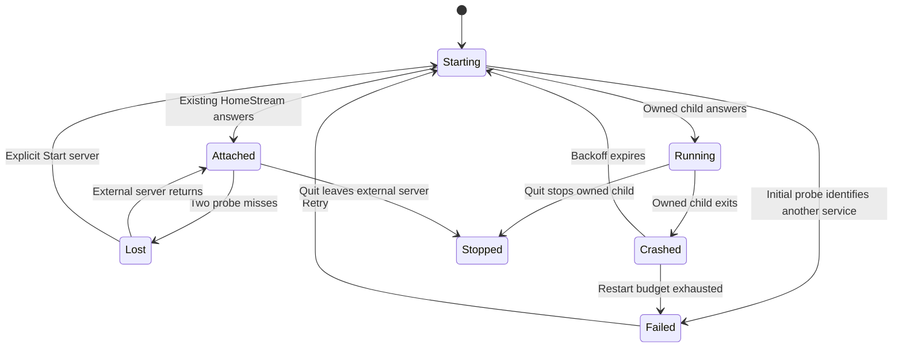

# Server supervision

Active contributors: VeroxAUS

## Purpose and layout

The desktop shell keeps an owned server alive without taking ownership of a server started elsewhere. `Supervisor` in `apps/desktop/src/supervisor.ts` implements the lifecycle; `ServerMonitor` in `apps/desktop/src/monitor.ts` supplies activity and health to the tray, notifications and keep-awake policy. See the [desktop overview](index.md).

| Abstraction           | Source                                  | Boundary                                                                 |
| --------------------- | --------------------------------------- | ------------------------------------------------------------------------ |
| `createServerClient`  | `apps/desktop/src/serverHttp.ts`        | Loopback requests with fresh request IDs and bounded JSON/probe timeouts |
| `resolveServerLaunch` | `apps/desktop/src/serverLaunch.ts`      | Development versus packaged command/environment                          |
| `spawnServerChild`    | `apps/desktop/src/serverProcess.ts`     | Child pipes, exit observation and termination                            |
| `createSseParser`     | `apps/desktop/src/sse.ts`               | Chunked event-stream parsing                                             |
| `trayView`            | `apps/desktop/src/trayModel.ts`         | Consistent icon, tooltip and menu model                                  |
| `TrayAdapter`         | `apps/desktop/src/shell/trayAdapter.ts` | Electron images, menu and tray events                                    |

## Ownership and readiness

The client probes `/api/info` on the configured loopback port and recognizes the `app: homestream` marker. A matching server is **attached**: no child is spawned, restart is refused with “Server is managed outside the app,” and quit leaves it running.

An attached server is probed every four seconds. Two consecutive misses make it **lost**; a later matching answer restores attachment. Losing attachment never automatically launches a competing server. The explicit Start server action can start an owned child.

If the initial probe finds **another application**, `Supervisor.begin()` fails immediately after that probe with `code: EADDRINUSE`, a timestamp and `portInUse: true`. It spawns nothing and schedules no automatic restart, so the user does not wait for the 60-second child-readiness deadline or exhaust a crash budget. The probe in `apps/desktop/src/serverHttp.ts` treats JSON lacking the HomeStream marker and invalid JSON as `other`; connection failures/timeouts are `none`, not proof of an occupied port. Retry re-probes and can attach or spawn after the conflict clears.

`apps/desktop/src/loadingPage.ts` carries the flag into the bundled page URL; `apps/desktop/assets/loading.html` displays “Port N is used by another program” instead of the repeated-crash wording. The `EADDRINUSE` hint asks the user to close that program or set a different `PORT` in `config.env`, then Retry. A child that actually launches and repeatedly exits with `EADDRINUSE` still uses the crash-recovery wording: the code alone does not set `portInUse`.

If the initial probe finds nobody, supervision attempts a child launch. Development runs Node against the built server. Packaged mode runs Electron's own executable as Node against server files in resources and supplies the bundled web directory (`apps/desktop/src/serverLaunch.ts`). This resolver is not an installer pipeline.

An owned child is probed every 250 ms, with a 60-second readiness deadline. It becomes **running** only after a HomeStream answer; timeout kills that child and enters normal crash recovery. The probe is an identity/readiness check, not authentication or a full dependency-health check.

## Serialized recovery and shutdown

Start, Retry, restart and explicit Start server requests run through a promise queue (`apps/desktop/src/supervisor.ts`). Concurrent restart requests share one restart promise. This prevents overlapping stop/start operations from leaving duplicate live children.

Generation checks invalidate obsolete readiness probes and attachment timers. A separate stop epoch prevents queued or awaiting operations from spawning after quit. Stop bypasses the queue, invalidates timers immediately and also waits for a child already being ended by a restart.

Owned-child crashes use a rolling 60-second history. Restart waits are **1 s, 2 s, then 5 s** for subsequent attempts; at most five automatic restarts are allowed in that window. The sixth exit produces **failed**, including a safe code and last-attempt time. Retry clears crash history. The last 30 output lines support classification of occupied port, denied access, missing build, missing executable and generic exit/kill failures (`apps/desktop/src/serverLaunch.ts`).

A clean stop writes `shutdown\n` to child stdin so the server can close sessions and advertise its mDNS goodbye. After five seconds it force-terminates the child; Windows uses PID-scoped `taskkill /T /F`, while POSIX kills the direct child. It waits up to another two seconds. Deliberately stopped children are detached from crash handling, so shutdown does not schedule recovery (`apps/desktop/src/serverProcess.ts`, `apps/desktop/src/supervisor.ts`).

## Monitoring without activity polling

While reachable, the shell opens `/api/events`, reads `/api/activity` once per stream connection, and requests `/api/health` initially and on a minute interval. Health events update the cached health and suppress redundant refreshes near them. Event-stream disconnection retries after three seconds. Stop aborts the stream, clears timers/counts/error deduplication and prevents reconnect.

Every activity load has its own map of session changes arriving while the snapshot is pending. The returned snapshot is accepted only if that load is still current; newer stream changes then override its session membership. An end or error arriving during the request therefore cannot be undone by an older snapshot. Conversely, a newly started session absent from the snapshot remains counted (`apps/desktop/src/monitor.ts`).

Snapshots exclude **stopped and error** sessions. Error updates remove sessions immediately, even when failed startup never emits an end event. Failure notification is deduplicated until end or recovery. A recovered update can count again. This keeps stale/failed sessions from retaining a stream count or app-suspension blocker.

The monitor validates lightweight session, health and download payloads using `packages/shared/src/desktop.ts`, `packages/shared/src/health.ts` and `packages/shared/src/downloads.ts`; malformed/irrelevant messages are ignored.

## Tray and integration

A reachable server is healthy until a non-OK health answer arrives. Dependency warnings **or errors** use the warning tray icon; supervisor failure uses error; starting, crashed, lost and stopped use stopped (`apps/desktop/src/trayModel.ts`). Tooltips include the active-session count. Menus expose open, health dashboard, Windows startup, restart/start and quit; logs appear on supervisor failure.

`apps/desktop/src/shell/shell.ts` starts/stops monitoring on supervisor changes, forwards counts into power policy and routes download/session failures to notifications. It leaves the loaded web page in place during transient crashes so the renderer can display its restart banner. Startup and permanent failure use bundled pages; successful startup clears their navigation history (`apps/desktop/src/loadingPage.ts`). Renderer details belong in [desktop integration](../web/desktop-integration.md); server behavior belongs in the [server app](../server.md).

## Modification entry points and tests

Change supervision timing/ownership in `apps/desktop/src/supervisor.ts`, subprocess mechanics in `apps/desktop/src/serverProcess.ts`, and reconciliation in `apps/desktop/src/monitor.ts`. Keep user-facing restart timing aligned with shared contracts.

`apps/desktop/test/supervisor.test.ts` covers attach/lost recovery, backoff limits, forced shutdown, overlapping restarts/Retry and quit during pending operations. Its wrong-service regressions require starting → failed with no child even after 60 seconds, Retry while occupied and after release, and preserved crash wording for a spawned child. `apps/desktop/test/launchAndEnv.test.ts` checks the port-specific startup message/hint and its absence for crash failures. `apps/desktop/test/monitor.test.ts` covers errors without ends, recovery, delayed snapshots, stream reconnect and stop. Scripted process tests exercise real process plumbing without starting Electron (`apps/desktop/test/spawnScripted.test.ts`, `apps/desktop/test/processAndFiles.test.ts`).

The separate real-runtime smoke covers both first run and configured Home, not just injectable supervisor policy (`apps/desktop/test/smoke/launch.smoke.ts`, `apps/desktop/test/smoke/configured.smoke.ts`). Both assert second-instance `--quit` leaves the server unavailable and no tracked owned PIDs alive. The shared harness retains known children after the launcher exits; fallback teardown attempts shell, stub hub and folder cleanup independently even if another step fails. `apps/desktop/test/smokeHarness.test.ts` tests those cleanup paths with fake processes, without Electron. See the [desktop smoke details](index.md#first-run-versus-configured-home) for ports, render assertions, timing and limitations. This does not add a runtime supervisor ownership rule or prove live playback.

## Key source files

| File                                    | Purpose                                           |
| --------------------------------------- | ------------------------------------------------- |
| `apps/desktop/src/supervisor.ts`        | Ownership/state machine and serialized operations |
| `apps/desktop/src/serverLaunch.ts`      | Launch environments and safe failure hints        |
| `apps/desktop/src/serverProcess.ts`     | Process boundary                                  |
| `apps/desktop/src/serverHttp.ts`        | Correlated loopback client                        |
| `apps/desktop/src/monitor.ts`           | SSE and snapshot concurrency                      |
| `apps/desktop/src/trayModel.ts`         | Pure tray presentation rules                      |
| `apps/desktop/src/shell/trayAdapter.ts` | Cached multi-scale tray images                    |
| `apps/desktop/src/loadingPage.ts`       | Failure-page query and message classification     |
| `apps/desktop/test/supervisor.test.ts`  | Wrong-service, ownership and recovery regressions |
| `apps/desktop/test/monitor.test.ts`     | Activity race regressions                         |

## Measured scope

Desktop-wide committed inventory at `663492c`: **33 source / 21 test files** (19 `.test.ts`, two `.smoke.ts`; three helpers excluded), ratio **0.64**, **1 unique human author** from `origin/main` excluding bots, VeroxAUS. Committed-path method and exclusions are in the [desktop overview](index.md#measured-scope); these figures describe the whole app, not an overlapping subsystem total.
