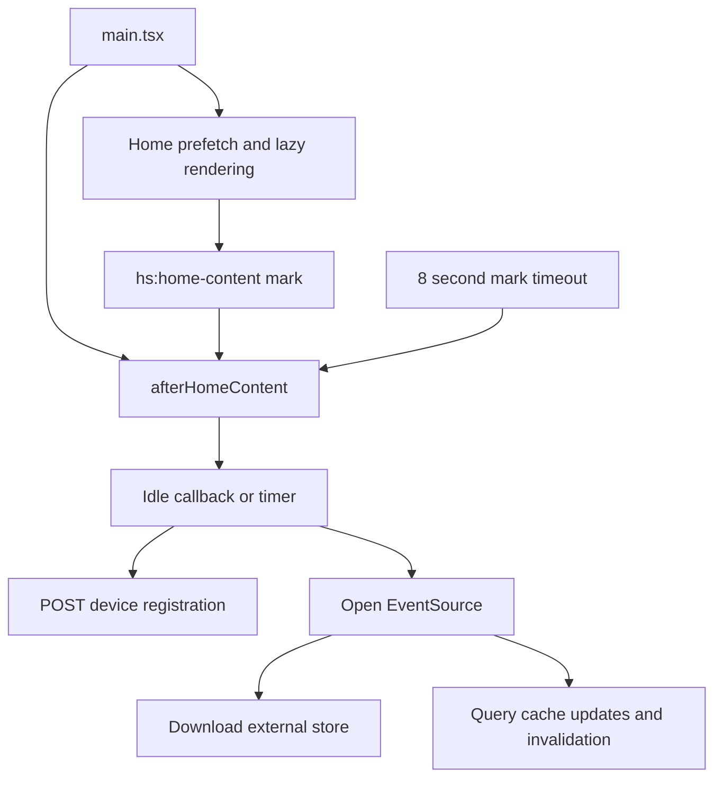

# Data and startup

Active contributors: VeroxAUS

## Purpose and layout

Browser state is split between a TanStack Query server-data cache, local route/component state, persistent device identity and a small download-progress external store. `apps/web/src/api/`, `apps/web/src/device/`, `apps/web/src/events/` and `apps/web/src/lib/startup.ts` implement these boundaries. There is no separate global application store.

## Request and cache abstractions

`apiFetch` in `apps/web/src/api/client.ts` generates a UUID `X-Request-ID`, preserves caller options, records a log entry and throws `ApiError` for non-2xx responses. `ApiError` carries status, code, message, hint and the request ID. `apiGet` parses JSON with the supplied [shared schema](../../packages/shared.md); an incompatible response is an error rather than unchecked screen data.

`createQueryClient` and query factories in `apps/web/src/api/queries.ts` centralize these defaults:

| Setting               | Current value                                                    |
| --------------------- | ---------------------------------------------------------------- |
| Request deadline      | 15 seconds, combined with Query's abort signal                   |
| Retry                 | One retry for non-`ApiError`, non-timeout failures, after 800 ms |
| Window-focus refetch  | Disabled                                                         |
| Default staleness     | 5 minutes                                                        |
| Unused cache lifetime | 10 minutes                                                       |
| Home staleness        | 30 seconds                                                       |
| Health                | 30-second staleness; 60-second foreground refresh                |
| Saved progress        | Immediately stale; always refetched on mount                     |

Keys are `['home']`, `['health']`, `['info']`, `['search', text]`, `['movie', id]`, `['show', id]`, `['season', id, season]`, `['progress', 'movie', id]` and `['progress', 'tv', id]`. Movie-progress 404 becomes `null`; other failures reach the caller. Screens deliberately treat failed progress as absent rather than blocking metadata/actions (`apps/web/src/pages/MovieDetailsPage.tsx`, `apps/web/src/pages/ShowDetailsPage.tsx`).

## Deferred startup flow

`apps/web/src/main.tsx` prefetches Home only when the initial pathname is `/`. It schedules registration, SSE and telemetry separately, without waiting for any to mount React. Health loading in the persistent navigation remains an ordinary immediate Query request; not all network traffic is deferred.

`markContentShown` in `apps/web/src/lib/startup.ts` creates `hs:home-content` once on the next animation frame. `afterHomeContent` accepts an existing mark or observes it, but gives up waiting after **8,000 ms**. `whenIdle` uses `requestIdleCallback` with a **3,000 ms timeout**, or `setTimeout(0)` when unavailable. These are fallback budgets, not guaranteed startup durations.

Pages call `useContentShown` from `apps/web/src/lib/useContentShown.ts`: Home waits until its query is no longer pending; details wait for the main metadata query; Search and Settings can mark their usable screen before results arrive. Placeholder dashboards need not set the mark, so the timeout matters. Optional telemetry has an additional no-key/opt-out guard before scheduling; see [telemetry](../../systems/telemetry.md).

## Device identity

`apps/web/src/device/identity.ts` stores a random UUID at `homestream.deviceId`, falling back to a page-lifetime memory ID if storage is blocked. Names use `homestream.deviceName`, are trimmed and limited to **128 characters**, and default to **Web browser** or **HomeStream Desktop**. Registration catches failures and returns a boolean; it is not required for browsing.

The advertised profile is fixed: **3840×2160**, H.264 enabled, HEVC/Main10/HDR10 disabled, **2 audio channels**. Kind is `desktop` only when the optional `window.homestream.isDesktop` marker exists. This is a conservative requested output profile, not runtime codec probing. The server still always re-encodes video. Device identity is not authentication and is distinct from analytics identity; see [security](../../security.md) and [desktop](../desktop.md).

## SSE and download updates

`startServerEvents` in `apps/web/src/events/serverEvents.ts` opens one native `EventSource('/api/events')`; absent EventSource support leaves browsing operational. It is a native SSE connection, not an `apiFetch` request with a custom UUID header.

| Event                               | Client effect                                                                         |
| ----------------------------------- | ------------------------------------------------------------------------------------- |
| `health`                            | Parse shared schema, update `['health']` only while pathname starts with `/dashboard` |
| `download.progress`                 | Store the fraction for the movie/episode key                                          |
| `download.ready`, `download.failed` | Clear the fraction and invalidate the matching movie/show details                     |
| Connection reopen after an error    | Invalidate all queries once to repair stale snapshots                                 |

Malformed JSON/schema-invalid events are ignored. Native EventSource owns reconnects; the code does not add download polling. `stopServerEvents` closes/reset the singleton for tests (`apps/web/src/events/serverEvents.ts`).

`downloadKey` and `useDownloadProgress` in `apps/web/src/events/downloadProgress.ts` join responses/events using `movie:<id>` or `tv:<id>:<season>:<episode>`. A Map and `useSyncExternalStore` expose changed fractions; identical values do not emit notifications. `usePendingDownload` in `apps/web/src/events/usePendingDownload.ts` requires a pending details record, then prefers the live value over the snapshot. An event alone does not invent pending status. Final events refetch metadata so [screen actions](screens.md#details-and-action-state) can change.

## Integration and modification points

Add endpoint/query keys in `apps/web/src/api/queries.ts`, not individual screens. Extend SSE parsing with shared contracts and narrowly scoped cache changes. Preserve the content/idle scheduling for work unrelated to first paint, and do not log typed search text or device names; the logger/scrubber boundary is detailed under [telemetry](../../systems/telemetry.md).

## Key source files

| File                                        | Purpose                                      |
| ------------------------------------------- | -------------------------------------------- |
| `apps/web/src/main.tsx`                     | Concurrent Home prefetch and root startup    |
| `apps/web/src/api/client.ts`                | Request IDs, ApiError and schema parsing     |
| `apps/web/src/api/queries.ts`               | Query keys, deadlines and cache defaults     |
| `apps/web/src/lib/startup.ts`               | Content mark, observer timeout and idle gate |
| `apps/web/src/lib/useContentShown.ts`       | Page-level readiness hook                    |
| `apps/web/src/device/identity.ts`           | Identity, capabilities and registration      |
| `apps/web/src/events/serverEvents.ts`       | SSE lifecycle and invalidations              |
| `apps/web/src/events/downloadProgress.ts`   | External progress store                      |
| `apps/web/src/events/usePendingDownload.ts` | Snapshot/live progress combination           |
| `apps/web/src/events/events.test.tsx`       | SSE, reconnect and progress-store tests      |

Measured tracked scope for `apps/web/src/api/`, `apps/web/src/device/` and `apps/web/src/events/`: **6 production TS/TSX files**, **3 tests**, **0.50 test-to-code file ratio**. Startup hooks are excluded from this scope and counted on [screens](screens.md). Default-branch human authors: **1** (VeroxAUS).
