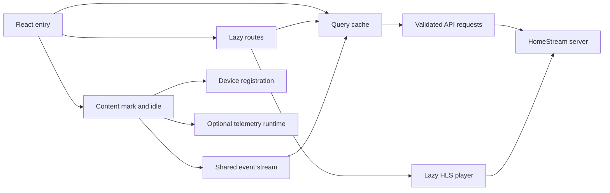

# Web app

Active contributors: VeroxAUS

## Purpose

HomeStream's React 19/Vite client implements catalog browsing, navigation search, details with cast and related titles, saved-progress actions, HLS playback, local spoiler preferences, Settings/About and the Electron renderer. The five dashboard tabs remain placeholders. The server chooses sources, persists progress and encodes video; the client always requests automatic stream selection (`apps/web/src/App.tsx`, `apps/web/src/player/sessionApi.ts`).

## Implementation map

| Area                                                                         | Responsibility                                                          | Read next                                         |
| ---------------------------------------------------------------------------- | ----------------------------------------------------------------------- | ------------------------------------------------- |
| `apps/web/src/pages/`, `apps/web/src/components/`                            | Lazy routes, Home, details, shared rows and presentation                | [Screens](screens.md)                             |
| `apps/web/src/components/NavSearch.tsx`, `apps/web/src/pages/SearchPage.tsx` | One navigation field, URL/history synchronization and debounced results | [Navigation search](search.md)                    |
| `apps/web/src/pages/settings/`, `apps/web/src/lib/spoilers.ts`               | Accessible Settings/About tabs and device-local preferences             | [Settings and spoilers](settings-and-spoilers.md) |
| `apps/web/src/api/`, `apps/web/src/events/`, `apps/web/src/device/`          | Validated requests, Query cache, SSE and device identity                | [Data and startup](data-and-startup.md)           |
| `apps/web/src/player/`                                                       | Session ownership, HLS, controls, tracks and progress                   | [Player](player.md)                               |
| `apps/web/src/desktop/`                                                      | Setup, shell settings, shortcuts and mini-player handoff                | [Desktop integration](desktop-integration.md)     |
| `apps/web/src/notices/`                                                      | App-wide download outcomes and dismissible toasts                       | [Screens](screens.md#notifications-and-toasts)    |
| `apps/web/src/telemetry/`                                                    | SDK-free facade and lazy Sentry/PostHog runtime                         | [Telemetry](../../systems/telemetry.md)           |
| `apps/web/src/styles/`                                                       | Tokens, global CSS and self-hosted Inter                                | [Build and tests](build-and-tests.md)             |
| `apps/web/src/test/`, `apps/web/e2e/`                                        | Offline component fixtures and isolated browser tests                   | [Build and tests](build-and-tests.md)             |

## Runtime flow

The entry point in `apps/web/src/main.tsx` creates one Query client, prefetches Home when opened at `/`, schedules background startup and mounts StrictMode, error boundaries, Query providers and BrowserRouter. `Layout` in `apps/web/src/components/Layout.tsx` keeps navigation around lazy routes, except that playback owns the full window. Page changes report template page views; new non-POP path navigation scrolls to the top.

Health is not a dashboard-only feature: navigation and desktop setup consume it globally. SSE opening fetches a baseline through the health Query; pushed answers cancel older requests. Polling runs only when the stream is not live. Device registration, SSE and telemetry wait for content and idle time, but visible-page requests do not (`apps/web/src/events/serverEvents.ts`, `apps/web/src/components/HealthPill.tsx`, `apps/web/src/lib/startup.ts`).

The renderer uses the implemented preload bridge for desktop behavior, not cross-app imports. First-run setup requires that bridge as well as missing required keys; ordinary browsers retain Home's normal loading/error/content states even if navigation has cached a missing-key health answer (`apps/web/src/desktop/useMissingKeys.ts`). Window creation and server supervision belong to the [Electron shell](../desktop/index.md); the renderer integration is described [separately](desktop-integration.md).

## Integration and modification points

Add routes in `apps/web/src/App.tsx`, endpoint queries in `apps/web/src/api/queries.ts`, and request/IPC contracts in [shared](../../packages/shared.md). Keep source-selection and completion policy on the server. Preserve the player's session cleanup and handoff ownership when altering navigation. Keep heavy dependencies behind lazy boundaries with explicit [bundle budgets](build-and-tests.md#asset-flow-and-budgets).

Search typing updates the URL before the data request, while spoiler changes update a local external store without a server mutation. Do not merge those states into Query or make either action register a device (`apps/web/src/components/useNavSearch.ts`, `apps/web/src/lib/spoilers.ts`). Server-side metadata assembly belongs to [catalog](../../features/catalog.md), not these components.

## Key source files

| File                                           | Purpose                                                 |
| ---------------------------------------------- | ------------------------------------------------------- |
| `apps/web/src/main.tsx`                        | Root providers, prefetch and deferred startup           |
| `apps/web/src/App.tsx`                         | Lazy route table                                        |
| `apps/web/src/components/Layout.tsx`           | Chrome, route boundaries and global notices             |
| `apps/web/src/components/NavSearch.tsx`        | Static-shell search entry and responsive field          |
| `apps/web/src/pages/settings/SettingsTabs.tsx` | Settings tab keyboard and ARIA relationships            |
| `apps/web/src/lib/spoilers.ts`                 | Default-on local spoiler store                          |
| `apps/web/src/api/queries.ts`                  | Cache, cancellation and query deadlines                 |
| `apps/web/src/events/serverEvents.ts`          | Latest-answer health reconciliation and download events |
| `apps/web/src/pages/PlayerPage.tsx`            | Start/attach/retry route state                          |
| `apps/web/src/player/usePlaybackModel.ts`      | Playback composition                                    |
| `apps/web/src/desktop/bridge.ts`               | Browser-safe bridge detection                           |
| `apps/web/src/App.test.tsx`                    | Route composition tests                                 |

## Measured scope

At commit `0b766e2f21a19468e04d0a9c7352c635a4357c87`, the committed web tree contains **119 production TS/TSX files**, **49 unit/component test files** and **11 browser specs**: **60/119 = 0.50 test files per production file**. Unit/component files alone give **49/119 = 0.41**. Method: enumerate `git ls-tree -r --name-only 0b766e2f21a19468e04d0a9c7352c635a4357c87 -- apps/web`; production means TS/TSX under `apps/web/src/` excluding declarations, test files and `apps/web/src/test/`; tests mean `*.test.ts(x)` plus `*.spec.ts`. CSS, fonts, fixture helpers and build configuration are excluded from the production denominator. This is a file inventory, not executed coverage or test-case counts.

Unique human authors: **1**, VeroxAUS, using the supplied verified `origin/main` history with bots excluded and `.github/CODEOWNERS` as the ownership cross-check. Unchanged narrower subpage counts retain their original revision. See [repository statistics](../../by-the-numbers.md) for the wider inventory and [build and tests](build-and-tests.md) for the added range-input browser regression and build-environment guard.
