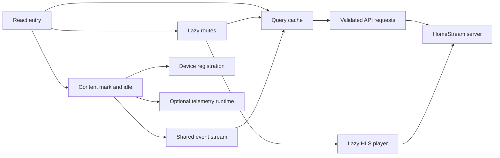

# Web app

Active contributors: VeroxAUS

HomeStream's React 19/Vite client implements catalog browsing, saved-progress actions, HLS playback, notifications and the Electron renderer. Only the five dashboard tabs remain placeholders. The server chooses sources, persists progress and encodes video; the client always requests automatic stream selection (`apps/web/src/App.tsx`, `apps/web/src/player/sessionApi.ts`).

## Implementation map

| Area | Responsibility | Read next |
| --- | --- | --- |
| `apps/web/src/pages/`, `apps/web/src/components/` | Lazy routes, Home, search, details, Settings and presentation | [Screens](screens.md) |
| `apps/web/src/api/`, `apps/web/src/events/`, `apps/web/src/device/` | Validated requests, Query cache, SSE and device identity | [Data and startup](data-and-startup.md) |
| `apps/web/src/player/` | Session ownership, HLS, controls, tracks and progress | [Player](player.md) |
| `apps/web/src/desktop/` | Setup, shell settings, shortcuts and mini-player handoff | [Desktop integration](desktop-integration.md) |
| `apps/web/src/notices/` | App-wide download outcomes and dismissible toasts | [Screens](screens.md#notifications-and-toasts) |
| `apps/web/src/telemetry/` | SDK-free facade and lazy Sentry/PostHog runtime | [Telemetry](../../systems/telemetry.md) |
| `apps/web/src/styles/` | Tokens, global CSS and self-hosted Inter | [Build and tests](build-and-tests.md) |
| `apps/web/src/test/`, `apps/web/e2e/` | Offline component fixtures and isolated browser tests | [Build and tests](build-and-tests.md) |

## Runtime flow

The entry point in `apps/web/src/main.tsx` creates one Query client, prefetches Home when opened at `/`, schedules background startup and mounts StrictMode, error boundaries, Query providers and BrowserRouter. `Layout` in `apps/web/src/components/Layout.tsx` keeps navigation around lazy routes, except that playback owns the full window. Page changes report template page views; new non-POP path navigation scrolls to the top.

Health is not a dashboard-only feature: navigation and desktop setup consume it globally. SSE opening fetches a baseline through the health Query; pushed answers cancel older requests. Polling runs only when the stream is not live. Device registration, SSE and telemetry wait for content and idle time, but visible-page requests do not.

The renderer uses the implemented preload bridge for desktop behavior, not cross-app imports. Window creation and server supervision belong to the [Electron shell](../desktop/index.md); the renderer integration is described [separately](desktop-integration.md).

## Integration and modification points

Add routes in `apps/web/src/App.tsx`, endpoint queries in `apps/web/src/api/queries.ts`, and request/IPC contracts in [shared](../../packages/shared.md). Keep source-selection and completion policy on the server. Preserve the player's session cleanup and handoff ownership when altering navigation. Keep heavy dependencies behind lazy boundaries with explicit [bundle budgets](build-and-tests.md#asset-flow-and-budgets).

## Key source files

| File | Purpose |
| --- | --- |
| `apps/web/src/main.tsx` | Root providers, prefetch and deferred startup |
| `apps/web/src/App.tsx` | Lazy route table |
| `apps/web/src/components/Layout.tsx` | Chrome, route boundaries and global notices |
| `apps/web/src/api/queries.ts` | Cache, cancellation and query deadlines |
| `apps/web/src/events/serverEvents.ts` | Latest-answer health reconciliation and download events |
| `apps/web/src/pages/PlayerPage.tsx` | Start/attach/retry route state |
| `apps/web/src/player/usePlaybackModel.ts` | Playback composition |
| `apps/web/src/desktop/bridge.ts` | Browser-safe bridge detection |
| `apps/web/src/App.test.tsx` | Route composition tests |

## Measured scope

At commit `5eefa37775db95b4bdd1e1dfe7b33cb8a9f31001`, committed web files contain **104 production TS/TSX files**, **39 unit/component test files** and **4 browser specs**: **43/104 = 0.41 test files per production file**. Method: enumerate `git ls-files apps/web`; production means `src/**/*.ts(x)` excluding declarations, `*.test.*` and `src/test/`; tests mean `*.test.ts(x)` plus `*.spec.ts`. CSS, fonts, helpers and build configuration are excluded from production counts. This is an inventory, not executed coverage.

Unique human authors: **1**, VeroxAUS, using the supplied verified `origin/main` history with bots excluded and `.github/CODEOWNERS` as the ownership cross-check. Subpage counts use the same file method and explicit narrower scopes.
