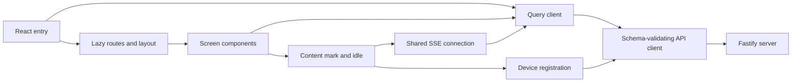

# Web

Active contributors: VeroxAUS

## Purpose

`@homestream/web` is the React 19/Vite LAN client. Home, search, movie/show details and Settings work; Play links lead to an explicit placeholder, and dashboard tabs are navigation scaffolding (`apps/web/src/App.tsx`, `apps/web/src/pages/PlayerPage.tsx`, `apps/web/src/pages/dashboard/DashboardPlaceholder.tsx`). The server owns metadata, saved progress, source selection and encoding.

Read [screens](screens.md) for route behavior, [data and startup](data-and-startup.md) for cache and deferred networking, and [build and tests](build-and-tests.md) for asset and validation boundaries. Optional SDKs and privacy rules are covered once under [telemetry](../../systems/telemetry.md).

## Directory layout

```text
apps/web/
├── src/main.tsx                 # root, Home prefetch, deferred startup
├── src/App.tsx                  # lazy route table
├── src/api/                     # request IDs, validation, Query options
├── src/pages/                   # screens and dashboard placeholders
├── src/components/              # navigation, cards, details and actions
├── src/device/                  # browser identity and fixed capabilities
├── src/events/                  # shared SSE and download progress store
├── src/lib/                     # startup, formatting and hooks
├── src/styles/                  # tokens, global CSS and local Inter font
├── src/telemetry/               # SDK-free facade and deferred runtime
├── src/test/                    # fixtures, mock API and render providers
├── e2e/                         # isolated plain/stub browser builds
├── vite.config.ts
└── vite.plugins.ts
```

## Key abstractions

| Abstraction            | Source                                | Role                                                                        |
| ---------------------- | ------------------------------------- | --------------------------------------------------------------------------- |
| `App`                  | `apps/web/src/App.tsx`                | Lazy client routes, including planned-screen placeholders                   |
| `Layout`               | `apps/web/src/components/Layout.tsx`  | Persistent navigation, Suspense outlet, route reporting and scroll behavior |
| `createQueryClient`    | `apps/web/src/api/queries.ts`         | Shared cache, cancellation, timeouts and retry rules                        |
| `apiGet`               | `apps/web/src/api/client.ts`          | Request correlation and shared-schema response parsing                      |
| `getCapabilityProfile` | `apps/web/src/device/identity.ts`     | Stable device ID and conservative playback output requirements              |
| `startServerEvents`    | `apps/web/src/events/serverEvents.ts` | One SSE connection updating cache and download progress                     |

## How it works

`apps/web/src/main.tsx` creates one Query client. On `/`, it starts the Home data request while the Home route chunk is loading. It schedules device registration, events and optional telemetry without awaiting them, then mounts StrictMode, QueryClientProvider and BrowserRouter. `apps/web/src/components/Layout.tsx` keeps navigation visible while routes load; new non-POP pathname navigation scrolls to the top, while back/forward navigation leaves restoration to the browser.



The existing desktop-aware renderer path checks `window.homestream?.isDesktop`; it changes navigation styling, device kind and default name. It is a seam for a future preload, not proof of a running [Electron shell](../desktop.md) (`apps/web/src/device/identity.ts`, `apps/web/src/components/Nav.tsx`, `apps/web/src/env.d.ts`).

## Integration and modification points

Add screens through `apps/web/src/App.tsx`, reuse query options in `apps/web/src/api/queries.ts`, and validate new responses with [shared contracts](../../packages/shared.md). Do not fetch the server directly from screen components. Keep expensive features lazy and budgeted; playback still needs actual player/session integration rather than a replacement label. See [server](../server.md), [catalog](../../features/catalog.md) and [architecture](../../overview/architecture.md) for the other side of these boundaries.

## Key source files

| File                                  | Purpose                                    |
| ------------------------------------- | ------------------------------------------ |
| `apps/web/index.html`                 | HTML root                                  |
| `apps/web/src/main.tsx`               | Providers, prefetch and startup scheduling |
| `apps/web/src/App.tsx`                | Lazy route table                           |
| `apps/web/src/components/Layout.tsx`  | Persistent chrome and route outlet         |
| `apps/web/src/api/queries.ts`         | Query configuration and endpoint schemas   |
| `apps/web/src/device/identity.ts`     | Local identity and registration            |
| `apps/web/src/events/serverEvents.ts` | Deferred event stream                      |
| `apps/web/src/App.test.tsx`           | Route and placeholder expectations         |

## Measured scope

At the documented checkout, tracked `apps/web/src/` has **57 production TypeScript/TSX files**, excluding declarations, tests and `apps/web/src/test/` helpers. There are **24 colocated test files** and **2 e2e specs**, or **26/57 = 0.46 test files per production file**. Production files contain 2,857 physical lines; tests contain 3,030. CSS, assets and build configuration are outside this count. Default-branch history has **1 unique human author**, VeroxAUS, excluding bots. These are file measurements, not a test-run result.
