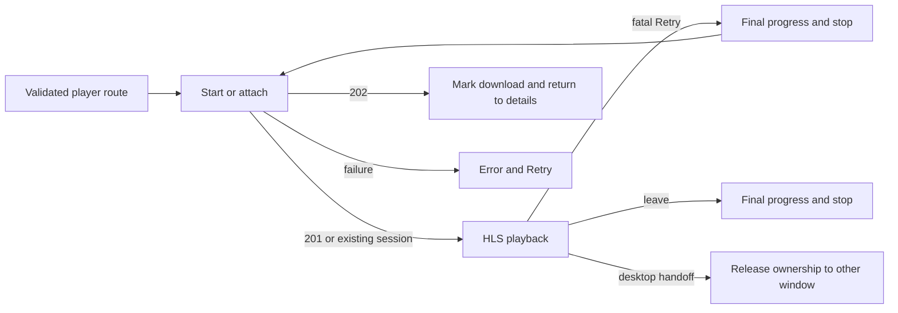

# Player

Active contributors: VeroxAUS

## Purpose

The full-window HLS player starts or attaches to a server session, drives a video element and owns progress, cleanup, controls and track selection. `PlayerPage` in `apps/web/src/pages/PlayerPage.tsx` is the route controller; `Playback` in `apps/web/src/player/Playback.tsx` renders the ready session; `usePlaybackModel` in `apps/web/src/player/usePlaybackModel.ts` composes the hooks. Server encoding and selection are covered in [playback](../../systems/playback/index.md).

## Routes and session startup

`parsePlayTarget` in `apps/web/src/player/target.ts` accepts `/play/movie/:id` or `/play/tv/:id/:season/:episode`, rejects malformed/extra segments and permits season zero for Specials. `?start=` accepts 1–6 decimal digits as seconds. Details actions supply floored saved seconds for Resume or explicit zero for Start over; the player does not independently fetch saved progress to choose a starting position.

`useSessionStart` in `apps/web/src/player/useSessionStart.ts` exposes loading, ready, downloading or error. A microtask avoids duplicate development-remount POSTs. If a session arrives after navigation away, it is stopped immediately.

`startSession` in `apps/web/src/player/sessionApi.ts` sends `POST /api/sessions` with title fields, capability profile, **`streamId: "auto"`**, optional `startPositionSec` and **no subtitle field**. The server applies its default-subtitle policy.

| Answer                    | Client behavior                                                                                                                                                   |
| ------------------------- | ----------------------------------------------------------------------------------------------------------------------------------------------------------------- |
| **201 session**           | Validate session, mount playback using the server's playlist URL and reported start position                                                                      |
| **202 download tracking** | Validate download, update/invalidate details via `apps/web/src/player/downloading.ts`, show “Downloading, try again later,” return to details without opening HLS |
| Error                     | Show message/hint, Retry, Back to details and Health-dashboard access                                                                                             |

Retry after a startup failure starts another attempt. Retry after a fatal playing-stream failure first snapshots the current position and ends the old session. `waitForStop` in `apps/web/src/player/sessionApi.ts` waits for that shutdown promise or **4 seconds**, then permits replacement, preventing a race against the old encoder slot. Retry clicks are deduplicated while draining. An attached desktop session has a separate give-up path that also drains a failed attachment before normal startup; see [desktop integration](desktop-integration.md#session-handoff-and-retry).

## HLS and playback state

The route is lazy in `apps/web/src/App.tsx`; `useHls` in `apps/web/src/player/useHls.ts` statically imports hls.js inside that lazy player dependency graph, not Home's initial code. The player chunk has its own **200 kB gzip** budget in `apps/web/.size-limit.json`. This is a configured ceiling, not a fresh measured bundle size.

When MediaSource-based hls.js is supported, the hook creates an instance, attaches video, loads the master playlist and attempts play after manifest parsing. It retains **60 seconds** of back buffer. Fragment policy uses **20-second** first-byte and **120-second** load limits, **four timeout retries with zero delay**, and up to **90 error retries** with a **1-second** base delay and **2-second** maximum delay, accommodating subtitle extraction's temporary 503s (`apps/web/src/player/useHls.ts`).

The fragment error predicate is exactly `hlsVerdict || (response?.code === 0 && retryCount < MAX_FRAGMENT_RETRIES)`, with `MAX_FRAGMENT_RETRIES = 90`. It preserves hls.js's decision for other responses and adds retries for status-0 aborted/reset connections, including video fragments, even when hls.js would reject an online status-0 failure as CORS. It does **not** rewrite the response to HTTP 502 or add a separate retry loop. With a false hls.js verdict, counts 0–89 retry; count 90 and above stop. HTTP 4xx and errors without a response get no added retry (`apps/web/src/player/useHls.ts`, `apps/web/src/player/useHls.test.ts`). This is a retry-count budget, not a fixed 90-second deadline.

The error listener leaves nonfatal errors with hls.js. Fatal media errors get **two** `recoverMediaError()` attempts per instance; the next fatal media error, or a fatal error of another type, reports a user-facing failure card (`apps/web/src/player/useHls.ts`). Server-side subtitle extraction and temporary availability belong to [subtitles](../../systems/playback/subtitles.md).

When hls.js is unsupported but the video element accepts `application/vnd.apple.mpegurl`, the hook loads HLS natively and seeks after metadata. With neither path, it reports unsupported HLS. The richer rendition-selection path is hls.js-specific; this fallback is not a claim of identical native track controls. Cleanup destroys the hls.js instance.

The video-state hook, reload flag and pending track PATCH determine buffering UI. Busy overlays use **`pointer-events: none`** in `apps/web/src/player/PlayerOverlays.module.css`: Back, Play/Pause and Seek remain clickable while starting/buffering. Error cards retain interactive Retry/Back links and buttons. This distinction has real Chromium hit-testing coverage, not only jsdom assertions.

## Tracks and controls

`useTrackSwitching` in `apps/web/src/player/useTrackSwitching.ts` serializes track changes with a ref guard:

- Text/sidecar subtitles select hls.js renditions locally; server track indices map to rendition IDs in `apps/web/src/player/tracks.ts`.
- Burn-in subtitles PATCH the session, then reload the **same playlist** at the current video position.
- Leaving burn-in sends **`subtitle: null`**, then applies the requested local text track or Off.
- Audio changes PATCH `audioIndex`, update the described session and reload at the current position.
- Selection is kept in a shared ref and reapplied when renditions are relisted. `SUBTITLE_TRACKS_UPDATED` queues a microtask because hls.js chooses its own default immediately after the event handler returns. The microtask applies the current choice only if that instance is still active, so late listings from replaced streams are ignored. Off and burned-in tracks select rendition `-1`; sidecar selection maps the server index to the rendition and enables display, avoiding a redundant track assignment when already selected (`apps/web/src/player/useHls.ts`).
- That ordering preserves Off and non-default text choices through audio/burn-in stream reloads; it is not persistence across a browser-page refresh. Subtitle toggle restores the last choice or first usable entry, with text tracks ordered before bitmap tracks (`apps/web/src/player/tracks.ts`). `apps/web/src/pages/PlayerSubtitleReload.test.tsx` covers Off/non-default choices after audio switches, Off after leaving burn-in with one `subtitle: null` PATCH, and stale-instance listings.
- A refused PATCH leaves playback available and displays a persistent error toast.

`usePlayerActions` in `apps/web/src/player/usePlayerActions.ts` centralizes buttons, keyboard and media-key behavior. Seek clamps to the title duration; skip is **−10/+30 seconds**, volume step **0.05**, and fullscreen targets the player stage. `useShortcuts` in `apps/web/src/player/useShortcuts.ts` listens even when chrome is hidden:

| Keys          | Action                                                      |
| ------------- | ----------------------------------------------------------- |
| Space / K     | Play/pause                                                  |
| Left / Right  | Skip −10/+30 seconds                                        |
| Up / Down     | Volume ±0.05                                                |
| M / F / C / I | Mute / fullscreen / subtitles / info                        |
| P             | Desktop pop-out or mini-player expand; ignored in a browser |
| Escape        | Close menu, close info, exit fullscreen, then leave         |

These arrow shortcuts apply outside native range inputs. When a native `input[type=range]` has focus, `useShortcuts` returns before cancelling the arrow event or running global seek/volume actions. The Volume input in `apps/web/src/player/ControlBar.tsx` therefore keeps the browser's **0.01-step** arrow behavior instead of also seeking or applying the global **0.05** volume step. Other shortcuts remain available on that input, including K and M.

The Seek control in `apps/web/src/player/SeekBar.tsx` is a focusable `div` with `role="slider"`, not a native range input. It retains the shared document-level keyboard handling: Left/Right seek and Up/Down adjust volume. Its pointer handlers still own drag preview and release-to-seek. `apps/web/src/pages/PlayerControls.test.tsx` checks uncancelled volume-arrow events, retained K/M behavior and focused Seek shortcuts.

`apps/web/e2e/player-volume-keys.spec.ts` adds real Chromium checks for native volume steps without seeks and for global arrows when focus is elsewhere. It fabricates the session response, holds HLS requests, waits for each painted slider value and counts `currentTime` setter calls rather than claiming successful media seeks. No real playback session or encoder starts; see [browser test boundaries](build-and-tests.md#isolated-browser-flow).

Text-entry targets and Ctrl/Alt/Meta combinations are ignored; toggle keys do not repeat. Space key-up is consumed to avoid also clicking a focused button. Chrome hides after **3 seconds** of inactivity, stays visible when paused/buffering or menus/info/track changes require it, and returns on input.

Clock events write directly to the DOM rather than repeatedly rendering the playback tree (`apps/web/src/player/useVideoState.ts`, `apps/web/src/player/SeekBar.tsx`). Auto-hide changes the stage's `data-chrome` attribute, throttles activity resets and keeps controls visible for hover or keyboard-visible focus (`apps/web/src/player/useIdleChrome.ts`, `apps/web/src/player/idleHider.ts`).

The desktop mini player shares these actions, including its **0–1**, **0.01-step** volume slider and mute button. Setting a positive volume unmutes; toggling mute preserves the stored volume. Handoffs carry both values rather than introducing a second session (`apps/web/src/desktop/MiniVolume.tsx`, `apps/web/src/player/usePlayerActions.ts`). See [mini-player controls](desktop-integration.md#mini-player-controls).

`InfoPanel` in `apps/web/src/player/InfoPanel.tsx` reports source/output decisions, tone mapping, tracks and encoder statistics; it fetches immediately and every **4 seconds** only while open. `outputSummary` in `apps/web/src/player/decisionText.ts` distinguishes **1440p** rather than labeling it 1080p. Media Session metadata/actions are implemented in `apps/web/src/player/useMediaSession.ts`; snapshots for shell handoff live in `apps/web/src/player/snapshot.ts`.

## Progress and cleanup

`useProgressPings` and `useSessionEnd` in `apps/web/src/player/useSessionLifetime.ts` enforce ownership:

1. Wait for video metadata before storing/sending a position, so a not-yet-started resume cannot overwrite saved progress with zero.
2. Send position/state every **10 seconds**, including while **paused**, plus pause/seek events. Paused sessions otherwise make no segment requests and could hit the server's inactivity timeout.
3. On normal exit, send final known position with paused state, invalidate Home and all progress queries, then issue bodyless, content-type-free DELETE.
4. On non-persisted `pagehide`, beacon final progress and issue keepalive DELETE. A page entering back/forward cache is not ended.
5. Defer unmount cleanup by a zero-delay timer so StrictMode cleanup/setup does not terminate a live session; end at most once.
6. While a successful desktop handoff marks ownership released, skip final ping/DELETE because the other window now owns the session.

`invalidateWatchState` in `apps/web/src/player/watchState.ts` makes cached Continue Watching, Up next, Resume and Watched answers stale. The server owns completion/resumability rules; see [viewing progress](../../features/viewing-progress.md).

## Key source files

Preserve cleanup ordering, metadata gating and handoff release when changing hooks. Track changes must distinguish local sidecar selection from server encoder restart; avoid adding a manual source picker or a second session owner.

| File                                               | Purpose                                                |
| -------------------------------------------------- | ------------------------------------------------------ |
| `apps/web/src/pages/PlayerPage.tsx`                | Target, start/attach state and retry transitions       |
| `apps/web/src/player/Playback.tsx`                 | Video, overlays and draining Retry                     |
| `apps/web/src/player/sessionApi.ts`                | Start/PATCH/DELETE/progress/prefetch helpers           |
| `apps/web/src/player/useHls.ts`                    | HLS instance, native fallback and recovery             |
| `apps/web/src/player/useHls.test.ts`               | Status-0 retry bounds and idempotent track selection   |
| `apps/web/src/player/useTrackSwitching.ts`         | Audio/subtitle handoff                                 |
| `apps/web/src/player/useSessionLifetime.ts`        | Paused pings and exactly-once teardown                 |
| `apps/web/src/player/useVideoState.ts`             | Discrete media state and DOM-only clock subscription   |
| `apps/web/src/player/useShortcuts.ts`              | Global shortcuts and native-range arrow exclusion      |
| `apps/web/src/player/SeekBar.tsx`                  | Custom slider, pointer preview and release-to-seek     |
| `apps/web/src/desktop/MiniVolume.tsx`              | Shared video volume/mute in mini mode                  |
| `apps/web/src/pages/PlayerPage.test.tsx`           | Starts, progress, late results and fatal Retry         |
| `apps/web/src/pages/PlayerControls.test.tsx`       | Input, tracks, info and chrome                         |
| `apps/web/src/pages/PlayerExtras.test.tsx`         | Pagehide, native fallback and PATCH failure            |
| `apps/web/src/pages/PlayerSubtitleReload.test.tsx` | Subtitle choice after reload and stale-instance guards |
| `apps/web/e2e/player-input.spec.ts`                | Browser-intercepted layout hit-testing                 |
| `apps/web/e2e/player-volume-keys.spec.ts`          | Native arrow steps and global shortcuts in Chromium    |

Measured tracked scope at `663492c`: `apps/web/src/player/` has **27 production files**, **4 tests**; adding the five dedicated player-page suites under `apps/web/src/pages/` gives **9/27 = 0.33** test-to-source file ratio. The route file itself, mini-player files and browser specs are excluded from this denominator. Unique human authors **1**; see [inventory method](index.md#measured-scope). Browser fixtures do not run a real encoder or prove media playback; see [test boundaries](build-and-tests.md#isolated-browser-flow).
