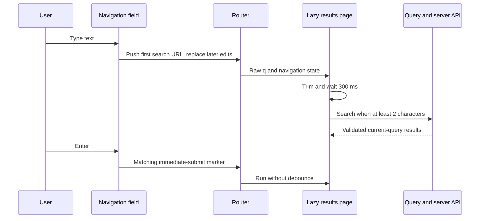

# Navigation search

Active contributors: VeroxAUS

## Purpose

One field in the navigation bar drives mixed movie/show search. The field stays in the initial shell; the results page loads lazily and does not duplicate the input. URL state, local typing and the debounced server request are deliberately separate (`apps/web/src/components/NavSearch.tsx`, `apps/web/src/components/useNavSearch.ts`, `apps/web/src/pages/SearchPage.tsx`).

## Layout and abstractions

| Piece                                     | Responsibility                                                                         |
| ----------------------------------------- | -------------------------------------------------------------------------------------- |
| `apps/web/src/components/Nav.tsx`         | Home, Dashboard, Settings, search field and health pill                                |
| `apps/web/src/components/NavSearch.tsx`   | Field/clear controls, Enter/Escape, phone expansion, route preload                     |
| `apps/web/src/components/useNavSearch.ts` | Raw field value, URL synchronization and push-versus-replace history                   |
| `apps/web/src/lib/searchUrl.ts`           | Query parsing/encoding, length/delay constants, immediate-submit state and field focus |
| `apps/web/src/pages/searchRoute.ts`       | Dynamic import shared by route loading and field warm-up                               |
| `apps/web/src/pages/SearchPage.tsx`       | Settled query, prompt/loading/error/results states and local filters                   |
| `apps/web/src/api/queries.ts`             | Schema-validating request, cancellation and per-text cache key                         |

The wide-screen field is **240–520 px** wide. At widths up to **699 px**, `useMediaQuery` switches it to a Search icon; pressing the icon opens an autofocused **44 px** overlay over the navigation without shifting page content. Escape clears and collapses it; an empty blur collapses it, but a nonempty blur keeps it open. Leaving the search route closes the expanded phone field (`apps/web/src/components/NavSearch.module.css`, `apps/web/src/components/NavSearch.tsx`, `apps/web/src/lib/useMediaQuery.ts`).

The field, clear button and icon are explicitly outside Electron's draggable region. The normal desktop search field is not a separate Search link or page-level form (`apps/web/src/components/Nav.tsx`, `apps/web/src/components/NavSearch.module.css`).

## URL, debounce and request flow

`apps/web/src/components/useNavSearch.ts` pushes one search entry when typing first leaves another route, then replaces that entry for later edits. Back returns to the previous page, rather than walking each prefix. Raw spaces remain in the field and URL; only the request text is trimmed. The field is empty outside `/search`, and it follows external URL changes and Back/Forward.

The hook tracks both its intended destination and outstanding text navigations. Router commits from earlier keystrokes must not overwrite newer local typing. A navigation not matching that pending list is treated as external and becomes the field value (`apps/web/src/components/useNavSearch.ts`).

| Input/event                               | Behavior                                                                      |
| ----------------------------------------- | ----------------------------------------------------------------------------- |
| Focus or phone expansion                  | Warm the Search route, but send no search request                             |
| Typing                                    | Update URL immediately; request after **300 ms** of settled trimmed text      |
| Fewer than **2 trimmed characters**       | Show the prompt; no request for that value                                    |
| Enter with enough text                    | Set a matching navigation-state marker and search immediately                 |
| Enter while empty/short                   | No search                                                                     |
| Escape                                    | Clear text and `q`; keep `/search` when already there                         |
| Clear button                              | Clear text/`q` and refocus the field                                          |
| Initial direct search load or POP remount | Initialize the settled value from URL text rather than an empty debounce seed |

Constants are in `apps/web/src/lib/searchUrl.ts`; keyboard composition is ignored by Enter/Escape handling in `apps/web/src/components/NavSearch.tsx`. The field's **200-character** `maxLength` limits input editing, not arbitrary hand-written URL length.

`apps/web/src/pages/SearchPage.tsx` hides stale results as soon as trimmed URL text differs from the settled query. Requests use `['search', text]` keys and the Query abort signal in `apps/web/src/api/queries.ts`. When a newer settled query takes over, an obsolete answer cannot populate the current results. The minimum-length gate suppresses the current short value; an older already-running query may finish or be canceled when its observer changes.

All/Movies/Shows are client-side filters over one response. A new settled text remounts the results section and resets its filter. “No results,” “filter has no matches” and an API failure have separate UI; failure includes Retry (`apps/web/src/pages/SearchPage.tsx`). Metadata discovery belongs to [catalog](../../features/catalog.md), and request deadlines/cache policy to [data and startup](data-and-startup.md).

## Desktop shortcuts

`apps/web/src/desktop/AppKeys.tsx` installs **Ctrl+F** and **/** only when the desktop bridge exists. They focus and select the current navigation field without changing route; `/` respects text-entry targets. Player routes skip search shortcuts because they have no navigation. `?` in a text field remains text rather than opening the shortcut sheet.

`focusNavSearch` in `apps/web/src/lib/searchUrl.ts` only focuses an existing input; it does not open a collapsed phone field. Normal browser Find is not overridden by this desktop-only component. See [desktop integration](desktop-integration.md#app-shortcuts-and-unreachable-banner).

## Modification entry points and tests

Change search timing/length constants in `apps/web/src/lib/searchUrl.ts`, input presentation in `apps/web/src/components/NavSearch.tsx`, history rules in `apps/web/src/components/useNavSearch.ts`, and result behavior in `apps/web/src/pages/SearchPage.tsx`. Keep the input mounted in the shared shell, retain the single dynamic import, and preserve Query cancellation rather than adding an independent fetch loop.

`apps/web/src/components/NavSearch.test.tsx`, `apps/web/src/pages/SearchPage.test.tsx` and `apps/web/src/lib/searchUrl.test.ts` cover typing/history, threshold/debounce/Enter, abort/late answers, URL helpers and phone state. `apps/web/e2e/nav-search.spec.ts` adds real browser timing, Back/Forward, responsive layout, drag regions, desktop-like shortcuts and lazy-code checks against the isolated hub. These are committed test boundaries, not freshly executed results.

## Key source files

| File                                      | Purpose                                        |
| ----------------------------------------- | ---------------------------------------------- |
| `apps/web/src/components/NavSearch.tsx`   | Single responsive search entry                 |
| `apps/web/src/components/useNavSearch.ts` | URL/history versus local typing reconciliation |
| `apps/web/src/lib/searchUrl.ts`           | Search contract within the renderer            |
| `apps/web/src/lib/useDebouncedValue.ts`   | Cancelable settled-value timer                 |
| `apps/web/src/pages/SearchPage.tsx`       | Query and result states                        |
| `apps/web/src/pages/searchRoute.ts`       | Shared route preload                           |
| `apps/web/e2e/nav-search.spec.ts`         | Browser interaction and layout regressions     |

For source/test counts, file-ratio methodology and the **1 unique human contributor**, see the [web inventory](index.md#measured-scope). Shared navigation, responsive hooks and Query files overlap other pages, so they are not counted again as a standalone application.
