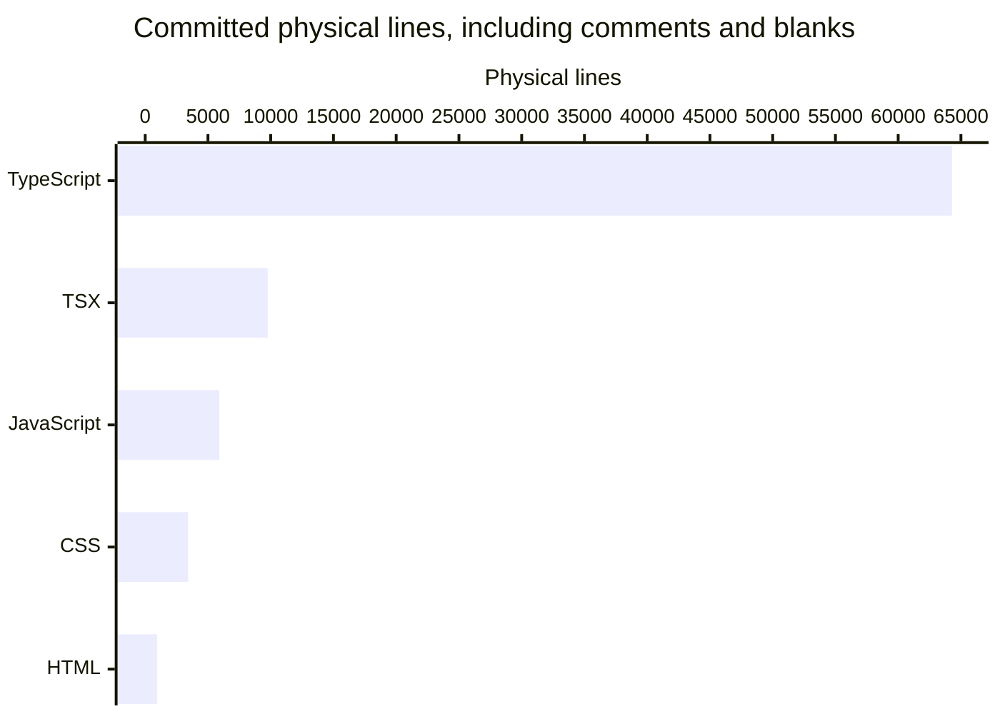

# By the numbers

Collected **2026-11-10** (trusted system date), from committed tree **`663492c256cb1f3c715f761a9d44e23db4c68b33`**. Working-tree wiki edits are excluded. HomeStream has four workspaces and 38,237 physical source lines under the rules below; these are repository measurements, not individual productivity scores. See [architecture](overview/architecture.md) and [lore](lore.md).

The measured HEAD records **2026-11-11 08:19:08 +11:00** (**2026-11-10 21:19:08 UTC**). November 11 below is a commit-metadata bucket in UTC+11, not a later collection date or an independently verified wall-clock event.

## Measurement scope

Inventory reads `git ls-tree -rz <commit>` and UTF-8 blobs through `git cat-file --batch`, not the working tree. Exclude:

- `droid-wiki/`.
- Any path component named `node_modules`, `dist`, `coverage`, `reports`, `release`, `vendor`, or `.turbo`.
- Basenames `pnpm-lock.yaml`, `package-lock.json`, and `yarn.lock`.
- Generated exports `docs/openapi.json`, `docs/schema.sql`, and filenames containing `.generated.`. The implementation `apps/server/src/docs/generated.ts` remains included.
- NUL-containing or non-UTF-8 blobs from text totals.

There are **890 tracked paths**; exclusions leave **828 paths**, comprising **810 text files** and **18 binary assets** (17 desktop PNGs and one web font).

A **physical line** is one Python `str.splitlines()` element, including comments, blank lines, and an unterminated final line. **Nonblank lines** remove whitespace-only lines but retain comments. Neither measure is code-only LOC/SLOC; no code-only claim is made.

Assign each included text path to the first matching class:

1. **Test/support:** contains `/test/` or `/e2e/`, or matches `\.(test|spec)\.[cm]?[jt]sx?$`. Includes fixtures, helpers, smoke tests, and browser e2e support.
2. **Source:** remaining `/src/` files; `.mjs`, `.mts`, `.js`, or `.ts` files in any `scripts/` directory; `apps/web/index.html`; and `apps/desktop/assets/loading.html`. Includes styles, declarations, and the font license.
3. **Documentation:** remaining `.md` files and root `LICENSE`.
4. **Configuration/tool data:** everything else, including manifests, workflows, tooling data, and the proposal mockup `docs/ideas/settings-sidebar-mockup.html`. This classification does not imply that the mockup ships in the app.

## Size

| Class                          | Text files | Physical lines |
| ------------------------------ | ---------: | -------------: |
| Source                         |        425 |         38,237 |
| Test/support                   |        281 |         44,953 |
| Configuration/tool data        |         70 |          5,069 |
| Documentation and root license |         34 |          2,921 |
| **Total**                      |    **810** |     **91,180** |

Test/source ratios are **0.66:1 by files** and **1.18:1 by physical lines**. Helpers and fixtures count; these are not coverage or test-quality measurements.

Since the previous measured tree (`bb09d63`), **six commits** add **two source files / 140 net physical source lines** and **four test/support files / 493 net physical test/support lines**. Configuration/tool data grows by 75 lines and documentation by 20, for **728 net included text lines**. The delta covers HLS network/subtitle recovery, desktop permissions and window bounds, browser setup/health behavior, correlated SSE logging, and parallel Linux CI jobs—not a new workspace or runtime subsystem. Source graph size rises by two nodes and five edges; desktop exports rise by six slots. Workspace manifests and the dependency lockfile are unchanged.

### Lines by language

Extension-based totals cover the entire text inventory, including tests and configuration. TypeScript includes declarations. The horizontal chart shows programming/style/markup extensions; HTML includes the unshipped proposal mockup.



| Extension-based language                  |   Files | Physical lines | Nonblank lines |
| ----------------------------------------- | ------: | -------------: | -------------: |
| TypeScript (`.ts`, `.mts`, `.cts`)        |     541 |         64,288 |         58,134 |
| TSX                                       |      85 |          9,760 |          8,917 |
| JavaScript (`.js`, `.mjs`, `.cjs`)        |      44 |          5,905 |          5,419 |
| CSS                                       |      42 |          3,419 |          2,964 |
| Markdown                                  |      33 |          2,247 |          1,617 |
| JSON                                      |      29 |          1,893 |          1,893 |
| YAML                                      |      20 |          1,565 |          1,394 |
| Other text, including extensionless files |      11 |          1,035 |            841 |
| HTML                                      |       3 |            944 |            940 |
| Text (`.txt`)                             |       1 |             93 |             75 |
| JSONC                                     |       1 |             31 |             31 |
| **Total**                                 | **810** |     **91,180** |     **82,225** |

### Four workspace packages

`pnpm-workspace.yaml` lists **four packages**. Root tooling is not a fifth workspace; TV has no source workspace.

| Workspace         | Source files | Source lines | Test/support files | Test lines | Test/source files | Test/source lines |
| ----------------- | -----------: | -----------: | -----------------: | ---------: | ----------------: | ----------------: |
| `apps/server`     |          149 |       16,702 |                176 |     29,639 |              1.18 |              1.77 |
| `apps/web`        |          164 |       10,698 |                 71 |     10,768 |              0.43 |              1.01 |
| `apps/desktop`    |           37 |        3,620 |                 24 |      3,528 |              0.65 |              0.97 |
| `packages/shared` |           15 |        1,462 |                 10 |      1,018 |              0.67 |              0.70 |

The remaining **60 source files / 5,755 lines** belong to root `scripts/`. Workspace source includes authored HTML and desktop build/asset scripts; test counts include e2e and smoke support.

### Source organization

Counts are recursive, non-test source text files, not services or endpoint counts.

| Server directory            | Files | Server directory              | Files |
| --------------------------- | ----: | ----------------------------- | ----: |
| `apps/server/src/playback`  |    42 | `apps/server/src/routes`      |    14 |
| `apps/server/src/health`    |    11 | `apps/server/src/sourceproxy` |     9 |
| `apps/server/src/telemetry` |     9 | `apps/server/src/db`          |     7 |
| `apps/server/src/network`   |     7 | `apps/server/src/docs`        |     6 |
| `apps/server/src/gateway`   |     5 | `apps/server/src/downloads`   |     4 |
| `apps/server/src/events`    |     4 | `apps/server/src/progress`    |     4 |
| `apps/server/src/streams`   |     4 | `apps/server/src/tmdb`        |     3 |
| `apps/server/src/home`      |     2 | `apps/server/src/http`        |     2 |
| `apps/server/src/stats`     |     2 | `apps/server/src/metrics`     |     1 |
| `apps/server/src/prefetch`  |     1 | Directly in `apps/server/src` |    12 |

Server has **19 immediate source subdirectories**. Web has **11**: `apps/web/src/components` (47), `apps/web/src/player` (33), `apps/web/src/pages` (23), `apps/web/src/desktop` (20), `apps/web/src/lib` (14), `apps/web/src/telemetry` (9), `apps/web/src/notices` (4), `apps/web/src/events` (3), `apps/web/src/styles` (3), `apps/web/src/api` (2), and `apps/web/src/device` (1), plus four direct source files. Desktop has `apps/desktop/src/shell` (6), `apps/desktop/src/telemetry` (4), and 23 direct files. Shared has 15 direct source files.

## Activity

All **119 commits reachable from the measured commit** count, including the root and wiki automation. The checkout is not shallow. Available history runs from **2026-11-05 10:51:13 +11:00** (`c0781bd`) to **2026-11-11 08:19:08 +11:00** (`663492c`), about 141.5 hours.

Buckets use **committer timestamps normalized to UTC+11**, not author timestamps. ISO weeks start Monday. Latest buckets are partial through the measured commit, not an inferred collection time.

| Monthly bucket   | Commits | Weekly bucket     | Commits |
| ---------------- | ------: | ----------------- | ------: |
| 2026-08          |       0 | 2026-W43          |       0 |
| 2026-09          |       0 | 2026-W44          |       0 |
| 2026-10          |       0 | 2026-W45          |     113 |
| 2026-11, partial |     119 | 2026-W46, partial |       6 |

Daily totals are **12 on November 5**, **32 on November 6**, **48 on November 7**, **21 on November 8**, **1 on November 9**, **3 on November 10**, and **2 on November 11**. Empty buckets mean no commits in the available history, not proof of no earlier private development. This short history cannot establish a steady development rate.

### Ninety-day churn

The window is **2026-08-13 08:19:08 through 2026-11-11 08:19:08 +11:00** (inclusive), ending at the measured commit. All 119 commits fall inside it.

For every commit, sum numeric additions and deletions from `git diff-tree --root --no-commit-id --numstat --no-renames -r <commit>`, applying the inventory path exclusions and omitting binary rows. Root additions, formatting, and moves count; moves are deletion plus addition. All recorded commits have zero or one parent, so no merge-parent policy is needed. Current-file rows require the path to remain in the measured text inventory.

| Current file                                            | Added | Deleted | Churn | Commits touching path |
| ------------------------------------------------------- | ----: | ------: | ----: | --------------------: |
| `apps/server/src/playback/manager.ts`                   | 1,994 |   1,673 | 3,667 |                    24 |
| `scripts/readiness-criteria.json`                       | 1,291 |       4 | 1,295 |                     2 |
| `apps/server/test/encode/tracks.test.ts`                |   684 |     304 |   988 |                     5 |
| `apps/server/test/encode/lifecycle.test.ts`             |   678 |     276 |   954 |                     7 |
| `apps/server/test/integration/progress-routes.test.ts`  |   893 |       1 |   894 |                     2 |
| `apps/server/test/integration/downloads.test.ts`        |   865 |       7 |   872 |                     2 |
| `apps/server/test/encode/progressive-subtitles.test.ts` |   582 |     190 |   772 |                     5 |
| `apps/server/test/encode/hls-encode.test.ts`            |   526 |     171 |   697 |                     4 |

Directory totals also include historical paths that were deleted or moved:

| Directory, recursively | Added + deleted lines |
| ---------------------- | --------------------: |
| `apps/server/test`     |                44,109 |
| `apps/server/src`      |                22,768 |
| `apps/web/src`         |                21,019 |
| `scripts`              |                 7,474 |
| `apps/desktop/test`    |                 3,784 |
| `apps/desktop/src`     |                 3,276 |
| `apps/web/e2e`         |                 2,449 |
| `docs`                 |                 2,231 |
| `packages/shared/src`  |                 1,512 |
| `.github`              |                 1,548 |
| `packages/shared/test` |                 1,094 |

The manager's lead partly reflects its **November 7 decomposition** (`2d60a28`): **1,562 → 305 physical lines**, with **321 at the measured commit**. Historical churn does not mean the present file is monolithic or defective. See [playback](systems/playback/index.md) and [testing](how-to-contribute/testing.md).

## Bot and recorded AI attribution

Denominator: **all 119 reachable commits**. Inspect metadata internally without publishing identities or individual rankings. A bot author has the literal `[bot]` in author name or email. A bot co-author has a line matching `^Co-authored-by:\s*(.*)$` case-insensitively whose value contains `[bot]`, also case-insensitively.

| Counted indicator                                           | Commits | Percentage |
| ----------------------------------------------------------- | ------: | ---------: |
| Bot co-author line                                          |     114 |     95.80% |
| Bot author                                                  |       5 |      4.20% |
| Either indicator, union without double-counting             |     119 |    100.00% |
| Co-author line specifically containing `factory-droid[bot]` |     114 |     95.80% |

**114/119 (95.80%) is a lower bound on explicitly recorded AI-assisted commits**, not AI-written lines or a fraction of engineering effort. Missing trailers can leave assistance unrecorded; a present trailer does not quantify its extent. The broader 100% bot-attribution union also includes automation authorship and is **not** a 100% AI-usage claim.

## Complexity proxies

These static measurements are not cyclomatic/cognitive complexity, runtime call depth, performance measurements, or maintainability scores.

### Average source-file size

All counts use the source text classification. Rows are recursive; drill-downs overlap parents.

| Directory                     | Files | Physical lines | Mean lines/file |
| ----------------------------- | ----: | -------------: | --------------: |
| `apps/server/src`             |   149 |         16,702 |           112.1 |
| `apps/web/src`                |   163 |         10,686 |            65.6 |
| `apps/desktop/src`            |    33 |          3,166 |            95.9 |
| `packages/shared/src`         |    15 |          1,462 |            97.5 |
| `scripts`                     |    60 |          5,755 |            95.9 |
| `apps/server/src/playback`    |    42 |          5,688 |           135.4 |
| `apps/server/src/sourceproxy` |     9 |          1,757 |           195.2 |
| `apps/server/src/downloads`   |     4 |            988 |           247.0 |
| `apps/web/src/player`         |    33 |          2,687 |            81.4 |
| `apps/web/src/desktop`        |    20 |          1,447 |            72.3 |
| `apps/desktop/src/shell`      |     6 |            886 |           147.7 |

### Deepest local import chains

As in the previous measured tree, this refresh uses the **already-installed TypeScript 6.0.3 parser** on committed blobs. Nodes are classified source files ending `.ts`, `.tsx`, `.mts`, `.cts`, `.js`, `.mjs`, or `.cjs`. Visit AST import/export declarations with literal module specifiers, literal dynamic `import()` calls, and literal import-type nodes; include type-only edges and deduplicate each directed pair.

Resolve relative specifiers against the committed node set in this order: exact path; `.js` → `.ts`, `.js` → `.tsx`, `.cjs` → `.cts`, `.mjs` → `.mts`; appended `.ts`, `.tsx`, `.mts`, `.cts`, `.mjs`, `.js`; then `/index.ts`, `/index.tsx`, `/index.js`. Map bare `@homestream/shared` to `packages/shared/src/index.ts`; other external imports terminate the graph.

The graph has **380 nodes**, **1,048 distinct directed edges**, **zero parser diagnostics**, and **no cycles detected by depth-first traversal**. The **50 distinct unresolved local `(module, specifier)` pairs are CSS imports**, intentionally outside this script graph. Computed imports, CommonJS `require`, external dependency internals, and non-script assets are not modeled.

| Starting workspace | Longest chain, nodes | Edges | Start                          | Terminal                         |
| ------------------ | -------------------: | ----: | ------------------------------ | -------------------------------- |
| Server             |                   27 |    26 | `apps/server/src/docs/cli.ts`  | `packages/shared/src/catalog.ts` |
| Web                |                   14 |    13 | `apps/web/src/main.tsx`        | `packages/shared/src/catalog.ts` |
| Desktop            |                    9 |     8 | `apps/desktop/src/main.ts`     | `packages/shared/src/catalog.ts` |
| Shared             |                    4 |     3 | `packages/shared/src/index.ts` | `packages/shared/src/catalog.ts` |

One maximum chain, with every entry a repository-root path:

1. `apps/server/src/docs/cli.ts`
2. `apps/server/src/docs/generated.ts`
3. `apps/server/src/docs/export.ts`
4. `apps/server/src/app.ts`
5. `apps/server/src/http/observability.ts`
6. `apps/server/src/context.ts`
7. `apps/server/src/health/service.ts`
8. `apps/server/src/network/snapshot.ts`
9. `apps/server/src/playback/manager.ts`
10. `apps/server/src/playback/hlsServing.ts`
11. `apps/server/src/playback/recovery.ts`
12. `apps/server/src/playback/encoderLifecycle.ts`
13. `apps/server/src/playback/readAheadPacing.ts`
14. `apps/server/src/playback/context.ts`
15. `apps/server/src/playback/sessionSlots.ts`
16. `apps/server/src/playback/support.ts`
17. `apps/server/src/playback/session.ts`
18. `apps/server/src/playback/subtitleExtractor.ts`
19. `apps/server/src/playback/extractorSchedule.ts`
20. `apps/server/src/playback/playlist.ts`
21. `apps/server/src/playback/decision.ts`
22. `apps/server/src/playback/probe.ts`
23. `apps/server/src/errors.ts`
24. `packages/shared/src/index.ts`
25. `packages/shared/src/desktop.ts`
26. `packages/shared/src/playback.ts`
27. `packages/shared/src/catalog.ts`

Type-only imports and the shared barrel contribute to depth. This is **not** a 27-step runtime playback startup. The web maximum includes `apps/web/src/components/NavSearch.tsx` and `apps/web/src/pages/searchRoute.ts`.

### Exported symbols per workspace

Create an in-memory TypeScript program over those committed script nodes, with `target: Latest`, `module: ESNext`, `moduleResolution: Bundler`, `allowJs: true`, `noLib: true`, and the same local resolver. No standard library or external dependency source is loaded. For each workspace's non-test `src/` module, call `checker.getSymbolAtLocation(sourceFile)`, then `checker.getExportsOfModule(symbol)`.

Count each exported **`(module path, export name)` slot** once. Type/value merges and overloads therefore count once within a module; default counts as `default`; local star re-exports are expanded. Distinct spellings are the union of those names within a workspace, not globally unique semantic identities.

| Workspace         | Scanned script modules | Exported module/name slots | Distinct name spellings |
| ----------------- | ---------------------: | -------------------------: | ----------------------: |
| `apps/server`     |                    149 |                        570 |                     560 |
| `apps/web`        |                    120 |                        285 |                     275 |
| `apps/desktop`    |                     33 |                        140 |                     140 |
| `packages/shared` |                     15 |                        508 |                     254 |

`packages/shared/src/index.ts` exposes **254 exported names**; the 508 slots include those names both in defining modules and the barrel. App totals describe internal module exports, not supported package APIs. This is a static exported-name inventory, not a full typecheck or dead-export audit; unresolved external modules are outside its scope. The method matches the previous measured tree, not older lexical export-occurrence approximations.

## Reproduction

Run from the repository root, substituting the fixed hash rather than a moving HEAD:

```sh
git ls-tree -rz 663492c256cb1f3c715f761a9d44e23db4c68b33
git rev-parse --is-shallow-repository
git log 663492c256cb1f3c715f761a9d44e23db4c68b33 --reverse --format='%h|%cI|%s'
git rev-list 663492c256cb1f3c715f761a9d44e23db4c68b33
git diff-tree --root --no-commit-id --numstat --no-renames -r 2d60a28
```

Read committed blobs with `git cat-file --batch`; apply the exact exclusions and ordered classification; count Python `splitlines()` and nonblank lines. Bucket every reachable commit's committer timestamp in UTC+11. For churn, apply the stated 90-day window to numeric diff rows; require current inventory membership only for the file table. Apply the explicit AST/resolution rules above, detect cycles, then memoize longest directed paths; sort paths and outgoing edges for deterministic ties. Export counts use the stated TypeScript checker API.

Temporary Python/Node measurement data lived outside the tracked tree and was removed after use; no helper files remain in the repository. This statistics refresh installed no dependencies, ran no application tests, and started no server, encoder, GPU task, or upstream service.
