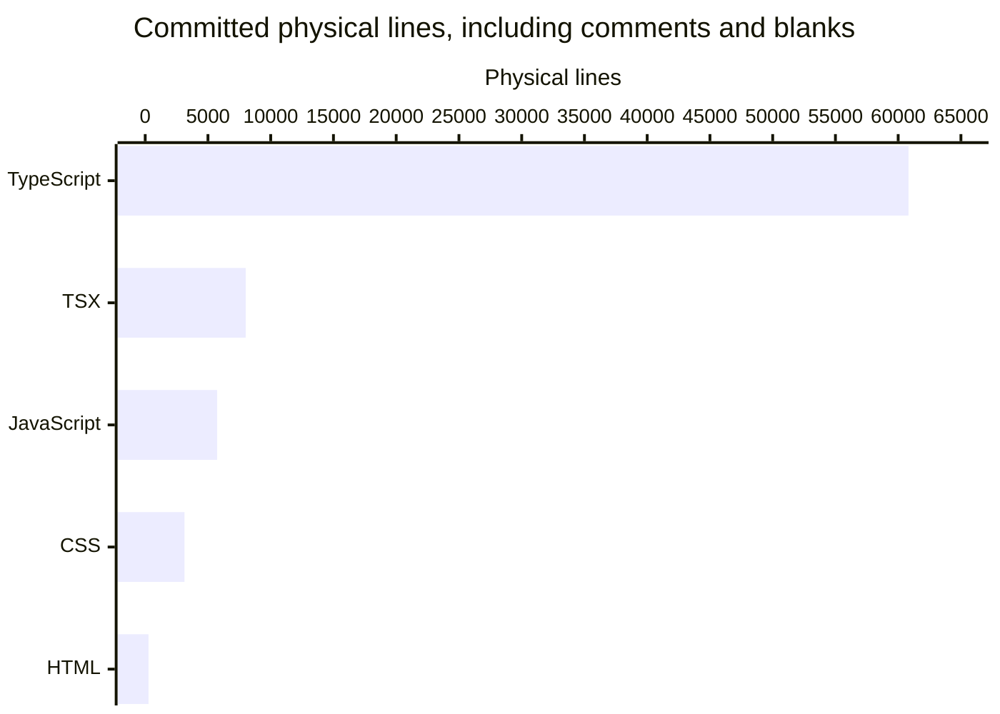

# By the numbers

Collected on **2026-11-07** (the supplied collection date), from committed tree **`5eefa37775db95b4bdd1e1dfe7b33cb8a9f31001`**, the supplied `origin/main` snapshot. Uncommitted wiki generation is not measured. These are repository measurements, not individual productivity scores. See [architecture](overview/architecture.md) and [lore](lore.md).

**Git dates are a separate observation:** HEAD records **2026-11-08 00:42:42 +11:00**, equivalent to **2026-11-07 13:42:42 UTC**. Historical tables normalize committer timestamps to UTC+11 and retain November 8 where recorded. No collection time was supplied; none is inferred from git or the machine clock.

## Measurement scope

Inventory uses `git ls-tree -rz HEAD` and committed blobs read with `git cat-file --batch`, never working-tree source. Exclude:

- `droid-wiki/`.
- Any path component named `node_modules`, `dist`, `coverage`, `reports`, `release`, `vendor`, or `.turbo`.
- Lockfiles named `pnpm-lock.yaml`, `package-lock.json`, or `yarn.lock`.
- Generated exports `docs/openapi.json` and `docs/schema.sql`, and filenames containing `.generated.`. The implementation `apps/server/src/docs/generated.ts` remains included.
- Non-UTF-8 or NUL-containing blobs from text totals. Binary assets are not source LOC.

HEAD has **835 tracked paths**. Path exclusions leave **779 paths**: **761 text files** and **18 binary assets** (17 desktop PNGs and the web font). No dependency or generated build tree contributes to the totals.

A **physical line** is one Python `str.splitlines()` element: comments and blank lines count, and an unterminated last line counts once. **Nonblank lines** remove whitespace-only lines but retain comments. Neither is **code-only LOC/SLOC**, which would require language-aware comment and syntax handling; code-only LOC is not reported.

Classification is ordered:

1. **Test:** paths containing `/test/` or `/e2e/`, or filenames matching `\.(test|spec)\.[cm]?[jt]sx?$`. This includes fixtures, helpers, smoke tests, and e2e build support.
2. **Source:** remaining `/src/` files; `.mjs`, `.mts`, `.js`, or `.ts` files in a `scripts/` directory; `apps/web/index.html`; and the desktop's authored `apps/desktop/assets/loading.html`. Source includes CSS, declarations, and the font license, not only executable statements.
3. **Documentation:** remaining `.md` files and root `LICENSE`.
4. **Configuration/tool data:** everything else, including manifests, workflows, build configurations, and readiness data.

## Size

| Class | Text files | Physical lines |
| --- | ---: | ---: |
| Source | 402 | 37,168 |
| Test and supporting files | 257 | 40,352 |
| Configuration and tool data | 69 | 4,265 |
| Documentation and root license | 33 | 2,866 |
| **Total** | **761** | **84,651** |

The test/source ratio is **0.64:1 by files** and **1.09:1 by physical lines**. These ratios include helpers and fixtures; they do not measure coverage or test quality.

### Language breakdown

Languages are extension-based across the included text inventory, not just production source. `.ts`, `.mts`, and `.cts` include declaration files. The horizontal chart shows programming/style/markup extensions; the table reconciles all text.



| Extension-based language | Files | Physical lines | Nonblank lines |
| --- | ---: | ---: | ---: |
| TypeScript (`.ts`, `.mts`, `.cts`) | 514 | 60,820 | 55,012 |
| TSX | 71 | 8,007 | 7,356 |
| JavaScript (`.js`, `.mjs`, `.cjs`) | 44 | 5,734 | 5,252 |
| CSS | 36 | 3,133 | 2,714 |
| Markdown | 32 | 2,192 | 1,579 |
| JSON | 29 | 1,893 | 1,893 |
| YAML | 20 | 1,451 | 1,290 |
| Other text, including extensionless files | 11 | 1,035 | 841 |
| HTML | 2 | 262 | 262 |
| Text (`.txt`) | 1 | 93 | 75 |
| JSONC | 1 | 31 | 31 |
| **Total** | **761** | **84,651** | **76,305** |

### Four workspace modules

`pnpm-workspace.yaml` explicitly lists **four packages**. Root tooling is not a fifth workspace; TV has no source workspace. Desktop is now an implemented Electron shell, not just support exports (`apps/desktop/src/main.ts`).

| Workspace | Source files | Source physical lines | Test/support files | Test physical lines | Test/source lines |
| --- | ---: | ---: | ---: | ---: | ---: |
| `apps/server` | 149 | 16,599 | 176 | 29,280 | 1.76 |
| `apps/web` | 143 | 9,869 | 53 | 7,463 | 0.76 |
| `apps/desktop` | 35 | 3,506 | 18 | 2,619 | 0.75 |
| `packages/shared` | 15 | 1,439 | 10 | 990 | 0.69 |

The other **60 source files / 5,755 lines** are root `scripts/` tooling. Workspace source totals include the two authored HTML entries and desktop asset/build scripts; workspace tests include browser e2e and desktop smoke support.

### Subsystem inventory

Counts are included **non-test source text files**, recursively below each directory. These are organization counts, not services, endpoints, or feature-completeness claims.

| Server directory | Files | Server directory | Files |
| --- | ---: | --- | ---: |
| `apps/server/src/playback` | 42 | `apps/server/src/routes` | 14 |
| `apps/server/src/health` | 11 | `apps/server/src/sourceproxy` | 9 |
| `apps/server/src/telemetry` | 9 | `apps/server/src/db` | 7 |
| `apps/server/src/network` | 7 | `apps/server/src/docs` | 6 |
| `apps/server/src/gateway` | 5 | `apps/server/src/downloads` | 4 |
| `apps/server/src/events` | 4 | `apps/server/src/progress` | 4 |
| `apps/server/src/streams` | 4 | `apps/server/src/tmdb` | 3 |
| `apps/server/src/home` | 2 | `apps/server/src/http` | 2 |
| `apps/server/src/stats` | 2 | `apps/server/src/metrics` | 1 |
| `apps/server/src/prefetch` | 1 | Directly in `apps/server/src` | 12 |

The server has **19 immediate source subdirectories**. Web has **11**: `apps/web/src/components` (37), `apps/web/src/player` (33), `apps/web/src/desktop` (19), `apps/web/src/pages` (16), `apps/web/src/lib` (11), `apps/web/src/telemetry` (9), `apps/web/src/notices` (4), `apps/web/src/events` (3), `apps/web/src/styles` (3), `apps/web/src/api` (2), and `apps/web/src/device` (1), plus four direct source files. Desktop has `apps/desktop/src/shell` (6), `apps/desktop/src/telemetry` (4), and 21 direct source files. Shared has 15 direct files in `packages/shared/src`.

## Activity

Count all **97 commits reachable from HEAD**, including the root commit and wiki automation. Available history begins at **2026-11-05 10:51:13 +11:00**, `c0781bd`, and ends at HEAD on **2026-11-08 00:42:42 +11:00**. This short history does not establish a steady development rate.

Buckets use **committer timestamps normalized to UTC+11**, not author timestamps. Weeks are ISO weeks beginning Monday; the latest buckets are partial as of HEAD.

| Monthly bucket | Commits |
| --- | ---: |
| 2026-08 | 0 |
| 2026-09 | 0 |
| 2026-10 | 0 |
| 2026-11, partial | 97 |

| Weekly bucket | Commits |
| --- | ---: |
| 2026-W42 | 0 |
| 2026-W43 | 0 |
| 2026-W44 | 0 |
| 2026-W45, partial | 97 |

Daily local totals are **12 on November 5**, **32 on November 6**, **48 on November 7**, and **5 on November 8**. Empty buckets describe the available git history, not any unrecorded private development.

### Ninety-day churn hotspots

The window is **2026-08-10 00:42:42 through 2026-11-08 00:42:42 +11:00**, ending at HEAD rather than a guessed collection time. All 97 commits fall inside it.

For each commit, run `git diff-tree --root --no-commit-id --numstat --no-renames -r <commit>`. Apply the inventory path exclusions, omit binary rows, and sum numeric additions plus deletions. Root introduction, formatting, and moves count; moves are deletion plus addition. The table includes only paths **still present at HEAD**, sorted by churn.

| Current file | Added | Deleted | Churn | Commits touching path |
| --- | ---: | ---: | ---: | ---: |
| `apps/server/src/playback/manager.ts` | 1,994 | 1,673 | 3,667 | 24 |
| `scripts/readiness-criteria.json` | 1,291 | 4 | 1,295 | 2 |
| `apps/server/test/encode/tracks.test.ts` | 684 | 304 | 988 | 5 |
| `apps/server/test/encode/lifecycle.test.ts` | 678 | 276 | 954 | 7 |
| `apps/server/test/integration/progress-routes.test.ts` | 893 | 1 | 894 | 2 |
| `apps/server/test/integration/downloads.test.ts` | 865 | 7 | 872 | 2 |
| `apps/server/test/encode/progressive-subtitles.test.ts` | 582 | 190 | 772 | 5 |
| `apps/server/test/encode/hls-encode.test.ts` | 526 | 171 | 697 | 4 |

Directory totals include historical deleted/moved paths, unlike the current-file table:

| Directory, recursively | Added + deleted lines |
| --- | ---: |
| `apps/server/test` | 43,728 |
| `apps/server/src` | 22,603 |
| `apps/web/src` | 17,269 |
| `scripts` | 7,474 |
| `apps/desktop/src` | 3,136 |
| `apps/desktop/test` | 2,627 |
| `docs` | 1,493 |
| `packages/shared/src` | 1,489 |
| `.github` | 1,354 |
| `packages/shared/test` | 1,066 |
| `apps/web/e2e` | 711 |

The manager's lead reflects, in part, its **November 7 split** (`2d60a28`): it fell from **1,562 to 305 physical lines**, and is **321 lines at HEAD**. High historical churn does not mean the current file is still monolithic or defective. See [playback](systems/playback/index.md) and [testing](how-to-contribute/testing.md).

## Bot and recorded AI attribution

Metadata is inspected internally; no identities or individual rankings are published. A bot author has literal `[bot]` in author name/email. A bot co-author has a case-insensitive `Co-authored-by:` trailer containing `[bot]`.

| Attribution, denominator: all 97 reachable commits | Commits | Percentage |
| --- | ---: | ---: |
| At least one bot co-author trailer | 95 | 97.94% |
| Bot author | 2 | 2.06% |
| Either condition, union without double-counting | 97 | 100.00% |

The **95/97 (97.94%) assistant co-author figure** is a lower bound on **explicitly recorded AI-assisted commits**, not AI-written lines or the fraction of engineering done by AI. The broader **97/97 bot-attribution union** also includes automation authorship and is not an AI-usage claim. Missing trailers leave assistance unrecorded; present trailers do not quantify its extent.

## Complexity proxies

These are static structural measurements, **not cyclomatic or cognitive complexity**, runtime call depth, performance measurements, or a maintainability score.

### Average physical source-file size

All rows are recursive. Drill-down rows overlap parents and must not be added together.

| Directory | Source text files | Physical lines | Mean lines/file |
| --- | ---: | ---: | ---: |
| `apps/server/src` | 149 | 16,599 | 111.4 |
| `apps/web/src` | 142 | 9,857 | 69.4 |
| `apps/desktop/src` | 31 | 3,054 | 98.5 |
| `packages/shared/src` | 15 | 1,439 | 95.9 |
| `scripts` | 60 | 5,755 | 95.9 |
| `apps/server/src/playback` | 42 | 5,688 | 135.4 |
| `apps/server/src/sourceproxy` | 9 | 1,757 | 195.2 |
| `apps/server/src/downloads` | 4 | 988 | 247.0 |
| `apps/web/src/player` | 33 | 2,669 | 80.9 |
| `apps/web/src/desktop` | 19 | 1,456 | 76.6 |
| `apps/desktop/src/shell` | 6 | 888 | 148.0 |

### Longest observed local import chain

The TypeScript dependency is **not installed in this checkout**, so these measurements use an explicit **lexical approximation**, not the TypeScript AST or type checker.

Graph nodes are source files ending `.ts`, `.tsx`, `.mts`, `.cts`, `.js`, `.mjs`, or `.cjs`. Scan literal specifiers with `(?:\bfrom\s*|\bimport\s*(?:\(\s*)?)['"]([^'"]+)['"]`: this captures `from`, bare imports, and literal dynamic imports, including type-only imports and re-exports. Resolve relative paths against the committed tree, trying the exact path, `.js` → `.ts`/`.tsx`, `.cjs` → `.cts`, `.mjs` → `.mts`, extension candidates `.ts`, `.tsx`, `.mts`, `.cts`, `.mjs`, `.js`, then `/index.ts`, `/index.tsx`, `/index.js`. Map bare `@homestream/shared` to `packages/shared/src/index.ts`; other external packages terminate the graph.

The graph has **363 nodes**, **1,004 distinct directed edges**, and **no cycles detected by depth-first traversal**. **42 relative specifier occurrences** do not resolve to an included script module, including styles/assets. Regex can match comments and misses computed imports, CommonJS `require`, and nonliteral resolution. This is not proof that the complete application's dependency graph is acyclic.

| Starting workspace | Longest chain, nodes | Edges | Starting module | Terminal module |
| --- | ---: | ---: | --- | --- |
| Server | 27 | 26 | `apps/server/src/docs/cli.ts` | `packages/shared/src/catalog.ts` |
| Web | 13 | 12 | `apps/web/src/main.tsx` | `packages/shared/src/catalog.ts` |
| Desktop | 9 | 8 | `apps/desktop/src/main.ts` | `packages/shared/src/catalog.ts` |
| Shared | 4 | 3 | `packages/shared/src/index.ts` | `packages/shared/src/catalog.ts` |

One longest observed chain is:

1. `apps/server/src/docs/cli.ts`
2. `apps/server/src/docs/generated.ts`
3. `apps/server/src/docs/export.ts`
4. `apps/server/src/app.ts`
5. `apps/server/src/http/observability.ts`
6. `apps/server/src/context.ts`
7. `apps/server/src/health/service.ts`
8. `apps/server/src/network/snapshot.ts`
9. `apps/server/src/playback/manager.ts`
10. `apps/server/src/playback/hlsServing.ts`
11. `apps/server/src/playback/recovery.ts`
12. `apps/server/src/playback/encoderLifecycle.ts`
13. `apps/server/src/playback/readAheadPacing.ts`
14. `apps/server/src/playback/context.ts`
15. `apps/server/src/playback/sessionSlots.ts`
16. `apps/server/src/playback/support.ts`
17. `apps/server/src/playback/session.ts`
18. `apps/server/src/playback/subtitleExtractor.ts`
19. `apps/server/src/playback/extractorSchedule.ts`
20. `apps/server/src/playback/playlist.ts`
21. `apps/server/src/playback/decision.ts`
22. `apps/server/src/playback/probe.ts`
23. `apps/server/src/errors.ts`
24. `packages/shared/src/index.ts`
25. `packages/shared/src/desktop.ts`
26. `packages/shared/src/playback.ts`
27. `packages/shared/src/catalog.ts`

Type-only imports and the shared barrel contribute to depth. This is **not** a 27-step runtime playback startup.

### Export-name occurrences per workspace

Scan non-test `.ts`, `.tsx`, `.mts`, and `.cts` under each workspace's `src/`. An anchored `export` with optional repeated `declare`, `async`, or `abstract` prefixes followed by `const`, `let`, `var`, `function`, `class`, `interface`, `type`, or `enum` and an identifier counts one named declaration. Count nonempty comma-separated entries in `export { ... }` and `export type { ... }` lists; count anchored `export default`; count star re-exports separately without expansion.

| Workspace | Scanned modules | Named declarations | Named export-list entries | Defaults | Name occurrences | Unexpanded star re-exports |
| --- | ---: | ---: | ---: | ---: | ---: | ---: |
| `apps/server` | 149 | 558 | 11 | 0 | 569 | 0 |
| `apps/web` | 105 | 241 | 1 | 9 | 251 | 0 |
| `apps/desktop` | 31 | 134 | 0 | 0 | 134 | 0 |
| `packages/shared` | 15 | 250 | 0 | 0 | 250 | 14 |

This is an **export syntax/name-occurrence approximation**, not unique exported symbols or a supported public API. Re-exports can repeat names; unexpanded stars, destructuring, multiline syntax, overloads, and comments limit accuracy. `packages/shared/src/index.ts` has 14 star re-exports; the table does not pretend to expand them.

## Reproduction

Read-only starting points from the repository root:

```sh
git ls-tree -rz 5eefa37775db95b4bdd1e1dfe7b33cb8a9f31001
git log HEAD --reverse --format='%h|%cI|%s'
git rev-list HEAD
git diff-tree --root --no-commit-id --numstat --no-renames -r 2d60a28
```

Read tree blobs using `git cat-file --batch`, apply the exact exclusions/classification above, and count `str.splitlines()` plus nonblank lines. For activity, bucket every reachable commit's committer timestamp in UTC+11. For churn, apply the timestamp window and path filters to every commit's numeric diff rows; filter current-file tables to HEAD paths. For graph depth, memoize longest directed paths after cycle detection; sort paths/specifiers for deterministic tie selection. Export counts use the lexical rules above, not installed dependencies.

Measurements used inline Python programs and created no helper files. No dependencies were installed, no build or test suite ran, and no server, encoder, or upstream service was started.
