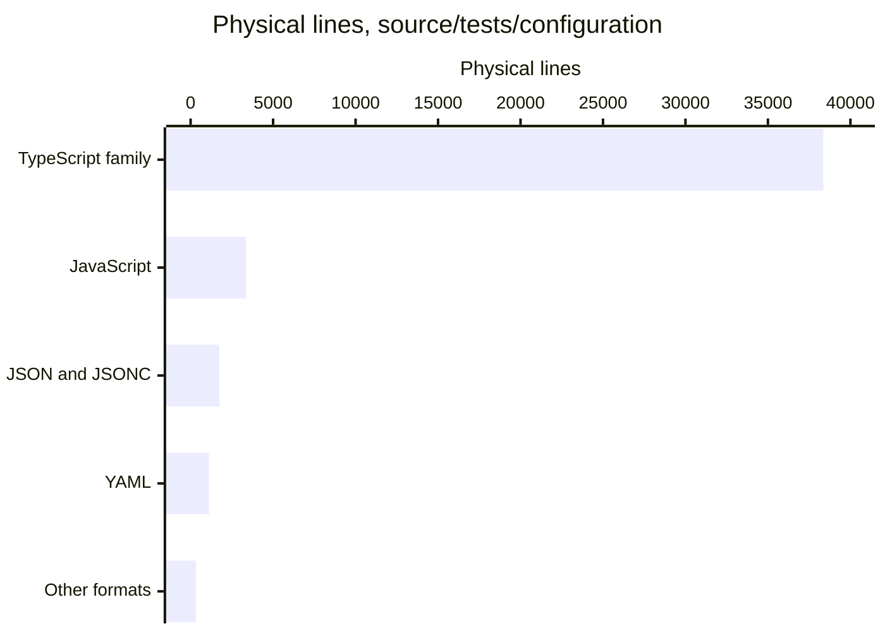

# By the numbers

Data collected on **2026-11-06**, from commit `bb48e6d9f6c0eb098ae6e3ea29ded95fd991d406` on `main` in [HomeStream](https://github.com/VeroxAUS/homestream). This is a fresh measurement of committed files, not a continuation of the old wiki's statistics. See [architecture](overview/architecture.md) for the system behind the numbers and [lore](lore.md) for its short recorded history.

## Measurement scope

- Read the paths and blobs in `git ls-tree -r HEAD` and `git cat-file`, never working-tree files. Untracked files, installed dependencies, local configuration, and concurrent wiki edits do not affect these totals.
- Exclude `droid-wiki/`, output directories named `node_modules`, `dist`, `coverage`, `reports`, or `release`, lockfile `pnpm-lock.yaml`, generated exports `docs/openapi.json` and `docs/schema.sql`, and filenames containing `.generated.`. The generator implementation `apps/server/src/docs/generated.ts` remains included.
- A physical line includes a blank or comment line; a final unterminated line counts once. Blank means whitespace-only. **Comments are included, not stripped or counted separately.** These are not executable-statement counts or comment-free SLOC.
- Classification is ordered: **tests** are paths containing `/test/` or filenames matching `.test.[cm]?[jt]sx?`; **source** is the remaining `/src/` files, `.mjs`/`.mts` files under `scripts/`, and `apps/web/index.html`; **documentation** is remaining Markdown plus `LICENSE`; **configuration** is everything else.
- The 448 tracked files become **406 included files** after excluding 39 wiki files, the lockfile, and the two generated documentation exports. No application was started and no credentials were needed.

## Size

| Class                        |   Files | Physical lines | Blank lines, included |
| ---------------------------- | ------: | -------------: | --------------------: |
| Source and developer scripts |     182 |         19,695 |                 1,776 |
| Tests and test support       |     139 |         21,748 |                 2,007 |
| Configuration and automation |      56 |          3,456 |                   194 |
| Documentation and license    |      29 |          2,499 |                   637 |
| **Total included inventory** | **406** |     **47,398** |             **4,614** |

The tests comprise **118 test modules and 21 support files**, not 139 individual test cases. Counts include GPU and live test sources; they do not claim that those tests ran or passed. Configuration includes executable tool configuration such as `eslint.config.mjs`, `.dependency-cruiser.cjs`, and `apps/server/vitest.config.ts`.

### Language mix

This table excludes the documentation/license class but includes source, tests, declaration files, and configuration: **377 files and 44,899 physical lines**. Extensions determine the language; JSON inside a `.json` file is not classified by its contents.

| Language or format                          | Files | Physical lines | Blank lines, included |
| ------------------------------------------- | ----: | -------------: | --------------------: |
| TypeScript, `.ts`                           |   285 |         38,001 |                 3,499 |
| JavaScript ESM, `.mjs`                      |    24 |          3,300 |                   287 |
| JSON                                        |    21 |          1,712 |                     0 |
| YAML                                        |    18 |          1,110 |                   120 |
| TypeScript declarations, `.mts`             |    13 |            325 |                     5 |
| Plain configuration and extensionless files |     8 |            239 |                    49 |
| TOML                                        |     1 |             72 |                    11 |
| JavaScript CJS, `.cjs`                      |     1 |             61 |                     0 |
| TSX                                         |     3 |             29 |                     3 |
| JSONC                                       |     1 |             27 |                     0 |
| HTML                                        |     1 |             12 |                     0 |
| Dockerfile                                  |     1 |             11 |                     3 |



The chart combines `.ts`, `.mts`, and TSX; ESM and CJS; and JSON with JSONC. “Other formats” is plain configuration, TOML, HTML, and Dockerfile. Blank and comment lines remain included throughout.

### Workspaces and root

| Present workspace | Source files | Test/support files | Configuration files | Role                                              |
| ----------------- | -----------: | -----------------: | ------------------: | ------------------------------------------------- |
| `apps/server`     |          130 |                130 |                   5 | Fastify service and media pipeline                |
| `apps/web`        |            3 |                  1 |                   4 | React/Vite placeholder                            |
| `packages/shared` |           13 |                  8 |                   5 | Contracts, sanitization, telemetry catalog, flags |

There are **three implemented workspaces plus the private root orchestration package**, or four present package manifests if the root is counted. The root `package.json` coordinates checks and builds; it is not a fourth runtime. `pnpm-workspace.yaml` also reserves `apps/desktop`, which has no tracked package manifest. Desktop and TV are planned, not extra implemented applications (`README.md`).

The web source count includes `apps/web/index.html`; the test under `apps/web/src/` is classified as a test. Outside the workspaces, `scripts/` contributes 36 source/declaration files and one JSON configuration file. See [apps](apps/index.md) and [shared](packages/shared.md).

## Activity

All **41 reachable HEAD commits** fall between **2026-11-05 10:51:13** and **2026-11-06 22:08:23**, using their recorded **committer timestamps in UTC+11**. Nothing in this checkout supports a multi-month development narrative.

| Recent activity bucket                            | Recorded commits |
| ------------------------------------------------- | ---------------: |
| 2026-11-05                                        |               12 |
| 2026-11-06, through HEAD                          |               29 |
| Week beginning 2026-11-02, Monday–Sunday, partial |               41 |
| November 2026, through HEAD, partial              |               41 |

The preceding weeks and months contain no reachable commits in this history. They are outside the observed development span, not evidence of inactivity elsewhere. There is only one populated weekly bucket and one monthly bucket, so a velocity trend would be misleading.

### Bot-attributed commits

Inspect each commit's author metadata and case-insensitive `Co-authored-by:` trailer lines for the literal account marker `[bot]`. Count each commit once if either category matches.

| Git evidence                              | Commits | Share of 41 |
| ----------------------------------------- | ------: | ----------: |
| Bot-marked author                         |       0 |          0% |
| At least one bot-marked co-author trailer |      41 |        100% |
| Either, deduplicated                      |      41 |        100% |

This is an **explicit-metadata lower bound on bot-attributed involvement**, not a percentage of code generated by AI. Inline assistants can leave no trailer, other bot naming conventions may not match, and a trailer does not identify which lines were assisted. No individual productivity statistics are derived.

## 90-day churn

The window is **2026-08-09 00:00 through 2026-11-07 00:00, end exclusive, UTC+11**, covering the snapshot day and its preceding 89 calendar days. All 41 reachable commits lie inside it. For each, sum additions and deletions from `git diff-tree --root --no-commit-id --numstat --no-renames -r`; apply the inventory exclusions above.

The initial commit is compared with the empty tree. Formatting counts, and moves count as removal at the old path plus addition at the new path. This is **line churn, not semantic rewrite size**. The test-tier reorganization in `a402734` and repository formatting in `bacce15` therefore have a large effect.

### Highest-churn current files

Rank only paths still present at HEAD; earlier names of moved tests are not merged into these rows. Full historical directory totals below still include their old names.

| Current path                                            | Added | Deleted | Churn | Commit touches at this path |
| ------------------------------------------------------- | ----: | ------: | ----: | --------------------------: |
| `apps/server/src/playback/manager.ts`                   | 1,791 |     258 | 2,049 |                          19 |
| `scripts/readiness-criteria.json`                       | 1,274 |       0 | 1,274 |                           1 |
| `apps/server/test/encode/tracks.test.ts`                |   684 |     304 |   988 |                           5 |
| `apps/server/test/encode/lifecycle.test.ts`             |   670 |     273 |   943 |                           6 |
| `apps/server/test/integration/progress-routes.test.ts`  |   849 |       0 |   849 |                           1 |
| `apps/server/test/integration/downloads.test.ts`        |   811 |       0 |   811 |                           1 |
| `apps/server/test/encode/progressive-subtitles.test.ts` |   579 |     189 |   768 |                           4 |
| `apps/server/test/encode/hls-encode.test.ts`            |   526 |     171 |   697 |                           4 |

A large newly added configuration file can outrank a repeatedly edited implementation. For example, `scripts/readiness-criteria.json` appears in one commit. Churn alone is not evidence of a defect or maintenance problem.

### Directory hotspots

Recursive prefix rollups, ordered by churn. Commit touches count distinct commits affecting any included file under that prefix. Rows can overlap: playback and source proxy are already part of the server source total, so do not add the rows together.

| Directory                     |  Added | Deleted |  Churn | Distinct commits |
| ----------------------------- | -----: | ------: | -----: | ---------------: |
| `apps/server/test`            | 27,813 |   6,903 | 34,716 |               34 |
| `apps/server/src`             | 15,911 |     989 | 16,900 |               29 |
| `apps/server/src/playback`    |  5,189 |     547 |  5,736 |               22 |
| `scripts`                     |  4,925 |     101 |  5,026 |               13 |
| `apps/server/src/sourceproxy` |  1,461 |      96 |  1,557 |               10 |
| `packages/shared/src`         |  1,205 |      14 |  1,219 |               17 |
| `docs`                        |  1,163 |      49 |  1,212 |                8 |
| `.github`                     |    986 |       4 |    990 |                4 |
| `packages/shared/test`        |    851 |      22 |    873 |                9 |
| `apps/server/src/network`     |    545 |      25 |    570 |                4 |

For what changed in these areas, read [playback](systems/playback/index.md), [source proxy](systems/source-proxy.md), and [testing](how-to-contribute/testing.md).

## Average file size by directory

Every direct parent containing included files is listed below. Unlike the churn rollups, these groups are **non-recursive and non-overlapping**. Means use physical lines and committed blob bytes, including line-ending bytes, rounded to one decimal. The 61 groups cover all 406 included files; `.` means the repository root.

| Direct parent                              | Files | Mean lines/file | Mean bytes/file |
| ------------------------------------------ | ----: | --------------: | --------------: |
| `.`                                        |    26 |            71.7 |          3567.1 |
| `.devcontainer`                            |     2 |            19.5 |           581.5 |
| `.factory/skills/homestream-add-api-route` |     1 |            44.0 |          3103.0 |
| `.factory/skills/homestream-live-tests`    |     1 |            45.0 |          3237.0 |
| `.factory/skills/homestream-run-checks`    |     1 |            71.0 |          3330.0 |
| `.factory/skills/homestream-telemetry`     |     1 |            42.0 |          4136.0 |
| `.github`                                  |     5 |            35.0 |          1010.6 |
| `.github/ISSUE_TEMPLATE`                   |     3 |            34.3 |          1071.7 |
| `.github/workflows`                        |     8 |            88.0 |          3044.1 |
| `.vscode`                                  |     1 |             3.0 |           107.0 |
| `apps/server`                              |     5 |            27.0 |           834.4 |
| `apps/server/src`                          |    12 |            92.6 |          3305.4 |
| `apps/server/src/db`                       |     7 |           100.1 |          3290.7 |
| `apps/server/src/docs`                     |     6 |           108.2 |          4061.0 |
| `apps/server/src/downloads`                |     4 |           244.5 |          8614.5 |
| `apps/server/src/events`                   |     4 |            52.0 |          1701.0 |
| `apps/server/src/gateway`                  |     4 |           129.2 |          4597.5 |
| `apps/server/src/health`                   |     2 |           193.0 |          7234.5 |
| `apps/server/src/health/checks`            |     9 |            71.6 |          2749.7 |
| `apps/server/src/home`                     |     2 |            84.5 |          3064.5 |
| `apps/server/src/http`                     |     2 |            30.5 |          1259.5 |
| `apps/server/src/metrics`                  |     1 |           205.0 |          7471.0 |
| `apps/server/src/network`                  |     7 |            74.3 |          2697.4 |
| `apps/server/src/playback`                 |    27 |           171.9 |          6461.3 |
| `apps/server/src/prefetch`                 |     1 |           201.0 |          7407.0 |
| `apps/server/src/progress`                 |     4 |            64.5 |          2435.2 |
| `apps/server/src/routes`                   |    14 |            40.6 |          1612.9 |
| `apps/server/src/sourceproxy`              |     6 |           227.5 |          8191.2 |
| `apps/server/src/stats`                    |     2 |            98.0 |          3459.5 |
| `apps/server/src/streams`                  |     4 |            94.0 |          3807.0 |
| `apps/server/src/telemetry`                |     9 |            76.8 |          2883.9 |
| `apps/server/src/tmdb`                     |     3 |           158.7 |          5370.0 |
| `apps/server/test`                         |    15 |            67.1 |          2605.1 |
| `apps/server/test/docs`                    |     1 |            65.0 |          2261.0 |
| `apps/server/test/downloads`               |     3 |           167.3 |          5547.0 |
| `apps/server/test/encode`                  |     9 |           249.7 |         10406.4 |
| `apps/server/test/gateway`                 |     2 |            76.0 |          2542.0 |
| `apps/server/test/health`                  |     2 |           324.5 |         12898.5 |
| `apps/server/test/home`                    |     1 |           181.0 |          6295.0 |
| `apps/server/test/integration`             |    22 |           250.8 |         10189.4 |
| `apps/server/test/live`                    |     2 |           114.5 |          4759.0 |
| `apps/server/test/network`                 |     8 |            99.6 |          3681.6 |
| `apps/server/test/playback`                |    19 |           182.2 |          6741.6 |
| `apps/server/test/progress`                |     4 |            96.5 |          3475.8 |
| `apps/server/test/scripts`                 |    19 |           131.1 |          5399.7 |
| `apps/server/test/sourceproxy`             |     9 |           121.8 |          4754.2 |
| `apps/server/test/stats`                   |     2 |           127.0 |          4688.0 |
| `apps/server/test/streams`                 |     4 |           155.5 |          5303.5 |
| `apps/server/test/telemetry`               |     6 |           168.5 |          7164.2 |
| `apps/server/test/tmdb`                    |     2 |           122.0 |          4058.5 |
| `apps/web`                                 |     5 |            18.2 |           461.2 |
| `apps/web/src`                             |     3 |             9.7 |           251.7 |
| `docs`                                     |     8 |            80.0 |          6026.8 |
| `docs/runbooks`                            |    10 |            47.4 |          2836.7 |
| `monitoring/prometheus`                    |     2 |            58.0 |          2029.0 |
| `monitoring/sentry`                        |     1 |            77.0 |          2263.0 |
| `packages/shared`                          |     5 |            14.0 |           306.8 |
| `packages/shared/src`                      |    13 |            91.6 |          3596.6 |
| `packages/shared/test`                     |     8 |           103.6 |          3783.9 |
| `scripts`                                  |    34 |           140.1 |          4921.1 |
| `scripts/lib`                              |     3 |            19.7 |           676.7 |

For scale, `apps/server/src/playback/manager.ts` is 1,533 physical lines and 59,463 bytes. An average should not hide this outlier; nor does its size alone establish excessive function complexity.

## Local import depth

TypeScript AST inspection covers **145 non-test `.ts`/`.tsx` modules under workspace `src/` directories**, with **452 unique directed edges**. An edge goes from the importing module to its target. Include static imports, re-exports, type-only references, literal dynamic imports, and import-type expressions. Resolve relative `.js` paths to tracked `.ts`/`.tsx` sources and `@homestream/shared` to `packages/shared/src/index.ts`. Ignore external packages, Node built-ins, tests, scripts, and tool configuration.

Compute strongly connected components first, then the longest path in the condensed directed acyclic graph. **All 145 components are singletons; no local cycles were found in this scope, and no local import was unresolved.** A future cycle would count as one component, not an infinitely repeatable chain.

| Starting workspace | Maximum modules/components | Edges |
| ------------------ | -------------------------: | ----: |
| `apps/server`      |                         21 |    20 |
| `apps/web`         |                          2 |     1 |
| `packages/shared`  |                          4 |     3 |

One deepest chain, with ties possible:

1. `apps/server/src/docs/cli.ts`
2. `apps/server/src/docs/generated.ts`
3. `apps/server/src/docs/export.ts`
4. `apps/server/src/app.ts`
5. `apps/server/src/http/observability.ts`
6. `apps/server/src/context.ts`
7. `apps/server/src/health/service.ts`
8. `apps/server/src/network/snapshot.ts`
9. `apps/server/src/playback/manager.ts`
10. `apps/server/src/playback/monitor.ts`
11. `apps/server/src/playback/session.ts`
12. `apps/server/src/playback/subtitleExtractor.ts`
13. `apps/server/src/playback/subtitleStore.ts`
14. `apps/server/src/playback/playlist.ts`
15. `apps/server/src/playback/decision.ts`
16. `apps/server/src/playback/probe.ts`
17. `apps/server/src/errors.ts`
18. `packages/shared/src/index.ts`
19. `packages/shared/src/progress.ts`
20. `packages/shared/src/playback.ts`
21. `packages/shared/src/catalog.ts`

The web maximum is `apps/web/src/main.tsx` → `apps/web/src/App.tsx`. The shared maximum is the last four modules of the server chain. These are **dependency paths, not runtime call stacks or startup-time measurements**; type-only edges and barrel exports deliberately lengthen them.

## Exported symbols

Use TypeScript **6.0.3** `createProgram`, `getTypeChecker`, `getSymbolAtLocation(sourceFile)`, and `getExportsOfModule` on the same 145 HEAD source modules, with a virtual host serving committed source text and a path mapping for shared. Count exported symbol names, including types, interfaces, values, defaults, and re-exports. A merged type/value with the same exported name counts once within a module. This is compiler-based symbol enumeration, **not a lexical approximation**, and is not a successful typecheck claim.

| Workspace         | Source modules | Sum of module export counts | Entry-module exports |
| ----------------- | -------------: | --------------------------: | -------------------: |
| `apps/server`     |            130 |                         489 |                    0 |
| `apps/web`        |              2 |                           1 |                    0 |
| `packages/shared` |             13 |                         428 |                  214 |

Entries are `apps/server/src/index.ts`, `apps/web/src/main.tsx`, and `packages/shared/src/index.ts`. Shared has **214 names in its barrel and the same 214 summed across its underlying modules**, hence 428 when re-exports are counted again. Server and web are applications, so their internal module exports are not supported public library APIs.

## Reproduction

Run from the repository root at the recorded commit:

```sh
git ls-tree -r HEAD
git log HEAD --reverse --format='%h|%cI|%s'
git rev-list HEAD
git diff-tree --root --no-commit-id --numstat --no-renames -r bb48e6d
```

For complete churn, run the last command for every commit from `git rev-list HEAD`, filter by committer date/window and the exclusions, then sum numeric additions/deletions. For inventory, read each tree entry's blob with `git cat-file`; apply the ordered classification rules and count `bytes.splitlines()` and whitespace-only lines. Group by extension for language and direct parent for means. Bot counting inspects metadata internally and emits aggregate counts only, never identities.

The export and import analysis uses the installed TypeScript parser/checker against committed sources, `NodeNext` module resolution, and the shared-source mapping described above. Measurements used inline Python/Node programs and created no helper scripts. Generated outputs, working-tree changes, and unrelated branches are outside this snapshot.
