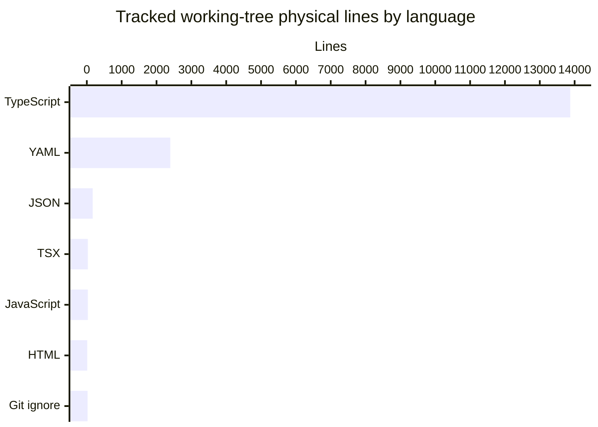

# By the numbers

Collected **2026-11-05** at HEAD `b2a0afd75d49a46d24a6895ef17ce4d4f6d7ecaf`. These are repository measurements, not contributor productivity metrics. See [architecture](overview/architecture.md) for meaning and [lore](lore.md) for the dated changes.

## Scope and counting rules

- Inventory: `git ls-files`, reading each tracked file's **working-tree** bytes. Exclude any path component named `node_modules`, `dist`, `droid-wiki`, or `.planning-research`. Untracked files and secrets such as `.env` are not inspected.
- LOC means physical lines, **including comments and blank lines**, counting a final unterminated line once. This is not executable-statement or comment-stripped SLOC. Extension determines language; `.tsx` is shown separately.
- Working-tree measurements include the existing edits to `apps/server/src/playback/ffmpegArgs.ts` and `apps/server/test/playback/ffmpegArgs.test.ts`; history/churn measurements do not.
- Test classification takes precedence: paths under `/test/` or filenames matching `.test.[cm]?[jt]sx?`. Source is the remaining `/src/` files plus `apps/web/index.html`. Everything else is configuration/metadata, including the lockfile and `.gitignore`.

| Inventory | Files | Physical lines |
| --- | ---: | ---: |
| Source | 70 | 7,387 |
| Tests and test support | 48 | 6,488 |
| Configuration/metadata | 18 | 2,655 |
| **Total** | **136** | **16,530** |

The 48 test/support files include fixtures, harnesses and stub services: this is not a test-case count. No coverage percentage or test-pass claim is implied.

## Language mix

| Language | Files | LOC |
| --- | ---: | ---: |
| TypeScript (`.ts`) | 118 | 13,875 |
| YAML | 2 | 2,395 |
| JSON | 10 | 168 |
| TSX | 3 | 29 |
| JavaScript (`.mjs`) | 1 | 29 |
| HTML | 1 | 12 |
| Git ignore rules | 1 | 22 |



`pnpm-lock.yaml` alone accounts for 2,385 lines; do not interpret YAML's share as handwritten application complexity.

## Present workspaces

**Three present workspaces**, excluding the private root orchestration package:

| Package | Directory | Role |
| --- | --- | --- |
| `@homestream/server` | `apps/server` | Implemented Fastify service |
| `@homestream/web` | `apps/web` | React/Vite placeholder |
| `@homestream/shared` | `packages/shared` | Shared Zod contracts |

Evidence: `pnpm-workspace.yaml`, `apps/server/package.json`, `apps/web/package.json`, `packages/shared/package.json`. The workspace list also names `apps/desktop`, but that directory is absent; it is not a fourth implemented workspace.

## Activity: one recorded day

All **eight reachable HEAD commits** have author dates on **2026-11-05**, from 10:51:13 to 17:32:43, UTC+11. Buckets below use those recorded local author dates, not UTC conversion. The 90-day inclusive window is **2026-08-08 through 2026-11-05**.

| Weekly bucket, Monday–Sunday | Commits |
| --- | ---: |
| Every intersecting week before 2026-11-02 | 0 |
| 2026-11-02–2026-11-08, observed only through Nov 5 | 8 |

| Monthly bucket within the window | Commits |
| --- | ---: |
| 2026-08, Aug 8 onward | 0 |
| 2026-09 | 0 |
| 2026-10 | 0 |
| 2026-11, through Nov 5 | 8 |

Zeros mean no commits in this checkout's reachable history, not proof that no development happened elsewhere. There is no defensible long-term velocity trend in this sample.

### Bot involvement: explicit lower bound

Of eight commits:

| Match category | Commits | Share |
| --- | ---: | ---: |
| Bot-matching author | 0 | 0% |
| At least one bot-matching `Co-authored-by:` trailer | 8 | 100% |
| Either category, deduplicated per commit | 8 | 100% |

Method: inspect `%an <%ae>` and the identity text of each case-insensitive `^Co-authored-by:\s*` line in `%B`. Match case-insensitively against `\[bot\]|(?:^|[^a-z])(?:factory-droid|dependabot|renovate|github-actions)(?:[^a-z]|$)`. Every commit contains a matching Factory Droid co-author trailer. The percentages are a **metadata-based lower bound on recorded bot-involved commits**, not a share of code written by AI, proof of automation quality, or a human contribution ranking. Other undisclosed assistance cannot be inferred.

## 90-day churn

Sum additions and deletions from `git diff-tree --root --no-commit-id --numstat -r <commit>` over the window, with the inventory exclusions above; rank by additions + deletions. The initial commit is included against the empty tree. There are no recorded deleted files in the inspected history. Current tracked paths form the reporting inventory; uncommitted edits are excluded.

Total: **16,896 additions + 422 deletions = 17,318 changed lines**. Most of this is initial construction, not repeated rewriting. These historical line counts need not equal working-tree LOC.

### Highest-churn files

| Full repository-relative path | Added | Deleted | Commit touches |
| --- | ---: | ---: | ---: |
| `pnpm-lock.yaml` | 2,385 | 0 | 1 |
| `apps/server/src/playback/manager.ts` | 1,054 | 105 | 5 |
| `apps/server/test/encode/tracks.test.ts` | 414 | 109 | 2 |
| `apps/server/test/sourceproxy/proxy.test.ts` | 427 | 0 | 1 |
| `apps/server/src/playback/subtitleExtractor.ts` | 309 | 86 | 2 |
| `apps/server/test/encode/lifecycle.test.ts` | 364 | 8 | 2 |
| `apps/server/test/encode/progressive-subtitles.test.ts` | 325 | 0 | 1 |
| `apps/server/test/streams/routes.test.ts` | 321 | 0 | 1 |
| `apps/server/test/playback/subtitles.test.ts` | 286 | 0 | 1 |
| `apps/server/src/sourceproxy/serve.ts` | 284 | 0 | 1 |

### Highest-churn directories

Directories are **direct parents**, not recursive rollups. File-commit touches are summed, so they are not distinct commit counts.

| Directory | Added | Deleted | File-commit touches |
| --- | ---: | ---: | ---: |
| `apps/server/src/playback` | 3,438 | 222 | 37 |
| Repository root (`.`) | 2,496 | 0 | 7 |
| `apps/server/test/playback` | 1,925 | 32 | 24 |
| `apps/server/test/encode` | 1,333 | 118 | 7 |
| `apps/server/src/sourceproxy` | 1,015 | 0 | 5 |
| `apps/server/test` | 790 | 0 | 11 |
| `apps/server/src` | 696 | 13 | 24 |
| `apps/server/test/sourceproxy` | 635 | 0 | 3 |
| `apps/server/test/streams` | 618 | 0 | 5 |
| `apps/server/test/tmdb` | 434 | 0 | 3 |

## Average file sizes by directory

Same 136-file working-tree inventory. Direct parents only; mean physical lines rounded to one decimal, mean on-disk bytes to the nearest byte. Byte counts include actual line-ending bytes; the root average is dominated by the lockfile.

| Directory | Files | Mean lines/file | Mean bytes/file |
| --- | ---: | ---: | ---: |
| Repository root (`.`) | 7 | 356.6 | 11,411 |
| `apps/server` | 4 | 13.3 | 328 |
| `apps/server/src` | 10 | 68.3 | 2,417 |
| `apps/server/src/db` | 4 | 70.8 | 2,349 |
| `apps/server/src/events` | 2 | 53.0 | 1,578 |
| `apps/server/src/gateway` | 4 | 100.0 | 3,321 |
| `apps/server/src/playback` | 20 | 161.7 | 6,302 |
| `apps/server/src/prefetch` | 1 | 176.0 | 6,654 |
| `apps/server/src/routes` | 9 | 35.3 | 1,454 |
| `apps/server/src/sourceproxy` | 5 | 203.0 | 7,154 |
| `apps/server/src/streams` | 4 | 87.3 | 3,426 |
| `apps/server/src/tmdb` | 3 | 137.0 | 4,809 |
| `apps/server/test` | 9 | 87.8 | 3,539 |
| `apps/server/test/encode` | 4 | 303.8 | 15,887 |
| `apps/server/test/gateway` | 3 | 112.7 | 4,325 |
| `apps/server/test/live` | 2 | 112.0 | 4,689 |
| `apps/server/test/playback` | 14 | 138.0 | 6,597 |
| `apps/server/test/prefetch` | 1 | 157.0 | 6,793 |
| `apps/server/test/sourceproxy` | 3 | 211.7 | 8,177 |
| `apps/server/test/streams` | 5 | 123.6 | 6,063 |
| `apps/server/test/tmdb` | 3 | 144.7 | 5,325 |
| `apps/web` | 4 | 17.3 | 434 |
| `apps/web/src` | 3 | 9.7 | 251 |
| `packages/shared` | 4 | 12.3 | 253 |
| `packages/shared/src` | 5 | 76.2 | 2,728 |
| `packages/shared/test` | 3 | 45.3 | 1,839 |

## Static import depth

TypeScript compiler AST inspection covered **69 non-test `.ts`/`.tsx` modules under `src`**. Edges include top-level static imports and re-exports, **including type-only references**. Resolve local `.js` specifiers to `.ts`, and `@homestream/shared` to `packages/shared/src/index.ts`; ignore external packages, built-ins, dynamic imports, tests, generated output and configuration.

Strongly connected components were computed before longest-path traversal. **No multi-module cycles were found in this scoped graph.** If cycles existed, a finite component-condensed depth would not describe an arbitrarily repeatable walk through the cycle. Absence here does not establish absence of runtime, dynamic or external dependency cycles.

| Workspace root | Deepest path, modules | Edges |
| --- | ---: | ---: |
| `apps/server` | 16 | 15 |
| `apps/web` | 2 | 1 |
| `packages/shared` | 3 | 2 |

One maximum path (ties are possible):

1. `apps/server/src/index.ts`
2. `apps/server/src/app.ts`
3. `apps/server/src/routes/catalog.ts`
4. `apps/server/src/context.ts`
5. `apps/server/src/playback/manager.ts`
6. `apps/server/src/playback/monitor.ts`
7. `apps/server/src/playback/session.ts`
8. `apps/server/src/playback/subtitleExtractor.ts`
9. `apps/server/src/playback/subtitleStore.ts`
10. `apps/server/src/playback/playlist.ts`
11. `apps/server/src/playback/decision.ts`
12. `apps/server/src/playback/probe.ts`
13. `apps/server/src/errors.ts`
14. `packages/shared/src/index.ts`
15. `packages/shared/src/playback.ts`
16. `packages/shared/src/catalog.ts`

Starting at `apps/server/src/app.ts` yields the same suffix at 15 modules. The web chain is `apps/web/src/main.tsx` → `apps/web/src/App.tsx`. A shared maximum is `packages/shared/src/index.ts` → `packages/shared/src/playback.ts` → `packages/shared/src/catalog.ts`.

This is **not a runtime call stack**: for example, routes import `AppContext` as a type, and the shared barrel expands the static graph. It measures structural reach, not latency or cyclomatic complexity.

## Exported symbols per package

Use the installed TypeScript compiler's `createProgram`, `getTypeChecker`, `getSymbolAtLocation(sourceFile)` and `getExportsOfModule`. Count named exported symbols, including types/interfaces, values and re-exports; exclude tests/configuration. A schema value and its inferred type are distinct names. Sum each source module's export count separately: repeated exports across modules intentionally count again.

| Package | Source modules | Sum of module export counts | Package entry exports |
| --- | ---: | ---: | --- |
| `@homestream/server` | 62 | 300 | 0 from `apps/server/src/index.ts` |
| `@homestream/web` | 2 | 1 | 0 from startup `apps/web/src/main.tsx`; `App` is exported by `apps/web/src/App.tsx` |
| `@homestream/shared` | 5 | 182 | 91 unique names from `packages/shared/src/index.ts` |

Server and web are applications, not supported library surfaces. Their internal module totals should not be mistaken for public package APIs. Shared's barrel re-exports 20 names from `packages/shared/src/schemas.ts`, 21 from `packages/shared/src/catalog.ts`, 15 from `packages/shared/src/streams.ts`, and 35 from `packages/shared/src/playback.ts`: 91 underlying names, counted once more by the barrel in the 182 module-export sum.

## Reproduction entry points

Run from PowerShell; no network or service credentials are needed:

```powershell
Set-Location -LiteralPath 'D:\Projects\no clue'
git ls-files
git log HEAD --reverse --format='%H|%aI|%s'
git log HEAD --format='%H%n%an <%ae>%n%B'
git log HEAD --reverse --stat
git diff-tree --root --no-commit-id --numstat -r b2a0afd75d49a46d24a6895ef17ce4d4f6d7ecaf
```

Apply the scope, date, AST and aggregation rules above to reproduce the tables. Measurements used inline Node.js with `fs`, `path`, `child_process` and the already-installed `typescript`; no helper file, dependency installation, build, test suite or application startup was required.
