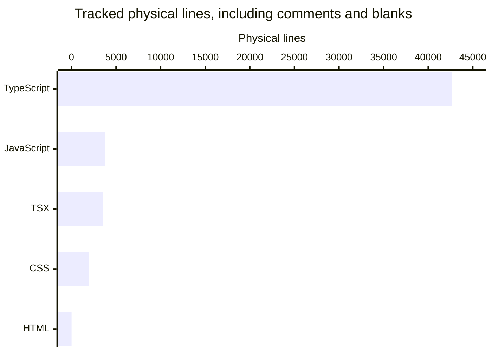

# By the numbers

Data collected on **2026-11-06**, at **22:00 UTC**, from committed tree `7eb94bafed5e0e046987a81d0cbbff8e6ba999d1` on `main`. This page measures repository size and recorded activity, not individual productivity. See [architecture](overview/architecture.md) for runtime boundaries and [lore](lore.md) for the history behind the totals.

The runtime clock agrees with the supplied 2026-11-06 collection date. Git records HEAD at **2026-11-07 05:57:34 +11:00**, which is **2026-11-06 18:57:34 UTC**. Historical tables retain the recorded local dates rather than silently changing November 7 to November 6.

## Measurement scope

All inventory comes from `git ls-tree -r` and committed blobs read with `git cat-file --batch`, not the working tree. The snapshot excludes:

- `droid-wiki/`, including concurrent generation changes.
- Any path component named `node_modules`, `dist`, `coverage`, `reports`, or `release`.
- Lockfiles named `pnpm-lock.yaml`, `package-lock.json`, or `yarn.lock`.
- Generated exports `docs/openapi.json` and `docs/schema.sql`, and filenames containing `.generated.`. The generator implementation `apps/server/src/docs/generated.ts` is included.
- Binary/non-UTF-8 blobs and text containing NUL bytes.

HEAD has **604 tracked paths**. Exclusions leave **551 paths**, of which **550 are text**; the remaining binary is `apps/web/src/styles/fonts/inter-var-latin.woff2`.

A physical line is one Python `str.splitlines()` element, including blank lines and comments; an unterminated final line counts once. “Nonblank” removes whitespace-only lines but **does not remove comments**. These are tracked-text counts by extension, not parser-derived executable LOC, comment-free SLOC, statement counts, or a measure of implementation difficulty.

Classification is ordered:

1. **Test:** paths containing `/test/` or `/e2e/`, or filenames matching `\.(test|spec)\.[cm]?[jt]sx?$`. Test helpers, fixtures, e2e build tools, and e2e configuration are included.
2. **Source:** remaining `/src/` paths, `.mjs`/`.mts` files under `scripts/`, and `apps/web/index.html`. This intentionally includes source-tree CSS, declaration files, and the font license.
3. **Documentation:** remaining `.md` files and root `LICENSE`.
4. **Configuration:** everything else, including manifests, workflows, root build/lint configurations, and tool data.

## Size

| Class                          | Text files | Physical lines |
| ------------------------------ | ---------: | -------------: |
| Source                         |        275 |         25,247 |
| Test and supporting files      |        178 |         26,317 |
| Configuration and tool data    |         65 |          3,929 |
| Documentation and root license |         32 |          2,748 |
| **Total**                      |    **550** |     **58,241** |

The test/source physical-line ratio is **1.04:1**. It includes fixtures and helpers and says nothing about test coverage or assertion quality.

### Lines by language

The chart shows programming/style/markup extensions only. The table also includes documentation and configuration languages, so its totals reconcile to the inventory.



| Extension-based language                           | Text files | Physical lines | Nonblank lines |
| -------------------------------------------------- | ---------: | -------------: | -------------: |
| TypeScript (`.ts`, `.mts`, including declarations) |        362 |         42,674 |         38,733 |
| JavaScript (`.js`, `.mjs`, `.cjs`)                 |         30 |          3,799 |          3,476 |
| TSX                                                |         43 |          3,513 |          3,196 |
| Markdown                                           |         31 |          2,074 |          1,490 |
| CSS                                                |         24 |          1,981 |          1,715 |
| JSON                                               |         28 |          1,847 |          1,847 |
| YAML                                               |         18 |          1,197 |          1,067 |
| Other text, including extensionless files          |         11 |          1,020 |            830 |
| Text (`.txt`)                                      |          1 |             93 |             75 |
| JSONC                                              |          1 |             31 |             31 |
| HTML                                               |          1 |             12 |             12 |
| **Total**                                          |    **550** |     **58,241** |     **52,472** |

### Workspace count

There are **four workspace packages**, explicitly listed in `pnpm-workspace.yaml`: `apps/server`, `apps/web`, `apps/desktop`, and `packages/shared`. The root tooling manifest is not a fifth workspace. No TV workspace exists. Workspace count is not deployable-app count: the desktop package has support modules, not a working Electron shell (`apps/desktop/src/index.ts`).

## Activity

All **51 commits reachable from HEAD** are counted, including the root commit and wiki-only automation. The available history begins at `c0781bd`, **2026-11-05 10:51:13 +11:00**, and ends at HEAD, **2026-11-07 05:57:34 +11:00**. There are no months of earlier recorded history from which to infer a stable development rate.

Buckets use **committer timestamps normalized to UTC+11**, not author timestamps. This matters for commits whose author and committer times differ.

| Monthly bucket   | Reachable commits |
| ---------------- | ----------------: |
| 2026-08          |                 0 |
| 2026-09          |                 0 |
| 2026-10          |                 0 |
| 2026-11, partial |                51 |

| ISO week, Monday start | Reachable commits |
| ---------------------- | ----------------: |
| 2026-W42               |                 0 |
| 2026-W43               |                 0 |
| 2026-W44               |                 0 |
| 2026-W45, partial      |                51 |

Within that last week, local daily totals are **12 on November 5**, **32 on November 6**, and **7 on November 7**. Zero buckets mean no commits in this available history, not proof that no private development occurred.

### Ninety-day churn hotspots

The window is **2026-08-09 05:57:34 through 2026-11-07 05:57:34 +11:00**, ending at HEAD rather than at collection time. It contains all available commits. Churn is numeric added plus deleted lines from each commit's `git diff-tree --root --numstat --no-renames -r`, with the inventory path exclusions above. Binary rows are omitted. Moves count as deletion plus addition; formatting counts as churn.

These are the highest-churn paths **still present at HEAD**:

| Current file                                            | Added | Deleted | Churn | Commits touching path |
| ------------------------------------------------------- | ----: | ------: | ----: | --------------------: |
| `apps/server/src/playback/manager.ts`                   | 1,803 |     270 | 2,073 |                    20 |
| `scripts/readiness-criteria.json`                       | 1,291 |       4 | 1,295 |                     2 |
| `apps/server/test/encode/tracks.test.ts`                |   684 |     304 |   988 |                     5 |
| `apps/server/test/encode/lifecycle.test.ts`             |   670 |     273 |   943 |                     6 |
| `apps/server/test/integration/progress-routes.test.ts`  |   893 |       1 |   894 |                     2 |
| `apps/server/test/integration/downloads.test.ts`        |   811 |       0 |   811 |                     1 |
| `apps/server/test/encode/progressive-subtitles.test.ts` |   582 |     190 |   772 |                     5 |
| `apps/server/test/encode/hls-encode.test.ts`            |   526 |     171 |   697 |                     4 |

Deleted/moved paths are retained in the underlying historical calculation but not this current-file table. For example, the former progress route test path accumulated **1,770** changed lines before the test-tier move; the former downloads test path accumulated **1,660**. Treating those as current maintenance targets would be misleading.

| Directory, recursively |  Churn |
| ---------------------- | -----: |
| `apps/server/test`     | 35,487 |
| `apps/server/src`      | 17,103 |
| `apps/web/src`         |  8,241 |
| `scripts`              |  5,319 |
| `docs`                 |  1,346 |
| `packages/shared/src`  |  1,339 |
| `.github`              |  1,084 |
| `packages/shared/test` |    985 |

The root introduction, formatting pass, and test moves dominate this short window. These totals are not evidence of regressions or poor quality. See [testing](how-to-contribute/testing.md) for the tier boundaries.

## Bot-attributed commits

Bot detection examines author name/email internally for the literal `[bot]` marker and scans commit messages for a `Co-authored-by:` trailer containing `[bot]`, case-insensitively. No identities are published.

| Attribution, across all 51 reachable commits    | Commits | Percentage |
| ----------------------------------------------- | ------: | ---------: |
| At least one bot co-author trailer              |      50 |     98.04% |
| Bot author                                      |       1 |      1.96% |
| Either condition, union without double-counting |      51 |    100.00% |

The **98.04% co-authorship figure** is an explicit lower bound on recorded AI-assisted commits here: those trailers identify the coding assistant. The **100% union** is the broader bot-attribution measure, not a claim that every bot-authored automation commit used AI. Inline suggestions and unrecorded assistance leave no required git trace; trailers also cannot measure how much of a commit was assisted.

## Complexity

These are structural proxies, not cyclomatic or cognitive complexity measurements.

### Average source-file size

Counts use the ordered source classification above. Workspace rows are recursive; narrower rows are independent drill-downs and must not be summed with their parent.

| Directory                                   | Source text files | Physical lines | Mean lines/file |
| ------------------------------------------- | ----------------: | -------------: | --------------: |
| `apps/server/src`                           |               130 |         14,999 |           115.4 |
| `apps/web/src`                              |                83 |          4,942 |            59.5 |
| `apps/desktop/src`                          |                 7 |            261 |            37.3 |
| `packages/shared/src`                       |                14 |          1,291 |            92.2 |
| `scripts`, recursive                        |                40 |          3,742 |            93.6 |
| `apps/server/src/playback`, direct files    |                27 |          4,678 |           173.3 |
| `apps/server/src/sourceproxy`, direct files |                 6 |          1,365 |           227.5 |
| `apps/server/src/downloads`, direct files   |                 4 |            978 |           244.5 |
| `apps/web/src/components`, direct files     |                36 |          2,464 |            68.4 |
| `apps/web/src/pages`, direct files          |                11 |            919 |            83.5 |

`apps/web/index.html` is the remaining source file outside these workspace `src` and script rows.

### Deepest observed import chains

A static **lexical heuristic** scans source `.ts`, `.tsx`, `.mts`, `.mjs`, and `.cjs` files for `from`, bare `import`, and literal dynamic `import(...)` specifiers. It includes type-only imports and re-exports. Relative specifiers resolve against the recorded tree, translating `.js` to TypeScript when present and trying directory indexes. Bare `@homestream/shared` maps to `packages/shared/src/index.ts`; other package imports terminate the graph.

The resulting graph has **249 nodes, 646 distinct directed edges, and no detected cycles**. Strongly connected components were condensed before longest-path calculation. **26 relative occurrences did not resolve to an included script module**, for example style/asset imports. This is not TypeScript module resolution, a runtime stack, or proof that the complete project has no cycles. Regexes can match comments and cannot follow computed imports.

| Starting workspace | Longest observed chain, nodes | Edges | Starting module                | Terminal module                  |
| ------------------ | ----------------------------: | ----: | ------------------------------ | -------------------------------- |
| Server             |                            21 |    20 | `apps/server/src/docs/cli.ts`  | `packages/shared/src/schemas.ts` |
| Web                |                            12 |    11 | `apps/web/src/main.tsx`        | `packages/shared/src/schemas.ts` |
| Desktop            |                             7 |     6 | `apps/desktop/src/index.ts`    | `packages/shared/src/schemas.ts` |
| Shared             |                             4 |     3 | `packages/shared/src/index.ts` | `packages/shared/src/schemas.ts` |

The server's longest observed chain is:

1. `apps/server/src/docs/cli.ts`
2. `apps/server/src/docs/generated.ts`
3. `apps/server/src/docs/export.ts`
4. `apps/server/src/app.ts`
5. `apps/server/src/routes/info.ts`
6. `apps/server/src/context.ts`
7. `apps/server/src/health/service.ts`
8. `apps/server/src/network/snapshot.ts`
9. `apps/server/src/playback/manager.ts`
10. `apps/server/src/playback/monitor.ts`
11. `apps/server/src/playback/session.ts`
12. `apps/server/src/playback/subtitleExtractor.ts`
13. `apps/server/src/playback/extractorSchedule.ts`
14. `apps/server/src/playback/playlist.ts`
15. `apps/server/src/playback/decision.ts`
16. `apps/server/src/playback/probe.ts`
17. `apps/server/src/errors.ts`
18. `packages/shared/src/index.ts`
19. `packages/shared/src/progress.ts`
20. `packages/shared/src/playback.ts`
21. `packages/shared/src/schemas.ts`

Type-only dependencies and barrels explain much of this depth. It does not imply a 21-module playback startup sequence.

### Exported symbols per workspace

These are **lexically observed export-name occurrences**, not a type-checker-derived unique public API. Scan non-test `.ts`/`.tsx` under each workspace's `src`: count named `export` declarations of variables, functions, classes, interfaces, types, and enums; comma-separated named export-list entries; and `export default` statements. Count star re-exports separately without expanding them. Re-exported names and a name exported from multiple modules count repeatedly. This deliberately avoids pretending an unexpanded barrel has zero API.

| Workspace         | TS/TSX source modules | Named declarations | Named export-list entries | Defaults | Observed name occurrences | Star re-exports, unexpanded |
| ----------------- | --------------------: | -----------------: | ------------------------: | -------: | ------------------------: | --------------------------: |
| `apps/server`     |                   130 |                489 |                         4 |        0 |                       493 |                           0 |
| `apps/web`        |                    58 |                110 |                         1 |        9 |                       120 |                           0 |
| `apps/desktop`    |                     7 |                 19 |                        19 |        0 |                        38 |                           0 |
| `packages/shared` |                    14 |                223 |                         0 |        0 |                       223 |                          13 |

Declaration counting uses an anchored `export`/optional `declare`, `async`, or `abstract` prefix followed by a declaration keyword and identifier; named lists use `export { ... }` or `export type { ... }`; defaults use anchored `export default`. It is a repeatable text heuristic, so destructuring, overloads, comments, and future syntax can change its accuracy. The 13 star re-exports in `packages/shared/src/index.ts` are not expanded; these counts must not be compared directly with earlier semantic export counts. Apps' internal module exports are not supported library interfaces.

## Reproduction

Read-only commands from the repository root:

```sh
git ls-tree -r 7eb94bafed5e0e046987a81d0cbbff8e6ba999d1
git rev-list --reverse 7eb94bafed5e0e046987a81d0cbbff8e6ba999d1
git log HEAD --reverse --format='%h|%cI|%s'
git diff-tree --root --no-commit-id --numstat --no-renames -r 7eb94ba
```

For inventory, read each included tree blob with `git cat-file --batch`, apply the documented UTF-8 and classification rules, then count `str.splitlines()`. Group by extension for language, or by directory for file-size means. For churn, run the last command for every reachable commit, filter each commit by its committer timestamp and each row by the exclusions, then sum numeric additions/deletions. Filter to paths present at HEAD only for the current-file hotspot table.

Bot attribution reads metadata internally and emits aggregates only. Graph/export measurements use the explicit lexical rules above, with no installed parser required. Measurements used inline Python programs and created no helper files. No server, tests, encoder, or network call was run.
