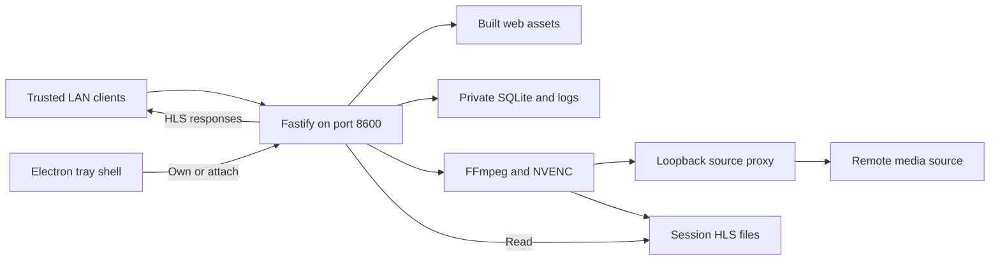

# Deployment

Active contributors: VeroxAUS

HomeStream runs on the encoding PC as a LAN server with a working React player and Electron tray shell. Releases create tags and release metadata, not installers or a deployed fleet. See [architecture](overview/architecture.md).



## Runtime shape and setup

`apps/server/src/index.ts` boots the server, proxy, health/download workers and discovery, then owns graceful shutdown. Intended real playback uses a Windows NVIDIA PC with FFmpeg/ffprobe and NVENC; Linux supports offline development and CI. The [desktop shell](apps/desktop/index.md) can supervise an owned server or attach to an existing compatible one. Browsing, search, playback and Settings/About are working UI; dashboard tabs remain placeholders, and TV is planned without a source app.

Use Node 24 and the pnpm version pinned by repository configuration:

```sh
node scripts/bootstrap.mjs
pnpm build
pnpm --filter @homestream/server start
```

Bootstrap checks tools, preserves existing configuration and builds shared contracts (`scripts/bootstrap.mjs`). Server/shared outputs are under their package `dist/` directories; web assets go to `apps/web/dist`. Keep workspace dependencies/manifests as well as compiled outputs: this is not a documented single-binary distribution.

Set credentials and writable dedicated `DATA_DIR`/`TRANSCODE_DIR` privately. Windows-oriented defaults need explicit replacement on Linux. Missing upstream credentials warn rather than prevent listening (`loadConfig` in `apps/server/src/config.ts`). Restart to apply settings; see [configuration](reference/configuration.md).

The default public listener is `0.0.0.0:8600`; isolate it with the host firewall and trusted LAN. `SourceProxy` in `apps/server/src/sourceproxy/proxy.ts` binds loopback, normally 8650 with free-port fallback. Do not port-forward the public listener. The app has no accounts or TLS termination; [security](security.md) describes those boundaries.

## Web and desktop delivery

`registerStatic` in `apps/server/src/routes/static.ts` serves an existing built web root, including precompressed assets. Hashed `assets/` files cache immutably for one year; other files revalidate. `shouldServeSpaFallback` permits GET/HEAD extensionless routes, excluding `/api`, `/hls` and their descendants. Missing filename assets remain 404.

Development uses web port 8601 with API/HLS proxying; it is not the production delivery route (`apps/web/vite.config.ts`). Browser telemetry keys are baked in at build time: changing server runtime keys does not retrofit an existing web bundle.

Build/start desktop separately:

```sh
pnpm --filter @homestream/desktop build
pnpm --filter @homestream/desktop start
```

The Electron binary is a separate prerequisite; use the [desktop setup](apps/desktop/index.md), not an assumed installer. `apps/desktop/src/main.ts` loads preferences/environment and initializes telemetry before readiness. The shell resolves repository versus packaged app-data configuration and stops only a server it owns. Mini-player handoff, restart serialization and external-server ownership are documented under [supervision](apps/desktop/supervisor.md).

`.devcontainer/Dockerfile` is a development environment, not a production deployment image.

## Storage, health and recovery

SQLite, local logs and upstream caches belong to `DATA_DIR`; session media belongs to `TRANSCODE_DIR`. Treat both as private, and preserve configuration/database when replacing build outputs. Gateway cache records can contain source URLs; backups are sensitive.

Use `/healthz` for liveness, `/readyz` for local DB/data-directory readiness and `/api/health` for dependency/playback checks. Readiness does not prove GPU, transcode directory or upstream usability. Full health can run commands, upstream calls and an NVENC encode; do not use fresh runs as high-frequency probes. See [monitoring](how-to-monitor/index.md).

Graceful close tears down workers, event streams, sessions, proxy and telemetry. Startup orphan recovery uses PID ownership information rather than killing all FFmpeg processes (`apps/server/src/playback/pidRegistry.ts`). Follow `docs/runbooks/ffmpeg-orphans.md`, `docs/runbooks/disk-full-transcode.md` and `docs/runbooks/rollback.md` for recovery; do not delete storage blindly.

## CI and releases

`.github/workflows/ci.yml` defines required **Linux** and **Windows** checks, plus advisory **Web e2e**. It validates formatting, lint/types, boundaries, dependency consistency, code/debt/size gates, generated docs, offline tests/coverage and bundles. GPU/live tiers never run there.

The required **Linux** job is a gate over three independent jobs in `.github/workflows/ci.yml`:

| Job               | Responsibility                                                                                                                                                            |
| ----------------- | ------------------------------------------------------------------------------------------------------------------------------------------------------------------------- |
| **Linux checks**  | Formatting, lint/types, dead-code/duplication/boundaries, dependency consistency, size/bundle gates, agent/docs/generated exports, flags, debt and environment-key checks |
| **Linux tests**   | Software FFmpeg installation, sequential workspace `pnpm test:coverage`, merged reports, summary and `test-reports` artifact                                              |
| **Linux secrets** | Redacted Gitleaks scan of the full git history; this checkout fetches full history                                                                                        |

The gate uses `needs` and `if: always()` and fails unless every dependency succeeded. Failed, cancelled or skipped dependencies cannot leave it green. The three jobs have no dependency, conditional skip or tolerated-failure setting. Branch protection still requires only **Linux** and **Windows**; inspect the failing child job for the actual check error (`.github/workflows/ci.yml`, `apps/server/test/scripts/workflows.test.ts`).

**Linux tests** caches FFmpeg `.deb` packages by runner OS and image version. A valid warm cache installs through `dpkg` and verifies `ffmpeg`; a missing or failed cache falls back to apt. Cold-cache attempts cap update/install at 60/90 seconds, retry three times, and run inside an eight-minute step limit. `docs/ci.md` records typical whole-run time around four minutes and an under-ten-minute target, not a guarantee or a fresh measurement from this wiki refresh. Parallel jobs reduce the critical path rather than removing gates.

Windows also builds server/web/desktop, installs the Electron binary into its runner-temp cache, and runs both real launch scenarios sequentially with `pnpm --filter @homestream/desktop smoke`:

- First run uses server/DevTools 8616/8617 and checks the 20-member bridge, owned-server status, visible window/tray, setup screen and saved desktop setting (`apps/desktop/test/smoke/launch.smoke.ts`).
- Configured launch uses 8618/8619, invented keys and the local web e2e stub hub on 8604–8607. It waits for the Home content mark, no setup screen, Trending Movies and poster text including “The Stub Matrix,” confirms a stub TMDB trending request, and checks that no session started (`apps/desktop/test/smoke/configured.smoke.ts`). The server fetch preloader redirects TMDB to loopback and rejects other non-loopback fetches.

Both isolate storage, disable telemetry/mDNS and use a second-instance `--quit` to assert app/server shutdown with no tracked owned PID survivors. Shared fallback teardown independently attempts shell survivors, stub hub and folder cleanup even after a failure; a locked folder warns rather than skipping process shutdown (`apps/desktop/test/smoke/harness.ts`, `apps/desktop/test/smoke/teardown.ts`). Do not overlap these tests with the browser harness because hub ports are shared. Server/page waits are 60 seconds each; configured Home gets 60 seconds, hub startup 30 seconds, and graceful/forced fallback stop gets 5/3 seconds. See [desktop smoke bounds](apps/desktop/index.md#bounded-harness-and-cleanup) and [testing](how-to-contribute/testing.md#real-electron-smoke).

Desktop Node tests, including fake-process smoke-harness regressions, do not launch Electron. Real smoke validates launch/render/shutdown, not real playback, NVENC or live upstream service availability. Web e2e separately builds isolated plain/telemetry-stub UIs and uses local upstreams, mocked playback responses and no real server session start. See [web build and tests](apps/web/build-and-tests.md) for browser harness/budgets and [testing](how-to-contribute/testing.md) for navigation, details, spoiler and Settings cases. These are checked-in CI procedures, not a claim of a fresh Electron or application-check run for this wiki.

Wiki-only changes are ignored by normal CI. Superseded PR runs can cancel; main runs have unique concurrency groups and are not cancelled by newer pushes, preserving timing records.

`.github/workflows/release.yml` runs after successful push CI on main. `scripts/next-version.mjs` plans Conventional Commit versions; eligible feat/fix/perf history can create a tag/GitHub release and Sentry release/deploy metadata. Older SHAs already contained in a newer release tag are skipped, because main CI may finish out of order. There is no installer build, artifact rollout or machine update step. A Sentry deploy marker is metadata, not evidence of installation.

### Advisory automation

`docs/ci.md` defines three non-required automations, none of which writes application code to main:

| Automation                             | Behavior                                                                                                                                                                                                                                |
| -------------------------------------- | --------------------------------------------------------------------------------------------------------------------------------------------------------------------------------------------------------------------------------------- |
| `.github/workflows/droid-review.yml`   | PR inline findings/summary with sticky cleanup; every main push gets commit review/summary. Generated-only pushes get a short summary without calling Droid. Fork/Dependabot secrets are withheld.                                      |
| CI timing job, `scripts/ci-timing.mjs` | Each main CI run appends a record to orphan `ci-metrics`; PRs update a sticky comparison against the median of ten successful main runs. Test durations come from the **Linux tests** artifact. History is retained rather than pruned. |
| `.github/workflows/code-health.yml`    | Daily **18:30 UTC**/manual read-only review, one rolling `Code health` issue. Skips when no reviewable new commit exists; pushes no code or PR.                                                                                         |

### Other workflows

| Workflow                                   | Scope                                                                                                  |
| ------------------------------------------ | ------------------------------------------------------------------------------------------------------ |
| `.github/workflows/docs.yml`               | Regenerates/checks OpenAPI and SQL schema, links and database docs on relevant changes/manual dispatch |
| `.github/workflows/gitleaks.yml`           | Push/PR, weekly and manual full-history secret scanning                                                |
| `.github/workflows/codeql.yml`             | JavaScript/TypeScript security-and-quality analysis; not a security certification                      |
| `.github/workflows/devcontainer.yml`       | Relevant changes, weekly/manual container build and unit tests                                         |
| `.github/workflows/sentry-issues.yml`      | Daily **19:17 UTC**/manual unresolved Sentry-to-GitHub issue sync, not paging                          |
| `.github/workflows/droid-wiki-refresh.yml` | Daily **17:00 UTC**/manual generated wiki refresh and rolling PR                                       |

Security workflows exclude wiki-only push/PR changes, while their scheduled/manual runs remain separate. External credentials, branch protection and service delivery have not been verified by this source inspection.

## Wiki publication

The refresh workflow checks for non-wiki changes since its last successful run; manual force bypasses that check. A read-only job restores the rolling wiki branch and generates pages. A separate write-enabled job mirrors the artifact with `scripts/wiki-mirror.mjs`, excluding video/images, and opens/updates `factory/droid-wiki`.

The wiki-only PR receives not-applicable success statuses named **Linux** and **Windows**, because ordinary CI skips it. Keep those names aligned with required checks. The workflow requests squash merge, using auto-merge for a protected base and retaining the rolling branch. Optional `FACTORY_WIKI_PR_TOKEN` can trigger downstream workflows; fallback workflow-token PRs and merges do not. Push/PR/merge failures are warned about rather than proving publication succeeded. Repository PR/auto-merge settings remain operator prerequisites (`docs/wiki.md`).

At this source revision, the publisher closes the workflow-token push-review gap itself. After requesting merge, it waits up to **three minutes** for `MERGED` plus a merge SHA, fetches that commit at depth two, and runs `scripts/droid-push-review.mjs` on its parent-to-merge diff. It supplies `GITHUB_TOKEN` but no `FACTORY_API_KEY`: the generated-only diff posts the short “no reviewable changes” summary on the merged commit without invoking Droid. This is not a code review or a test pass.

If the PR does not merge before the deadline, a warning explains that the commit gets no summary. Posting is `continue-on-error`. With `FACTORY_WIKI_PR_TOKEN`, the publisher skips this step and lets `.github/workflows/droid-review.yml` handle the push instead, preventing duplicate summaries (`.github/workflows/droid-wiki-refresh.yml`, `docs/ci.md`). This describes checked-in automation, not a verified remote publication.

See [contribution tooling](how-to-contribute/tooling.md) for commands and [alerting](how-to-monitor/alerting.md) for independent monitoring deployment.
