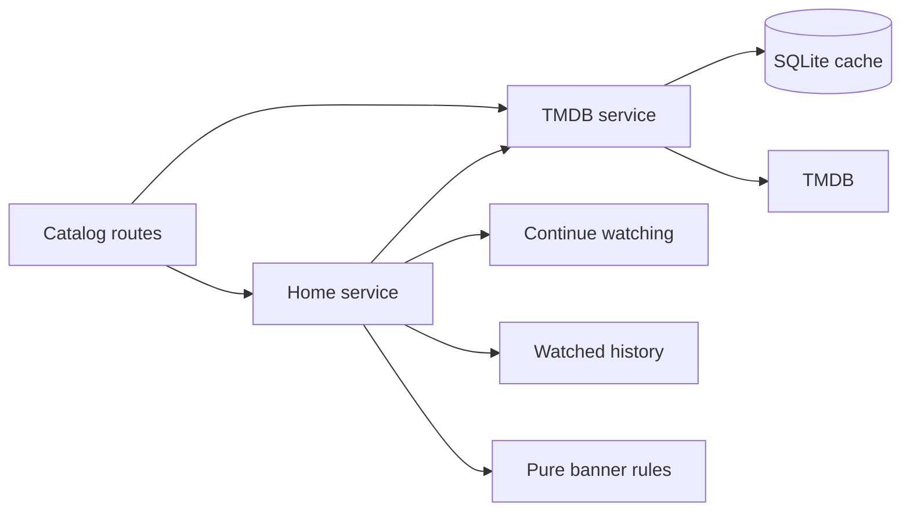

# Catalog

Active contributors: VeroxAUS

## Purpose

Catalog normalizes TMDB metadata and combines it with local progress and pending downloads. `TmdbService` in `apps/server/src/tmdb/service.ts` owns upstream/cache access; `HomeService` in `apps/server/src/home/service.ts` assembles Home rows and featured choices.

## Directory layout

| Path                                | Responsibility                                            |
| ----------------------------------- | --------------------------------------------------------- |
| `apps/server/src/tmdb/`             | Upstream requests, raw-JSON cache and normalized metadata |
| `apps/server/src/home/`             | Home composition and pure featured-slot rules             |
| `apps/server/test/tmdb/`            | Metadata normalization fixtures/tests                     |
| `apps/server/test/home/`            | Pure featured-selection tests                             |
| `apps/server/src/routes/catalog.ts` | Home, search, movie, show and season HTTP adapters        |
| `packages/shared/src/catalog.ts`    | Catalog schemas and details-extra bounds                  |

## Metadata and title details

`apps/server/src/tmdb/normalize.ts` converts movies, shows, seasons, lists and image configuration into shared shapes. Home requests weekly trending movies/shows and popular movies/shows in parallel. Search collapses whitespace, uses first-page multi-search and excludes adult/person results. Requests use English-US metadata.

IMDb identity bridges to [stream selection](stream-selection.md). Probed media, not catalog metadata, determines actual encoding; original language feeds automatic subtitle selection.

Movie/show details fetch their extras in the **same TMDB details request**, not separate credits/recommendation calls (`apps/server/src/tmdb/service.ts`):

| Details path | Exact `append_to_response` value                                  |
| ------------ | ----------------------------------------------------------------- |
| Movie        | `external_ids,credits,recommendations,similar`                    |
| Show         | `external_ids,aggregate_credits,recommendations,similar,season/1` |

Image configuration is fetched/cached separately. Posters use w342, backdrops w1280, episode stills w300 and cast profiles w185 (`apps/server/src/tmdb/normalize.ts`).

Cast normalization prefers a nonempty aggregate cast list, otherwise plain credits. It removes entries with empty names, sorts by numeric billing order (missing order last), then keeps **15**. Aggregate characters use the first role's character, falling back to the plain character; missing photos become null.

The public `similar` list first normalizes **recommendations** as the title's media type, removes the current title and duplicate IDs while preserving order, and uses TMDB's appended **similar** list only if no recommendations survive. It keeps **20**. This is neither concatenation nor backfilling a short recommendation list, and the fallback makes no additional request (`apps/server/src/tmdb/normalize.ts`).

`MAX_CAST`, `MAX_SIMILAR`, `MovieDetailsSchema` and `ShowDetailsSchema` in `packages/shared/src/catalog.ts` enforce those bounds. The current server always emits both arrays; schema defaults supply `[]` when fields are missing/undefined from an older server. Explicit null or oversized arrays are invalid, not silently truncated by the schema. Normalization itself performs the truncation.

Movie/show raw-cache keys include details version **v2** (`movie:v2:<id>` and `tv:v2:<id>`), so a still-fresh old unversioned row cannot suppress the new fields. Seasons retain their existing key format and 24-hour TTL (`apps/server/src/tmdb/service.ts`).

On a show-details cache miss, `TmdbService.show` also asks for **`season/1`**, matching the UI's initially selected season. Before caching the show, `moveFirstSeason` writes the appended object under **`tv:<id>:season:1`** with the details TTL and removes it from the show object. The browser still calls the normal season endpoint; that call can now use the separate cache row without another TMDB request. No season payload is added to the public show-details shape (`apps/server/src/tmdb/service.ts`, `packages/shared/src/catalog.ts`).

This preparation runs only on a fresh show fetch, not on a show-cache hit. A previously cached v2 show therefore does not backfill season 1 until refreshed. If TMDB omits the section, or the season row is missing or expired, the season endpoint follows its normal independent fetch and not-found handling. The server does not append other seasons or duplicate the season inside the stored show row (`apps/server/src/tmdb/service.ts`). See [data models](../reference/data-models.md).

`apps/server/src/routes/catalog.ts` delegates Home assembly and attaches only pending download tracking to details. Rendering cast/similar rows, navigation search and spoiler protection belongs to [screens](../apps/web/screens.md). The server still returns complete episode descriptions/stills; spoiler hiding is browser-local, not a metadata or database filter (`apps/web/src/lib/spoilers.ts`, `apps/web/src/components/EpisodeRow.tsx`, `apps/web/src/components/EpisodePanel.tsx`).

## Featured selection

`buildFeatured` in `apps/server/src/home/featured.ts` is a pure rule. Slot order is trending movie, because-you-watched recommendation, trending show, popular movie, popular show.

Candidates need a backdrop and nonblank overview; identity is media type plus TMDB ID. Continuing titles are initially excluded. The recommendation slot also excludes the base title and already-watched titles. Backfill tries to reach **three items**, allowing continuing titles only in its second pass; output is capped at **five**. Sparse input can still yield fewer than three.

`watchedTitles` in `apps/server/src/db/history.ts` supplies watched-title identity and the most recently started qualifying play, requiring **60 seconds of credited watched time**. This is not based on position alone. `apps/server/src/home/service.ts` starts that title's separate recommendations request alongside metadata and continue watching, with a **1500 ms** recommendation budget. Failure/timeout removes that slot only; it does not cancel the underlying request or cap total Home latency. This Home recommendation workflow is distinct from the appended details extras.

## Cache and failures

`TmdbCache` in `apps/server/src/tmdb/cache.ts` stores raw JSON with these TTLs:

| Data                                              | TTL        |
| ------------------------------------------------- | ---------- |
| Trending/popular lists                            | 1 hour     |
| Movie/show/season details and image configuration | 24 hours   |
| Recommendations                                   | 24 hours   |
| Search                                            | 10 minutes |

Expired/corrupt rows are deleted on read. Identical concurrent misses share a promise. Search keys use normalized lowercase text. Successful data is cached; failures are not, with no stale fallback.

A token is required even for cached reads. Missing configuration yields 503. Network attempts use a **10-second timeout**, at most **two attempts**, and a **300 ms** retry delay. Network/JSON/429/5xx errors can retry; 400/404/422 mean not found, 401 gives an authentication error (`apps/server/src/tmdb/service.ts`).

## Integration and modification

Change shapes in `apps/server/src/tmdb/normalize.ts`, transport/cache use in `apps/server/src/tmdb/service.ts`, and banner policy separately in `apps/server/src/home/featured.ts`. Coordinate contracts in `packages/shared/src/catalog.ts`. See [progress](viewing-progress.md) and [downloads](downloads.md) for local enrichments rather than duplicating their state logic.

`apps/server/test/tmdb/normalize.test.ts` covers cast billing/bounds, aggregate-role fallback, similar fallback and malformed data. `packages/shared/test/catalog.test.ts` checks older-payload defaults and array rejection; `apps/server/test/integration/catalog-routes.test.ts` checks appended requests, cache reuse, old-key bypass, separate season-one storage and independent fetching when the appended section is absent. `apps/web/e2e/details-api.spec.ts` verifies that the existing season endpoint returns episodes without a separate upstream season request against the stub hub in `apps/web/e2e/support/hub.mjs`. Featured rules and watched-history Home behavior are covered by `apps/server/test/home/featured.test.ts` and `apps/server/test/integration/progress-routes.test.ts`.

## Key source files

| File                                                  | Purpose                        |
| ----------------------------------------------------- | ------------------------------ |
| `apps/server/src/tmdb/service.ts`                     | Metadata transport/sharing     |
| `apps/server/src/tmdb/cache.ts`                       | Persistent cache               |
| `apps/server/src/tmdb/normalize.ts`                   | Stable shapes                  |
| `apps/server/src/home/service.ts`                     | Home orchestration             |
| `apps/server/src/home/featured.ts`                    | Featured slots                 |
| `apps/server/src/routes/catalog.ts`                   | HTTP adapters                  |
| `packages/shared/src/catalog.ts`                      | Wire schemas                   |
| `apps/server/test/integration/catalog-routes.test.ts` | Details request/cache contract |

## Measured scope

At `0a8f04f`: **5 source files / 2 test files**, test/source file ratio **0.40**, **1 unique human contributor**. Method: `git ls-tree -r --name-only 0a8f04fd81cfaa7ca5d1689550ad207e7fc0d3ae`, counting `.ts` under `apps/server/src/home/` and `apps/server/src/tmdb/`, and `*.test.ts` under `apps/server/test/home/` and `apps/server/test/tmdb/`. Exclude helpers, routes, integration/live tests, DB/shared/web. Human count uses scoped `origin/main` author history excluding bots, consistent with `.github/CODEOWNERS`. File ratios are not coverage. Source/tests were inspected; no tests or TMDB requests were run.
