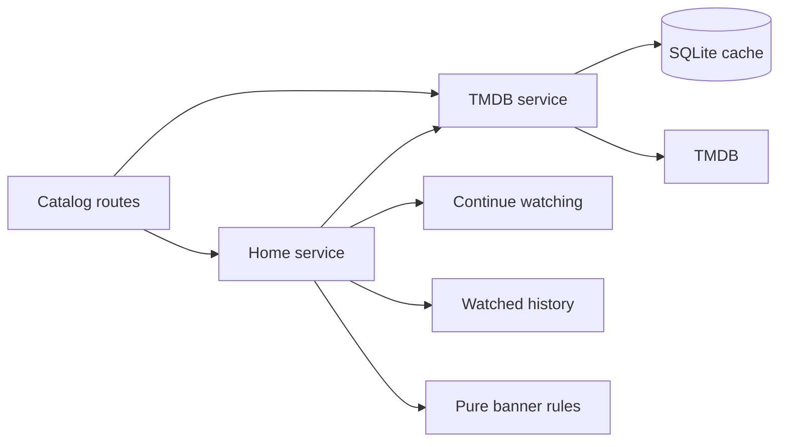

# Catalog

Active contributors: VeroxAUS

## Purpose

Catalog normalizes TMDB metadata and combines it with local progress and pending downloads. `TmdbService` in `apps/server/src/tmdb/service.ts` owns upstream/cache access; `HomeService` in `apps/server/src/home/service.ts` assembles Home rows and featured choices.

## Layout and metadata

`apps/server/src/tmdb/normalize.ts` converts movies, shows, seasons, lists and image configuration into shared shapes. Home requests weekly trending movies/shows and popular movies/shows in parallel. Search collapses whitespace, uses first-page multi-search and excludes adult/person results. Requests use English-US metadata.

Movie/show details append external IDs; IMDb identity bridges to [stream selection](stream-selection.md). Probed media, not catalog metadata, determines actual encoding. Original language feeds automatic subtitle selection.

`apps/server/src/routes/catalog.ts` delegates Home assembly and attaches only pending download tracking to movie/show details. UI presentation belongs to the [web app](../apps/web/index.md), which includes implemented playback rather than a placeholder player.

## Featured selection

`buildFeatured` in `apps/server/src/home/featured.ts` is a pure rule. Slot order is trending movie, because-you-watched recommendation, trending show, popular movie, popular show.

Candidates need a backdrop and nonblank overview; identity is media type plus TMDB ID. Continuing titles are initially excluded. The recommendation slot also excludes the base title and already-watched titles. Backfill tries to reach **three items**, allowing continuing titles only in its second pass; output is capped at **five**. Sparse input can still yield fewer than three.

`apps/server/src/db/history.ts` supplies watched-title identity and the latest qualifying base using credited watched time. `apps/server/src/home/service.ts` starts recommendations alongside metadata and continue watching, with a **1500 ms** recommendation budget. Failure/timeout removes that slot only; it does not cancel the underlying request or cap total Home latency.

## Cache and failures

`TmdbCache` in `apps/server/src/tmdb/cache.ts` stores raw JSON with these TTLs:

| Data | TTL |
| --- | --- |
| Trending/popular lists | 1 hour |
| Movie/show/season details and image configuration | 24 hours |
| Recommendations | 24 hours |
| Search | 10 minutes |

Expired/corrupt rows are deleted on read. Identical concurrent misses share a promise. Search keys use normalized lowercase text. Successful data is cached; failures are not, with no stale fallback.

A token is required even for cached reads. Missing configuration yields 503. Network attempts use a **10-second timeout**, at most **two attempts**, and a **300 ms** retry delay. Network/JSON/429/5xx errors can retry; 400/404/422 mean not found, 401 gives an authentication error (`apps/server/src/tmdb/service.ts`).

## Integration and modification

Change shapes in `apps/server/src/tmdb/normalize.ts`, transport/cache use in `apps/server/src/tmdb/service.ts`, and banner policy separately in `apps/server/src/home/featured.ts`. Coordinate contracts in `packages/shared/src/catalog.ts`. See [progress](viewing-progress.md) and [downloads](downloads.md) for local enrichments rather than duplicating their state logic.

## Key source files

| File | Purpose |
| --- | --- |
| `apps/server/src/tmdb/service.ts` | Metadata transport/sharing |
| `apps/server/src/tmdb/cache.ts` | Persistent cache |
| `apps/server/src/tmdb/normalize.ts` | Stable shapes |
| `apps/server/src/home/service.ts` | Home orchestration |
| `apps/server/src/home/featured.ts` | Featured slots |
| `apps/server/src/routes/catalog.ts` | HTTP adapters |
| `packages/shared/src/catalog.ts` | Wire schemas |

## Measured scope

At `5eefa37`, `git ls-files` counts **5 `.ts` source / 2 matching `*.test.ts` files** across home/tmdb source/test directories: **0.40**. Routes, integration/live tests, DB/shared/web and helpers are excluded. Default-branch history/CODEOWNERS identify **1 unique human author**, excluding bots. No TMDB calls were made.
