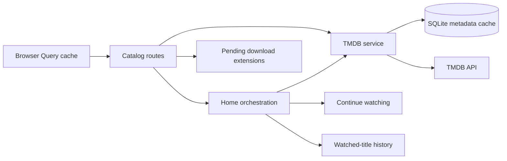

# Catalog

Active contributors: VeroxAUS

## Purpose

The catalog converts TMDB metadata into shared movie, show and episode shapes, then combines it with local viewing/download state. Home includes trending/popular rows, persisted continue watching and a featured banner (`apps/server/src/tmdb/service.ts`, `apps/server/src/home/service.ts`, `apps/server/src/routes/catalog.ts`).

## Metadata and route flow

`TmdbService` in `apps/server/src/tmdb/service.ts` fetches image configuration and normalizes upstream responses through `apps/server/src/tmdb/normalize.ts`. Home requests weekly trending movies/shows and popular movies/shows in parallel. Search uses the first page of multi-search, disables adult results and drops people/non-media results. Requests use `language=en-US`.

Movie/show details append external IDs. A valid IMDb ID bridges into [stream discovery](stream-selection.md); metadata does not expose playable media URLs. Normalization supplies nullable images/dates/runtimes, one-decimal ratings and original language for subtitle defaults. Show summaries omit season zero from watch order; the explicit season route still accepts zero. Episodes are sorted numerically.

Image references use configured secure image hosting with a fallback base, at sizes `w342` for posters, `w1280` for backdrops and `w300` for stills. HomeStream returns these references rather than downloading images locally (`apps/server/src/tmdb/normalize.ts`).

The route layer delegates `/api/home` to `HomeService`. Movie details add `download` only while tracking is pending; show details add pending episode `downloads` only when nonempty (`apps/server/src/routes/catalog.ts`). See [downloads](downloads.md) for their lifecycle.

## Featured banner and recommendations

`HomeService` in `apps/server/src/home/service.ts` reads locally watched titles, starts recommendation work alongside metadata/continue-watching reads, and calls the pure `buildFeatured` rule in `apps/server/src/home/featured.ts`.

Banner slots take the first usable candidate in this order:

1. Trending movie.
2. “Because you watched” recommendation, when available.
3. Trending show.
4. Popular movie.
5. Popular show.

Every chosen item needs a backdrop and nonblank overview, and titles are deduplicated by media type/TMDB ID. Continuing titles are excluded initially. The recommendation slot also excludes the base title and every title with enough watched time. Backfill tries to reach **3 items**, first excluding continuing titles and then permitting them; it never exceeds **5**. Sparse upstream lists can still produce fewer than 3. `logoUrl` is omitted.

The recommendation base is the most recent play by start time with **at least 60 seconds of credited watched time**, not merely a seeked position. TV bases use the show title (`apps/server/src/db/history.ts`). Recommendation failures, not-found results or the default **1500 ms** budget remove only that slot; they do not fail Home. The budget begins alongside the other reads, does not cancel the underlying request and does not cap total Home latency. Other metadata failures can still fail Home.

## Browser integration

`HomePage` in `apps/web/src/pages/HomePage.tsx` renders Continue Watching when nonempty, the featured banner, then the four metadata rows. `homeQuery` in `apps/web/src/api/queries.ts` validates the shared `HomeResponseSchema` from `packages/shared/src/catalog.ts` and uses a 30-second stale time. This browser Query cache is separate from the persistent TMDB cache.

`Banner` in `apps/web/src/components/Banner.tsx` is an implemented carousel. Rotation pauses for hover, keyboard focus, reduced motion and when it is offscreen. `useBannerIntervalMs` in `apps/web/src/lib/bannerInterval.ts` defaults to 9 seconds and accepts the lazily loaded experiment's assignment. Movie Play links target the player route; show actions open details. The player remains a placeholder and does not create sessions (`apps/web/src/pages/PlayerPage.tsx`).

`SearchPage` in `apps/web/src/pages/SearchPage.tsx` debounces trimmed input by 300 ms, skips empty requests and filters Movies/Shows within the returned results, not by additional upstream queries. `MovieDetailsPage` in `apps/web/src/pages/MovieDetailsPage.tsx` reads metadata and progress separately. `ShowDetailsPage` in `apps/web/src/pages/ShowDetailsPage.tsx` reads show metadata, one selected season and the show's bulk progress; it reveals episodes in batches of 100. See [viewing progress](viewing-progress.md) and the [web app](../apps/web/index.md).

## Cache and upstream policy

`TmdbCache` in `apps/server/src/tmdb/cache.ts` stores raw JSON in SQLite:

| Data                                  | TTL        |
| ------------------------------------- | ---------- |
| Trending/popular lists                | 1 hour     |
| Details, seasons, image configuration | 24 hours   |
| Recommendations                       | 24 hours   |
| Search                                | 10 minutes |

Expired/corrupt rows are deleted on read. Search cache keys collapse whitespace and lowercase the query. Identical concurrent misses share a promise; successful responses are cached, failures are not, and there is no stale fallback.

A configured token is required even to serve a cached response. Missing configuration yields 503 `config_missing`. Each network attempt has a **10-second** timeout, with at most **two attempts** and a **300 ms** retry delay. Network/JSON errors and 429/5xx retry; 400/404/422 become not-found, 401 becomes 502 `tmdb_auth_failed`, and other exhausted failures become 502 `tmdb_unavailable` (`apps/server/src/tmdb/service.ts`).

## Modification entry points

Change normalization in `apps/server/src/tmdb/normalize.ts`, transport/cache operations in `apps/server/src/tmdb/service.ts`, Home orchestration in `apps/server/src/home/service.ts`, and slot rules in `apps/server/src/home/featured.ts`. Keep [shared catalog contracts](../packages/shared.md) and [viewing progress](viewing-progress.md) aligned.

## Key source files

| File                                                   | Purpose                                                  |
| ------------------------------------------------------ | -------------------------------------------------------- |
| `apps/server/src/tmdb/service.ts`                      | Upstream metadata, retries and in-flight sharing         |
| `apps/server/src/tmdb/cache.ts`                        | Persistent cache and TTLs                                |
| `apps/server/src/tmdb/normalize.ts`                    | Stable metadata shapes                                   |
| `apps/server/src/home/service.ts`                      | Home and bounded recommendation orchestration            |
| `apps/server/src/home/featured.ts`                     | Pure banner selection                                    |
| `apps/server/src/db/history.ts`                        | Watched-title recommendation bases                       |
| `apps/server/src/routes/catalog.ts`                    | Catalog HTTP adapters and download extensions            |
| `packages/shared/src/catalog.ts`                       | Metadata, featured and Home contracts                    |
| `apps/web/src/pages/HomePage.tsx`                      | Home rows and content-ready integration                  |
| `apps/web/src/components/Banner.tsx`                   | Featured carousel and navigation                         |
| `apps/web/src/pages/SearchPage.tsx`                    | Debounced search and local media-type filters            |
| `apps/web/src/pages/ShowDetailsPage.tsx`               | Season, episode and bulk-progress integration            |
| `apps/server/test/home/featured.test.ts`               | Banner rules                                             |
| `apps/server/test/integration/catalog-routes.test.ts`  | Metadata routes, cache and upstream failures             |
| `apps/server/test/integration/progress-routes.test.ts` | Home with history, recommendations and continue watching |

## Measured scope

At the documented commit, recursively counting `*.ts` in `apps/server/src/tmdb/` plus `apps/server/src/home/` gives **5 source files**. Counting `*.test.ts` in the matching `apps/server/test/tmdb/` and `apps/server/test/home/` directories gives **2 test files**, a **0.40 test-to-code file ratio** (2 / 5). Routes, integration/live tests, fixtures, web and DB/shared files are excluded. Default-branch history has **1 unique human committer**, excluding bots; this is repository context, not an individual productivity metric.
