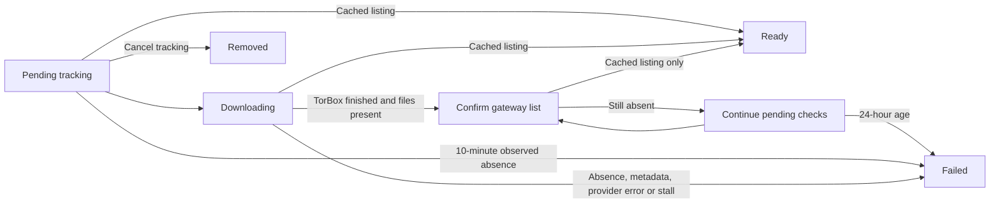

# Downloads

Active contributors: VeroxAUS

## Purpose

Downloads persist tracking of remote TorBox caching, not complete media files downloaded to the PC. `DownloadService` in `apps/server/src/downloads/service.ts` asks the gateway to initiate uncached playback and polls until the title is actually listed as cached.

## Directory layout

| Path                                    | Responsibility                                    |
| --------------------------------------- | ------------------------------------------------- |
| `apps/server/src/downloads/service.ts`  | Start dedupe, polling, confirmation and events    |
| `apps/server/src/downloads/store.ts`    | SQLite tracking rows                              |
| `apps/server/src/downloads/rules.ts`    | Pure timing, hash matching and progress verdicts  |
| `apps/server/src/downloads/messages.ts` | Start/failure wording and placeholder errors      |
| `apps/server/src/downloads/view.ts`     | Public download/event projections and start query |
| `apps/server/src/downloads/torbox.ts`   | Read-only TorBox list transport/normalization     |
| `apps/server/test/downloads/`           | Pure rules/client tests and integration rig       |
| `packages/shared/src/downloads.ts`      | Tracking, details extension and SSE contracts     |

## Start handoff

`SessionStarter` in `apps/server/src/playback/sessionStart.ts` reuses existing automatic tracking before session reservation/metadata work. Otherwise no cached source means one uncached recommendation enters download handling.

`DownloadService.begin` in `apps/server/src/downloads/service.ts` deduplicates concurrent starts by media key. It resolves the stream and calls the [gateway probe](../systems/gateway.md), following/checking redirects and implausible body sizes. A playable result carries its resolved target internally to the proxy and creates no tracking row.

| Probe result     | Outcome                                                         |
| ---------------- | --------------------------------------------------------------- |
| downloading clip | Persist detailed state `downloading`; **202** download response |
| probe timeout    | Persist detailed state `pending`; the add is unconfirmed        |
| playable media   | Continue normal session creation                                |
| slots-full clip  | 409                                                             |
| rate limit       | 429                                                             |
| other failure    | 502                                                             |

202 contains no session or playlist. Its outer `status: "downloading"` is the handoff discriminator, not proof of a remote start. The row's `status: "pending"` covers both detailed states: `pending` means no confirmation yet; `downloading` means the gateway downloading clip or a TorBox listing confirmed the item (`packages/shared/src/downloads.ts`). A listed item changes the detailed state even with zero progress; progress SSE still requires actual progress movement (`apps/server/src/downloads/service.ts`).

`startedMessage` in `apps/server/src/downloads/messages.ts` says a timed-out request was sent but did not confirm, rather than claiming acceptance. Clients show “Waiting for TorBox” for the unconfirmed state, without fabricated progress. Ready tracking does not automatically start video; the client must Play again. Tracking persists no media URL (`apps/server/src/downloads/store.ts`).

`TorboxClient` in `apps/server/src/downloads/torbox.ts` is a read-only list client. The gateway initiates the remote add; HomeStream does not upload media or manage remote job deletion.

## Persistent lifecycle and ready rule

**A cached gateway stream is required for ready.** TorBox completion alone sets progress to one and begins confirmation, not ready (`apps/server/src/downloads/service.ts`). Confirmation retries every **two minutes** initially. After **ten minutes** it slows to the **five-minute** gateway cadence; it does not trust completion and mark ready on timeout. The overall **24-hour** give-up still applies.

One TorBox list serves due hash-trackable rows, matching primary or alternative hashes. Missing API key/hash or auth refusal uses five-minute gateway checks, without applying the absence rule. A successful list missing the item uses the normal poll cadence and throttles gateway rechecks to five minutes. Cancellation is rechecked after asynchronous list work (`apps/server/src/downloads/service.ts`).

### Absence and metadata windows

Migration **5** in `apps/server/src/db/migrations.ts` adds nullable integer `absent_since` and `metadata_since` columns. `DownloadStore` in `apps/server/src/downloads/store.ts` maps them to persistent `absentSince` and `metadataSince`; neither timer is exposed in the public download projection.

| Observation                                          | Timer and outcome                                                                                                                                  |
| ---------------------------------------------------- | -------------------------------------------------------------------------------------------------------------------------------------------------- |
| Successful TorBox list missing the hash              | Start absence at the **first missed poll**, not the add time. Fail as `vanished` on a missing-item poll at **≥10 minutes** since that observation. |
| Item reappears                                       | Clear absence; a later disappearance starts a new window.                                                                                          |
| Exact case-insensitive `metaDL` state                | Start metadata timing on the first such poll; fail as `metadata_stuck` at **≥30 minutes** without progress.                                        |
| Progress rises by more than `1e-6` while in `metaDL` | Restart the metadata timer at this poll. Progress is compared with the stored, nondecreasing value.                                                |
| Item leaves `metaDL` or is missing                   | Clear metadata timing; returning to `metaDL` starts again.                                                                                         |
| Finished **and** present                             | Clear both timers and enter cached-list confirmation.                                                                                              |
| Transient list/network error                         | Back off; do not start, advance by observation, or clear either timer.                                                                             |

`trackAbsence` and `trackMetadata` in `apps/server/src/downloads/rules.ts` compute the boundaries; `pollMissing` and `pollListed` in `apps/server/src/downloads/service.ts` apply them. Timers retain their timestamps through restart and outages: errors are not missing-item observations, but they do not pause elapsed wall time for a previously started timer. Evaluation waits for a later usable observation, so failure need not occur exactly at the deadline.

On a missing-item poll, the gateway check happens **before** absence failure. If that permitted check finds a cached stream, ready wins even when the absence deadline has arrived. Once TorBox completion enters confirmation, the absence/metadata checks no longer apply; the overall 24-hour limit still does. A listing error alone cannot fail a row as vanished. Authentication refusal instead takes the gateway-only branch (`apps/server/src/downloads/service.ts`).

`apps/server/src/downloads/rules.ts` defines one-minute polls for the first hour, five minutes afterwards; transient backoff doubles up to ten minutes. Failed TorBox states terminate tracking. Stalled/no-progress state terminates after six hours. Progress is nondecreasing and events emit on movement at most once per minute.

`DownloadStore` in `apps/server/src/downloads/store.ts` persists identity, scheduling, progress and notification data. A unique pending-media-key index prevents duplicate active tracking (`apps/server/src/db/migrations.ts`). Startup resumes pending tracking and prunes finished rows last updated more than **30 days** ago; polling is not an in-memory-only queue.

## API and events

`apps/server/src/routes/downloads.ts` lists retained rows and deletes local tracking. **Cancel does not cancel the remote TorBox job.** Movie/show details expose pending entries through `apps/server/src/routes/catalog.ts`.

Events are `download.started`, `download.progress`, `download.ready` and `download.failed`. Ready rows completed without SSE listeners keep an unnotified marker for later replay; this is not a durable per-client acknowledgement system (`apps/server/src/downloads/service.ts`, `apps/server/src/routes/events.ts`).

The five failure reasons are `torbox_error`, `stalled`, `timeout`, `vanished` and `metadata_stuck` (`packages/shared/src/downloads.ts`). Failure writes terminal state/status once, clears ETA and stops further polling; a subsequent Play may create new tracking. `FAILURE_MESSAGES` in `apps/server/src/downloads/messages.ts` supplies both the operational log text and failed-event message, including “Try Play again” guidance for absence/metadata failures. `toDownload` and `eventBase` in `apps/server/src/downloads/view.ts` keep public projections separate from persistence and omit internal hashes, query keys and timer columns.

The [web player](../apps/web/player.md) consumes the 201/202 distinction, while [details/screens](../apps/web/screens.md) show pending state. Dashboard tabs are placeholders, not a completed queue UI. Source warm-up via [prefetch](prefetch.md) and the [local byte cache](../systems/source-proxy.md) are not remote TorBox caching. See [API](../api/index.md) and [data models](../reference/data-models.md) for transport/table inventories.

## Modification entry points

Change pure timing/verdicts in `apps/server/src/downloads/rules.ts`, orchestration in `apps/server/src/downloads/service.ts`, persistence in `apps/server/src/downloads/store.ts` and list transport in `apps/server/src/downloads/torbox.ts`. Preserve cached-only ready, title-key deduplication and cancellation boundaries.

`apps/server/test/downloads/rules.test.ts` and `apps/server/test/downloads/torbox.test.ts` cover pure verdicts and fake HTTP responses. `apps/server/test/integration/downloads.test.ts` covers 202/reuse, restart persistence, cancellation, polling, cached-only readiness and SSE replay; `apps/server/test/integration/downloads-playable.test.ts` verifies the already-playable target is reused instead of requesting the gateway link twice.

`apps/server/test/integration/downloads-vanished.test.ts` covers never-listed and removed items, absence recovery/restart, outages without fabricated absence, gateway-ready precedence, metadata resets on progress/state change/disappearance, terminal silence and Play retry. It also distinguishes timed-out `pending` from accepted `downloading` starts and checks URL/token-free wording. Exact 10/30-minute boundaries and exact case-insensitive `metaDL` matching are asserted in `apps/server/test/downloads/rules.test.ts`. These tests were read, not run.

## Key source files

| File                                       | Purpose                                   |
| ------------------------------------------ | ----------------------------------------- |
| `apps/server/src/downloads/service.ts`     | Handoff, polling and confirmation         |
| `apps/server/src/downloads/rules.ts`       | Pure timing/verdicts                      |
| `apps/server/src/downloads/store.ts`       | Persistent tracking                       |
| `apps/server/src/db/migrations.ts`         | Migration 5 persistent observation timers |
| `apps/server/src/downloads/messages.ts`    | Shared start/failure text and errors      |
| `apps/server/src/downloads/view.ts`        | Wire projections and event identity       |
| `apps/server/src/downloads/torbox.ts`      | Read-only provider list                   |
| `apps/server/src/gateway/playbackProbe.ts` | Placeholder-safe probe                    |
| `apps/server/src/routes/downloads.ts`      | Local tracking API                        |
| `packages/shared/src/downloads.ts`         | Wire states and events                    |

## Measured scope

Snapshot dated **2026-11-15**, revision `3c31c453d49a737e9d51ba39c6bd41bfc4dbd092`: **6 source files / 2 test files**, test/source file ratio **0.33**, **1 unique recent human contributor**. Method: committed-tree `.ts` files under `apps/server/src/downloads/` and `*.test.ts` under `apps/server/test/downloads/`. Exclude helpers, integration tests, routes, DB/shared/web. Human identity comes from scoped `origin/main` history excluding bots. Ratios are not coverage; no tests or TorBox/gateway requests were run.
