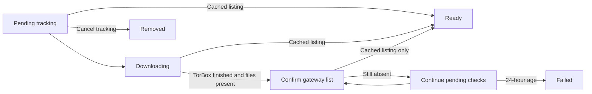

# Downloads

Active contributors: VeroxAUS

## Purpose

Downloads persist tracking of remote TorBox caching, not complete media files downloaded to the PC. `DownloadService` in `apps/server/src/downloads/service.ts` asks the gateway to initiate uncached playback and polls until the title is actually listed as cached.

## Directory layout

| Path                                   | Responsibility                                   |
| -------------------------------------- | ------------------------------------------------ |
| `apps/server/src/downloads/service.ts` | Start dedupe, polling, confirmation and events   |
| `apps/server/src/downloads/store.ts`   | SQLite tracking rows                             |
| `apps/server/src/downloads/rules.ts`   | Pure timing, hash matching and progress verdicts |
| `apps/server/src/downloads/torbox.ts`  | Read-only TorBox list transport/normalization    |
| `apps/server/test/downloads/`          | Pure rules/client tests and integration rig      |
| `packages/shared/src/downloads.ts`     | Tracking, details extension and SSE contracts    |

## Start handoff

`SessionStarter` in `apps/server/src/playback/sessionStart.ts` reuses existing automatic tracking before session reservation/metadata work. Otherwise no cached source means one uncached recommendation enters download handling.

`DownloadService.begin` in `apps/server/src/downloads/service.ts` deduplicates concurrent starts by media key. It resolves the stream and calls the [gateway probe](../systems/gateway.md), following/checking redirects and implausible body sizes. A playable result carries its resolved target internally to the proxy and creates no tracking row.

| Probe result      | Outcome                                           |
| ----------------- | ------------------------------------------------- |
| downloading clip  | Persist tracking; **202** download response       |
| first-hop timeout | Assume the add may have started; persist tracking |
| playable media    | Continue normal session creation                  |
| slots-full clip   | 409                                               |
| rate limit        | 429                                               |
| other failure     | 502                                               |

202 contains no session or playlist. Ready tracking does not automatically start video; the client must Play again. Tracking persists no media URL (`apps/server/src/downloads/store.ts`).

`TorboxClient` in `apps/server/src/downloads/torbox.ts` is a read-only list client. The gateway initiates the remote add; HomeStream does not upload media or manage remote job deletion.

## Persistent lifecycle and ready rule

**A cached gateway stream is required for ready.** TorBox completion alone sets progress to one and begins confirmation, not ready (`apps/server/src/downloads/service.ts`). Confirmation retries every **two minutes** initially. After **ten minutes** it slows to the **five-minute** gateway cadence; it does not trust completion and mark ready on timeout. The overall **24-hour** give-up still applies.

One TorBox list serves due hash-trackable rows, matching primary or alternative hashes. Missing API key/hash, auth refusal or absent items fall back to fresh gateway checks. Cancellation is rechecked after asynchronous list work.

`apps/server/src/downloads/rules.ts` defines one-minute polls for the first hour, five minutes afterwards; transient backoff doubles up to ten minutes. Failed TorBox states terminate tracking. Stalled/no-progress state terminates after six hours. Progress is nondecreasing and events emit on movement at most once per minute.

`DownloadStore` in `apps/server/src/downloads/store.ts` persists identity, scheduling, progress and notification data. A unique pending-media-key index prevents duplicate active tracking (`apps/server/src/db/migrations.ts`). Startup resumes pending tracking and prunes finished rows last updated more than **30 days** ago; polling is not an in-memory-only queue.

## API and events

`apps/server/src/routes/downloads.ts` lists retained rows and deletes local tracking. **Cancel does not cancel the remote TorBox job.** Movie/show details expose pending entries through `apps/server/src/routes/catalog.ts`.

Events are `download.started`, `download.progress`, `download.ready` and `download.failed`. Ready rows completed without SSE listeners keep an unnotified marker for later replay; this is not a durable per-client acknowledgement system (`apps/server/src/downloads/service.ts`, `apps/server/src/routes/events.ts`).

The [web player](../apps/web/player.md) consumes the 201/202 distinction, while [details/screens](../apps/web/screens.md) show pending state. Dashboard tabs are placeholders, not a completed queue UI. Source warm-up via [prefetch](prefetch.md) and the [local byte cache](../systems/source-proxy.md) are not remote TorBox caching. See [API](../api/index.md) and [data models](../reference/data-models.md) for transport/table inventories.

## Modification entry points

Change pure timing/verdicts in `apps/server/src/downloads/rules.ts`, orchestration in `apps/server/src/downloads/service.ts`, persistence in `apps/server/src/downloads/store.ts` and list transport in `apps/server/src/downloads/torbox.ts`. Preserve cached-only ready, title-key deduplication and cancellation boundaries.

`apps/server/test/downloads/rules.test.ts` and `apps/server/test/downloads/torbox.test.ts` cover pure verdicts and fake HTTP responses. `apps/server/test/integration/downloads.test.ts` covers 202/reuse, restart persistence, cancellation, polling, cached-only readiness and SSE replay; `apps/server/test/integration/downloads-playable.test.ts` verifies the already-playable target is reused instead of requesting the gateway link twice.

## Key source files

| File                                       | Purpose                           |
| ------------------------------------------ | --------------------------------- |
| `apps/server/src/downloads/service.ts`     | Handoff, polling and confirmation |
| `apps/server/src/downloads/rules.ts`       | Pure timing/verdicts              |
| `apps/server/src/downloads/store.ts`       | Persistent tracking               |
| `apps/server/src/downloads/torbox.ts`      | Read-only provider list           |
| `apps/server/src/gateway/playbackProbe.ts` | Placeholder-safe probe            |
| `apps/server/src/routes/downloads.ts`      | Local tracking API                |
| `packages/shared/src/downloads.ts`         | Wire states and events            |

## Measured scope

At `0a8f04f`: **4 source files / 2 test files**, test/source file ratio **0.50**, **1 unique human contributor**. Method: `git ls-tree -r --name-only 0a8f04fd81cfaa7ca5d1689550ad207e7fc0d3ae`, counting `.ts` under `apps/server/src/downloads/` and `*.test.ts` under `apps/server/test/downloads/`. Exclude helpers, integration tests, routes, DB/shared/web. Human count uses scoped `origin/main` author history excluding bots, consistent with `.github/CODEOWNERS`. Ratios are not coverage; no tests or TorBox/gateway requests were run.
