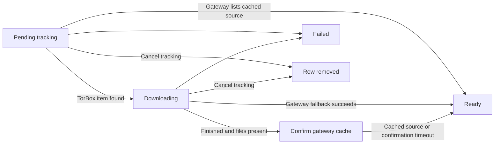

# Downloads

Active contributors: VeroxAUS

## Purpose

Downloads persistently track titles that TorBox must cache before playback. They are upstream jobs, not whole media files downloaded to the PC; HomeStream's TorBox client is read-only and the gateway initiates the remote add (`apps/server/src/downloads/service.ts`, `apps/server/src/downloads/torbox.ts`).

## Play: 201 versus 202

`apps/server/src/playback/manager.ts` first reuses an existing pending download for `streamId: "auto"`, before reserving a session slot or calling TMDB/gateway. Otherwise automatic selection considers cached sources first. With none cached, it asks `DownloadService.begin` to inspect the best uncached candidate that fits the device.

`GatewayClient.probePlayback` in `apps/server/src/gateway/client.ts` makes one range GET through the shared gateway limiter, with redirects disabled and a **60-second** timeout after dispatch. It cancels the response body and never requests the placeholder redirect target.

| Probe result                      | Outcome                                                                      |
| --------------------------------- | ---------------------------------------------------------------------------- |
| `downloading` placeholder         | Persist tracking and return **202** `{status: "downloading", download}`      |
| Timeout                           | Assume the gateway may have started the add; persist tracking and return 202 |
| Playable redirect or HTTP 200/206 | Do not create tracking; proceed with ordinary playback                       |
| Slots-full placeholder            | 409 `torbox_slots_full`                                                      |
| HTTP/placeholder rate limit       | 429 `gateway_rate_limited`                                                   |
| Other failure/placeholder         | 502 `download_failed`                                                        |

The final **201** response means a playback session was created; **202** has no session or playlist (`apps/server/src/routes/sessions.ts`). Tracking does not automatically start a session when ready. The client must Play again.

Concurrent `begin` calls share work by media key, and SQLite permits only one pending tracking row per title/episode (`apps/server/src/downloads/service.ts`, `apps/server/src/db/migrations.ts`). Repeat Play reuses the row without a second upstream add.

## Persistent lifecycle

`DownloadStore` in `apps/server/src/downloads/store.ts` writes `pending_downloads`: media identity, gateway query key, optional info hash, status/state, progress, scheduling and notification timestamps. It stores no playback URL. Startup prunes ready/failed rows older than **30 days** and resumes pending rows; that retention cleanup occurs at startup, not continuously.

The stored status is `pending`, `ready` or `failed`. Pending status includes both public states `pending` and `downloading`; TorBox completion can enter an internal confirmation phase before public ready.

`apps/server/src/downloads/service.ts` uses one TorBox list request for due hash-trackable rows, then matches primary/alternative hashes. Gateway-only checks cover missing API keys, missing hashes, refused TorBox credentials or items absent from the list.

| Default policy                      | Value                                                                           |
| ----------------------------------- | ------------------------------------------------------------------------------- |
| TorBox poll interval                | 1 minute for first hour; 5 minutes afterwards                                   |
| Gateway fallback check              | Every 5 minutes through fresh lookup/shared limiter                             |
| TorBox list timeout                 | 30 seconds                                                                      |
| Consecutive transient-error backoff | Doubled interval, capped at 10 minutes                                          |
| No result                           | Fail after 24 hours                                                             |
| Stalled state without progress      | Fail after 6 hours                                                              |
| Post-finish confirmation            | Recheck every 2 minutes; mark ready after 10 minutes even if cache listing lags |

Policies are in `apps/server/src/downloads/rules.ts`; gateway fallback orchestration is in `apps/server/src/downloads/service.ts`. TorBox ready requires both finished and files present. A gateway cached result can mark a title ready even without TorBox tracking. Confirmation eventually trusts TorBox completion so another Play can open the link despite stale cache metadata.

Progress is a nondecreasing fraction, and SSE progress emits only on movement, at most once per minute. Failures distinguish `torbox_error`, `stalled` and `timeout`. Transient TorBox outages retry; warning events are throttled to ten-minute intervals.

## API, events and cancellation

`GET /api/downloads` lists all retained tracking rows, newest first. Movie/show details include only pending entries. `DELETE /api/downloads/:id` deletes tracking and returns `state: cancelled`; **it does not cancel, delete or control the remote TorBox job**. Unknown IDs return 404 (`apps/server/src/routes/downloads.ts`, `apps/server/src/routes/catalog.ts`).

The service emits `download.started`, `download.progress`, `download.ready` and `download.failed`. Ready rows finished while no SSE client was connected remain unnotified and replay when a client connects. This is not per-client acknowledgement or durable replay of all event types (`apps/server/src/downloads/service.ts`, `apps/server/src/routes/events.ts`).

There is no retry-download endpoint. While pending, another automatic Play reuses tracking. After failure or local cancellation, another Play can attempt the gateway add again; transient list failures instead retry within the existing poller (`apps/server/src/downloads/service.ts`, `apps/server/src/playback/manager.ts`, `apps/server/src/routes/downloads.ts`).

## Browser badges and event updates

`startServerEventsWhenIdle` in `apps/web/src/events/serverEvents.ts` opens one shared `/api/events` connection after content is shown and the browser is idle. `download.progress` updates a small external progress store in `apps/web/src/events/downloadProgress.ts`. Ready/failed events clear that entry and invalidate only the affected movie/show query. A reconnect after an error invalidates Query snapshots. The current listener does not handle `download.started` or implement a complete download queue screen.

`usePendingDownload` in `apps/web/src/events/usePendingDownload.ts` requires a pending download in the details response, then overlays live progress when available. Unknown initial progress stays indeterminate. `DownloadBadge` in `apps/web/src/components/DownloadBadge.tsx` replaces the Play control with a noninteractive status and optional percentage; `PlayActions` in `apps/web/src/components/PlayActions.tsx` gives that status precedence over resume actions. Movie and episode details consume these states (`apps/web/src/pages/MovieDetailsPage.tsx`, `apps/web/src/pages/ShowDetailsPage.tsx`).

This is display integration, not browser playback. `apps/web/src/pages/PlayerPage.tsx` remains a placeholder, so those Play links do not yet initiate the server's 202 flow. TorBox remote caching is also distinct from [prefetch](prefetch.md) and the bounded byte caches in the [source proxy](../systems/source-proxy.md).

## Modification entry points

Change pure thresholds/verdicts in `apps/server/src/downloads/rules.ts`, polling/start orchestration in `apps/server/src/downloads/service.ts`, persistence in `apps/server/src/downloads/store.ts`, and read-only TorBox parsing in `apps/server/src/downloads/torbox.ts`. Preserve deduplication and the cancellation boundary. See [stream selection](stream-selection.md), [gateway](../systems/gateway.md), [API](../api/index.md) and [data models](../reference/data-models.md).

## Key source files

| File                                             | Purpose                                                  |
| ------------------------------------------------ | -------------------------------------------------------- |
| `apps/server/src/downloads/service.ts`           | Starts/reuses tracking, polls, confirms and emits events |
| `apps/server/src/downloads/rules.ts`             | Intervals, completion/stall rules and event throttle     |
| `apps/server/src/downloads/store.ts`             | Persistent tracking rows                                 |
| `apps/server/src/downloads/torbox.ts`            | Read-only list transport and normalization               |
| `apps/server/src/gateway/client.ts`              | Single-response playback probe                           |
| `apps/server/src/routes/downloads.ts`            | Listing and local cancellation                           |
| `packages/shared/src/downloads.ts`               | Download states, 202 and event contracts                 |
| `apps/server/src/routes/events.ts`               | SSE connections and deferred ready notification replay   |
| `apps/web/src/events/serverEvents.ts`            | Deferred SSE and targeted Query invalidation             |
| `apps/web/src/events/usePendingDownload.ts`      | Pending metadata plus live progress                      |
| `apps/web/src/components/DownloadBadge.tsx`      | Noninteractive caching status                            |
| `apps/server/test/downloads/rules.test.ts`       | Pure lifecycle policy                                    |
| `apps/server/test/downloads/torbox.test.ts`      | Transport/parsing                                        |
| `apps/server/test/integration/downloads.test.ts` | Deduplication, restart, polling, events and cancellation |

## Measured scope

At the documented commit, recursively counting `*.ts` in `apps/server/src/downloads/` gives **4 source files**; counting `*.test.ts` in `apps/server/test/downloads/` gives **2 test files**, a **0.50 test-to-code file ratio** (2 / 4). Integration tests, routes, DB/shared/web helpers and fixtures are excluded. Default-branch history has **1 unique human committer**, excluding bots, without individual productivity metrics. No real TorBox calls were made for this documentation.
