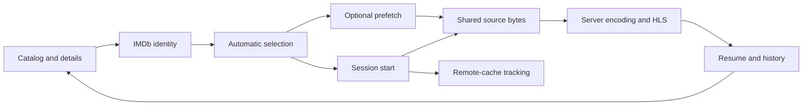

# Features

Active contributors: VeroxAUS

## Purpose

These pages follow title workflows across server services and clients. Catalog browsing, cast/similar-title details, resume state and download notices feed playback, while the server owns upstream credentials and media processing (`apps/server/src/app.ts`, `apps/web/src/pages/PlayerPage.tsx`).

## Capability layout

| Feature                                  | Main abstraction and implementation                                           |
| ---------------------------------------- | ----------------------------------------------------------------------------- |
| [Catalog](catalog.md)                    | TMDB metadata and Home assembly; `apps/server/src/home/service.ts`            |
| [Stream selection](stream-selection.md)  | Parsed/ranked candidates; `apps/server/src/streams/service.ts`                |
| [Prefetch](prefetch.md)                  | Cached-source warming without encoders; `apps/server/src/prefetch/service.ts` |
| [Downloads](downloads.md)                | Persistent remote-cache tracking; `apps/server/src/downloads/service.ts`      |
| [Viewing progress](viewing-progress.md)  | Resume, continue watching and up next; `apps/server/src/progress/service.ts`  |
| [Playback](../systems/playback/index.md) | Device-compatible HLS and subtitles; `apps/server/src/playback/manager.ts`    |

## Main flow

TMDB supplies the IMDb identity for gateway discovery. Selection ranks cached candidates by device tier. Prefetch may warm the recommendation; automatic session start returns a playable session or a 202 tracking response for remote caching. Player pings persist resume/history data used by Home (`apps/server/src/tmdb/service.ts`, `apps/server/src/streams/rank.ts`, `apps/server/src/playback/sessionStart.ts`, `apps/server/src/playback/manager.ts`).

Clients send `streamId: "auto"`; the PC always re-encodes video. Devices describe identity/capabilities, not accounts. See the [HLS client](../apps/web/player.md), [desktop shell](../apps/desktop/index.md) and [playback pipeline](../systems/playback/index.md) for those boundaries.

The [screens](../apps/web/screens.md) implement search, title details, browser-local spoiler protection and Settings/About. Dashboard tabs alone remain placeholders through `apps/web/src/pages/dashboard/DashboardPlaceholder.tsx`; TV remains planned.

Remote TorBox caching, [local proxy byte caching](../systems/source-proxy.md) and progressive subtitle extraction are different workflows. A ready remote download requires a cached gateway listing; a successful prefetch is not a reserved session.

## Integration and modification

Change pure policies in the owning domain, orchestration in its service, routes under `apps/server/src/routes/`, and wire shapes in [shared contracts](../packages/shared.md). Follow [conventions](../how-to-contribute/patterns-and-conventions.md) and the [API contract](../api/index.md) rather than embedding domain rules in a handler. Operational history/statistics are local data, distinct from optional [telemetry](../systems/telemetry.md).

## Key source files

| File                                       | Purpose               |
| ------------------------------------------ | --------------------- |
| `apps/server/src/home/service.ts`          | Home aggregation      |
| `apps/server/src/streams/rank.ts`          | Selection             |
| `apps/server/src/prefetch/service.ts`      | Warming               |
| `apps/server/src/downloads/service.ts`     | Remote-cache tracking |
| `apps/server/src/progress/service.ts`      | Continue watching     |
| `apps/server/src/playback/sessionStart.ts` | Play handoff          |

## Measured scope

At `0a8f04f`, the six feature domains contain **18 production `.ts` files / 11 `*.test.ts` files**, test/source file ratio **0.61**, and **1 unique human contributor**.

| Scope                  | Source files | Test files | Test/source |
| ---------------------- | -----------: | ---------: | ----------: |
| Catalog: Home and TMDB |            5 |          2 |        0.40 |
| Streams                |            4 |          3 |        0.75 |
| Prefetch               |            1 |          1 |        1.00 |
| Downloads              |            4 |          2 |        0.50 |
| Progress               |            4 |          3 |        0.75 |

Method: count paths from `git ls-tree -r --name-only 0a8f04fd81cfaa7ca5d1689550ad207e7fc0d3ae` beneath `apps/server/src/home/`, `apps/server/src/tmdb/`, `apps/server/src/streams/`, `apps/server/src/prefetch/`, `apps/server/src/downloads/` and `apps/server/src/progress/`, with matching directories under `apps/server/test/`. Include production `.ts` files and only `*.test.ts` tests; exclude helpers, routes, playback, DB/shared/web and integration/GPU/live tests elsewhere. Contributor count uses scoped `origin/main` author history, excludes bots and agrees with `.github/CODEOWNERS`. Ratios are file counts, not coverage; no application tests were run for this refresh.
