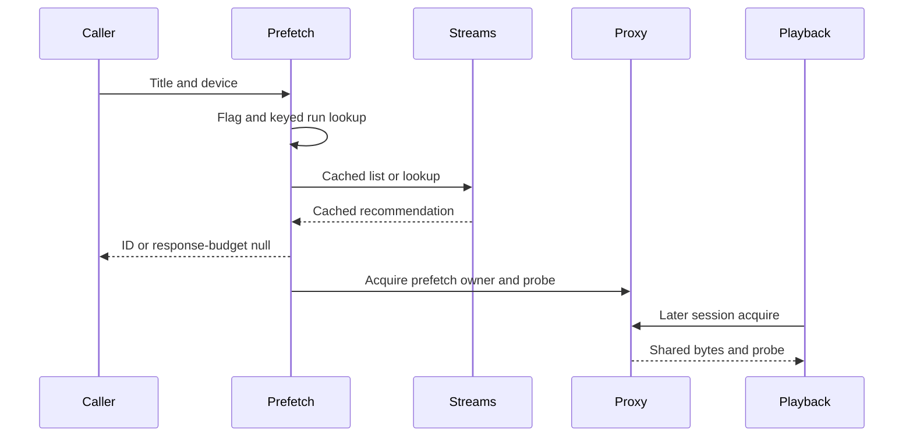

# Prefetch

Active contributors: VeroxAUS

## Purpose

Prefetch warms the cached source that automatic Play would recommend without creating a session, encoder or HLS files. `PrefetchService` in `apps/server/src/prefetch/service.ts` shares discovery/warming by media identity and display tier.

## Request and duplicate control

`apps/server/src/routes/prefetch.ts` validates title/episode plus device and returns **202** with nullable stream ID. Device upsert happens before the `prefetch-on-details` flag gate; missing telemetry or flag-read errors preserve the enabled default (`apps/server/src/prefetch/service.ts`).

The run map is keyed by **media key plus device resolution tier**, not only the most recent request. Interleaved A, B, A requests therefore rejoin A while it is running or successfully finished within **60 seconds**, even after B intervened.

A completed run is discarded when older than the merge window, unsuccessful, or when its source is no longer live in the proxy. That liveness check matters because proxy retention can evict a successfully warmed source before the service merge timer expires. Failed/skipped runs remain retryable.

The response waits up to **300 ms** for stream-ID selection, then returns null while background work continues. This budget starts after flag/device work and does not mean all warming completes within 300 ms. An ID is announced before source acquisition/probing, so it is not a readiness guarantee.

## Warm-up control flow

`apps/server/src/prefetch/service.ts` resolves TMDB to IMDb, reads a fresh cached list when possible, otherwise discovers, and skips missing IDs/candidates or uncached recommendations. Prefetch does not initiate TorBox caching or try playback fallback candidates.

`apps/server/src/sourceproxy/proxy.ts` keeps a successful prefetch owner; failed probe releases it. Remote warming loads up to **16 MiB head / 8 MiB tail**, with acquisition returning once size is known. Successful/in-flight probes and retained bytes can be reused by later Play.

## Independent retention and integration

Service deduplication is distinct from proxy retention: default proxy policy keeps at most **three prefetch-only sources**, ten-minute idle TTL, swept every 30 seconds (`apps/server/src/sourceproxy/proxy.ts`). Session owners protect active use. Warming shares aggregate [network](../systems/network.md) limits and lower priority than urgent playback.

Later clients still use automatic Play and rerun selection. Prefetch reserves no GPU place or stream choice. It runs ffprobe, not subtitle extraction. [Downloads](downloads.md) is a separate persistent workflow for uncached upstream titles.

Background failures become scrubbed warning events; prerequisite skips become informational events. Early validation/device/database errors can still fail the request. The service exposes an idle helper for tests, but the close hook does not explicitly await it (`apps/server/src/app.ts`).

## Modification entry points

Change run-key/merge/liveness/budget rules in `apps/server/src/prefetch/service.ts`; change bytes/TTL in the [proxy](../systems/source-proxy.md). Preserve [selection](stream-selection.md) consistency and do not equate a returned ID with ready video.

## Key source files

| File | Purpose |
| --- | --- |
| `apps/server/src/prefetch/service.ts` | Keyed runs and warm-up |
| `apps/server/src/routes/prefetch.ts` | 202 adapter |
| `apps/server/src/streams/rank.ts` | Shared device tier |
| `apps/server/src/sourceproxy/proxy.ts` | Source/probe retention |
| `packages/shared/src/playback.ts` | Request/response contract |

## Measured scope

At `5eefa37`, scoped `git ls-files` counts **1 source `.ts` / 1 matching `*.test.ts` file**, ratio **1.00**, under prefetch source/test directories. Encode-tier prefetch tests, integrations and proxy helpers are excluded. Default-branch history/CODEOWNERS identify **1 unique human author**, excluding bots. Tests were inspected, not executed.
