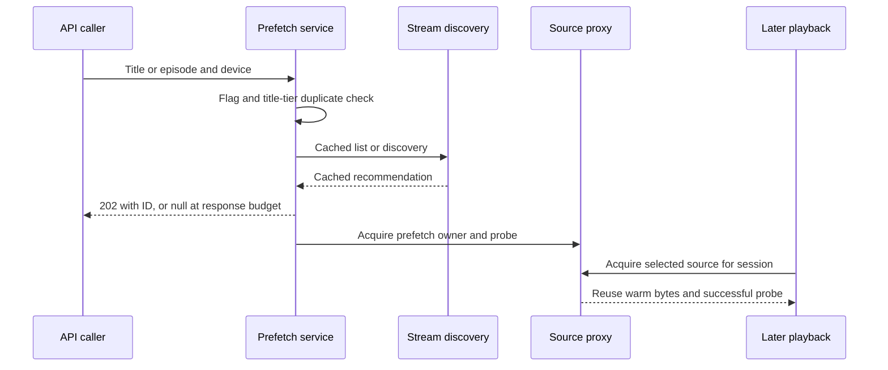

# Prefetch

Active contributors: VeroxAUS

Prefetch warms the cached source an automatic Play would choose, sharing resolved links, initial bytes and probe results. It creates no playback session, encoder or HLS output (`apps/server/src/prefetch/service.ts`).

## Request and flag flow

`POST /api/prefetch` validates a title/episode and full device profile, then returns HTTP **202** with a nullable stream ID (`apps/server/src/routes/prefetch.ts`, `packages/shared/src/playback.ts`).

`PrefetchService.request` in `apps/server/src/prefetch/service.ts` first upserts the device and evaluates `prefetch-on-details`. The local default is **true**; missing telemetry or a flag-read failure leaves warming enabled. When false, the service records a skip and returns `{streamId: null}` without discovery/warming. Device registration still happens. Optional `prefetch_requested` analytics records the evaluated gate, not a raw URL (`packages/shared/src/flags.ts`, `packages/shared/src/analytics.ts`).

Enabled runs are keyed by media key plus display-resolution tier. Devices in the same tier share an active run or a successful run completed within **60 seconds**. Failed/skipped runs are removed so they can retry.

## Selection and warming

The background flow resolves TMDB details to IMDb, reads a fresh gateway cache if possible, otherwise discovers streams, and chooses the shared recommendation. Missing identity/recommendation, an uncached recommendation or a vanished stream stops warming (`apps/server/src/prefetch/service.ts`). Prefetch does not initiate TorBox download tracking or attempt playback fallback.

The chosen ID is announced before server-side ID resolution and proxy acquisition. The response waits at most **300 ms** for that announcement by default, then returns null while background work continues. This budget begins after device/flag work and is not a total request or warming deadline. Even a non-null ID does not guarantee the source still exists or that warming succeeded.

The reply budget can expire before discovery returns; the diagram shows logical dependencies, not a guarantee that a response waits for the recommendation. The later session still sends `streamId: "auto"`, reruns selection and validates the source. A retained prefetch is an optimization, not a reservation or a playback-ready state.

`apps/server/src/sourceproxy/proxy.ts` acquires the raw URL under prefetch ownership. A new remote source starts head/tail warming, up to **16 MiB head** and **8 MiB tail**, then shares a probe promise (`apps/server/src/sourceproxy/sourceEntry.ts`). Acquisition can finish once size is known, while bytes continue arriving. Read priority and bandwidth limits are shared with active playback; see [network controls](../systems/network.md).

## The separate caches

| Layer                    | Scope and lifetime                                                                                          |
| ------------------------ | ----------------------------------------------------------------------------------------------------------- |
| Service duplicate map    | Same title/tier; active runs or successful completion within 60 seconds                                     |
| Gateway list cache       | Persistent lookup metadata; [gateway policy](../systems/gateway.md)                                         |
| Proxy source/probe       | Shared by raw gateway URL with later playback                                                               |
| Proxy prefetch ownership | At most **3 prefetch-only sources** by default; oldest evicted, **10-minute idle TTL**, **30-second sweep** |

The proxy limits are defined in `apps/server/src/sourceproxy/proxy.ts`, not by the service merge window. Session ownership prevents prefetch eviction from removing an actively used source. A successful warm keeps its prefetch ownership; failed probing releases its handle. Later Play can reuse the source/probe but is free to select a different stream.

## Failure and modification

Background failures become redacted warning events; missing prerequisites become informational skips. Validation/device/database failures before the background run can still fail the request. Event-recording errors are logged without failing warming. `idle()` waits for runs in tests, but app shutdown does not explicitly await it (`apps/server/src/prefetch/service.ts`, `apps/server/src/app.ts`).

Change scheduling/budget/merge policy in `apps/server/src/prefetch/service.ts`; change byte retention in the [source proxy](../systems/source-proxy.md). Preserve [stream selection](stream-selection.md) consistency and non-blocking behavior.

This source warming is separate from progressive subtitle extraction. Prefetch runs ffprobe, not subtitle FFmpeg. Heavy-source warm-up and burst scheduling begin only after [playback](../systems/playback/index.md) starts its workers; [TorBox downloads](downloads.md) are a third, persistent workflow for uncached titles.

## Key source files

| File                                                | Purpose                                             |
| --------------------------------------------------- | --------------------------------------------------- |
| `apps/server/src/prefetch/service.ts`               | Flag, run sharing, selection and background warming |
| `apps/server/src/routes/prefetch.ts`                | Request validation and 202 response                 |
| `packages/shared/src/playback.ts`                   | Prefetch contract                                   |
| `packages/shared/src/flags.ts`                      | Local flag default                                  |
| `apps/server/src/sourceproxy/proxy.ts`              | Shared source/probe ownership and eviction          |
| `apps/server/src/sourceproxy/sourceEntry.ts`        | Head/tail warming                                   |
| `apps/server/test/encode/prefetch.test.ts`          | GPU-tier warming/reuse and isolation tests          |
| `apps/server/test/integration/telemetryApp.test.ts` | Offline flag-gating integration                     |

## Measured scope

At `7eb94ba`, the measured scope is **1 source `.ts` file** under `apps/server/src/prefetch/` and **1 dedicated test file**, `apps/server/test/encode/prefetch.test.ts`, for a test/code file ratio of **1/1 = 1.00**. That suite exercises warming, merge/reuse, nullable IDs and failures in the GPU tier; there is no dedicated offline prefetch test directory. The ratio is not a coverage claim and overlaps the playback-wide encode-test count. Additional offline flag gating in `apps/server/test/integration/telemetryApp.test.ts` and shared proxy tests are excluded from this count. Scoped default-branch history has **1 unique human committer**, VeroxAUS, excluding bots. Tests were inspected, not executed.
