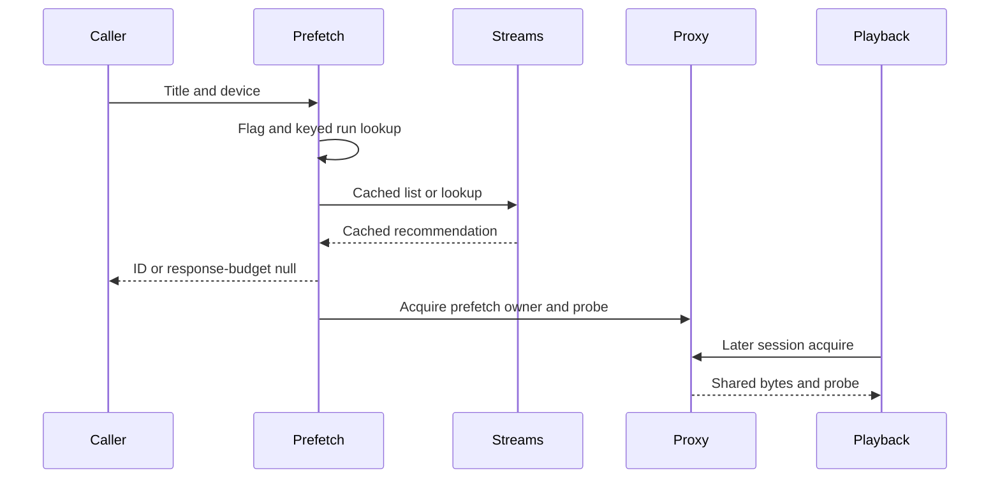

# Prefetch

Active contributors: VeroxAUS

## Purpose

Prefetch warms the cached source that automatic Play would recommend without creating a session, encoder or HLS files. `PrefetchService` in `apps/server/src/prefetch/service.ts` shares discovery/warming by media identity and display tier.

## Directory layout

| Path                                        | Responsibility                                       |
| ------------------------------------------- | ---------------------------------------------------- |
| `apps/server/src/prefetch/service.ts`       | Flag gate, keyed runs and cached-source warming      |
| `apps/server/src/routes/prefetch.ts`        | Validated 202 HTTP adapter                           |
| `apps/server/test/prefetch/service.test.ts` | Offline merging, retention and rewarming tests       |
| `apps/web/src/player/sessionApi.ts`         | Browser request and one-second duplicate suppression |
| `packages/shared/src/playback.ts`           | Prefetch request/response schemas                    |

## Request and duplicate control

`apps/server/src/routes/prefetch.ts` validates title/episode plus device and returns **202** with nullable stream ID. Device upsert happens before the `prefetch-on-details` flag gate; missing telemetry or flag-read errors preserve the enabled default (`apps/server/src/prefetch/service.ts`).

The run map is keyed by **media key plus device resolution tier**, not only the most recent request. Interleaved A, B, A requests therefore rejoin A while it is running or successfully finished within **60 seconds**, even after B intervened.

A completed run is discarded when older than the merge window, unsuccessful, or when its source is no longer live in the proxy. That liveness check matters because proxy retention can evict a successfully warmed source before the service merge timer expires. Failed/skipped runs remain retryable.

The response waits up to **300 ms** for stream-ID selection, then returns null while background work continues. This budget starts after flag/device work and does not mean all warming completes within 300 ms. An ID is announced before source acquisition/probing, so it is not a readiness guarantee.

`prefetchTitle` in `apps/web/src/player/sessionApi.ts` submits requests without awaiting warming and ignores failures. Its per-title **one-second** dedupe is separate from the server's 60-second, per-tier merge. Movie-details mount and selected-episode actions call it (`apps/web/src/pages/MovieDetailsPage.tsx`, `apps/web/src/pages/ShowDetailsPage.tsx`); see [screens](../apps/web/screens.md) for the interaction paths.

## Warm-up control flow

`apps/server/src/prefetch/service.ts` resolves TMDB to IMDb, reads a fresh cached list when possible, otherwise discovers, and skips missing IDs/candidates or uncached recommendations. Prefetch does not initiate TorBox caching or try playback fallback candidates.

`apps/server/src/sourceproxy/proxy.ts` keeps a successful prefetch owner; failed probe releases it. Remote warming loads up to **16 MiB head / 8 MiB tail**, defined in `apps/server/src/sourceproxy/sourceEntry.ts`, with acquisition returning once size is known rather than waiting for both regions. Successful/in-flight probes and retained bytes can be reused by later Play; failed probes clear their cached promise.

## Independent retention and integration

Service deduplication is distinct from proxy retention: default proxy policy keeps at most **three prefetch-only sources**, ten-minute idle TTL, swept every 30 seconds (`apps/server/src/sourceproxy/proxy.ts`). Session owners protect active use. Warming shares aggregate [network](../systems/network.md) limits and lower priority than urgent playback.

Later clients still use automatic Play and rerun selection. Prefetch reserves no GPU place or stream choice. It runs ffprobe, not subtitle extraction. [Downloads](downloads.md) is a separate persistent workflow for uncached upstream titles.

The prefetch flag and optional request event follow [telemetry](../systems/telemetry.md); missing telemetry keys do not disable prefetch. Neither a browser-local spoiler choice nor cast/similar details changes this source-warming contract.

Background failures become scrubbed warning events; prerequisite skips become informational events. Early validation/device/database errors can still fail the request. The service exposes an idle helper for tests, but the close hook does not explicitly await it (`apps/server/src/app.ts`).

## Modification entry points

Change run-key/merge/liveness/budget rules in `apps/server/src/prefetch/service.ts`; change bytes/TTL in the [proxy](../systems/source-proxy.md). Preserve [selection](stream-selection.md) consistency and do not equate a returned ID with ready video.

`apps/server/test/prefetch/service.test.ts` verifies same-title/in-flight merging, eviction-triggered rewarming and sources retained by a playing session. It uses local files and an injected probe; that is not a measurement of real NVENC startup improvement.

## Key source files

| File                                         | Purpose                             |
| -------------------------------------------- | ----------------------------------- |
| `apps/server/src/prefetch/service.ts`        | Keyed runs and warm-up              |
| `apps/server/src/routes/prefetch.ts`         | 202 adapter                         |
| `apps/server/src/streams/rank.ts`            | Shared device tier                  |
| `apps/server/src/sourceproxy/proxy.ts`       | Source/probe retention              |
| `apps/server/src/sourceproxy/sourceEntry.ts` | Head/tail region sizes and priority |
| `packages/shared/src/playback.ts`            | Request/response contract           |

## Measured scope

At `0a8f04f`: **1 source file / 1 test file**, test/source file ratio **1.00**, **1 unique human contributor**. Method: `git ls-tree -r --name-only 0a8f04fd81cfaa7ca5d1689550ad207e7fc0d3ae`, counting `.ts` under `apps/server/src/prefetch/` and `*.test.ts` under `apps/server/test/prefetch/`. Exclude proxy, routes, browser, helpers and integration/encode tests elsewhere. Human count uses scoped `origin/main` author history excluding bots, consistent with `.github/CODEOWNERS`. Ratios are not coverage; tests were inspected, not executed.
