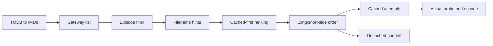

# Stream selection

Active contributors: VeroxAUS

## Purpose

Selection exposes URL-free source metadata and determines automatic playback order. `StreamService` in `apps/server/src/streams/service.ts` combines gateway lookup, episode filtering, parsing and device-aware recommendation; real probe/output policy belongs to [playback](../systems/playback/index.md).

## Layout and identity

`apps/server/src/routes/streams.ts` maps TMDB details to IMDb queries. `apps/server/src/streams/episode.ts` rejects contradictory explicit season/episode markers; unmarked files remain eligible, not proven correct.

`parseStream` in `apps/server/src/streams/parse.ts` extracts resolution, codec, HDR, source, audio and languages from filename hints. Explicit **1440p** is recognized between 2160p and 1080p. Explicit pixel-height tokens override generic 4K/UHD labels; 576/480/360 collapse to 480p.

Structured gateway cached status overrides legacy name markers, including explicit false. Hints describe listings, not fresh availability or actual probe results.

`apps/server/src/gateway/types.ts` creates URL-derived IDs. Public shapes in `packages/shared/src/streams.ts` omit raw URLs. `apps/server/src/streams/service.ts` resolves IDs from persistent gateway cache membership and refetches expired lookup identities when necessary; disappeared IDs cannot be opened.

## Ranking and display tiers

`rankStreams` in `apps/server/src/streams/rank.ts` drops uncached options when any relevant cached source exists, then orders:

1. Resolution: **2160p, 1440p, 1080p, 720p, 480p, unknown**.
2. Source: **WEB-DL, BluRay, WEBRip, Remux, HDTV**, then unranked.
3. Original gateway order for ties.

The source preference is a static policy, not a measured-size sort. HDR, codec and language do not break ties.

`deviceMaxRank` in `apps/server/src/streams/rank.ts` compares **long and short display sides**, making portrait/landscape equivalent. A tier qualifies when either its short-side or long-side threshold is reached: 2160/3840, 1440/2560, 1080/1920, 720/1280; otherwise lowest tier.

Recommendation orders known fitting resolutions first, then known resolutions above device tier **ascending**, then unknown. Unknown never counts as fitting. Without a device, all known resolutions precede unknown. Capability codec/HDR flags affect encoding, not this source-tier order.

## Automatic starts and clips

`startCandidates` in `apps/server/src/streams/rank.ts` returns at most three cached candidates in device order for session startup. When nothing is cached, it returns only the recommendation. The latter may trigger [download tracking](downloads.md), not an uncached multi-release retry loop.

`SessionStarter` in `apps/server/src/playback/sessionStart.ts` abandons failed attempts before fallback. Source faults can advance; bad explicit tracks/shutdown cannot. A surviving old encoder blocks replacement. Explicit IDs remain internally supported but do not imply a product manual stream picker.

`apps/server/src/playback/placeholder.ts` rejects named placeholder paths across hosts/prefixes and implausibly small uncached bodies. `apps/server/src/gateway/playbackProbe.ts` follows redirect chains manually and checks targets before requesting clips. Successful uncached probes hand their resolved target directly to the proxy to avoid an extra gateway resolution.

## Integration and modification

`cachedList` in `apps/server/src/streams/service.ts` never triggers network work; `refresh` bypasses gateway list freshness for ready-download confirmation. [Prefetch](prefetch.md) shares recommendation policy and groups requests by device tier.

Change filename tokens in `apps/server/src/streams/parse.ts`, ranking/device order in `apps/server/src/streams/rank.ts`, and explicit episode contradictions in `apps/server/src/streams/episode.ts`. Preserve URL secrecy and distinguish metadata cache status from availability.

## Key source files

| File | Purpose |
| --- | --- |
| `apps/server/src/streams/service.ts` | Listing and ID resolution |
| `apps/server/src/streams/parse.ts` | Hint parsing |
| `apps/server/src/streams/rank.ts` | Quality/device/candidate order |
| `apps/server/src/streams/episode.ts` | Episode checks |
| `apps/server/src/playback/sessionStart.ts` | Attempt orchestration |
| `apps/server/src/playback/placeholder.ts` | Clip rules |

## Measured scope

At `5eefa37`, scoped `git ls-files` counts **4 streams `.ts` source / 3 matching `*.test.ts` files**, ratio **0.75**. Gateway, route, integration/GPU/live tests and helpers are excluded. Default-branch history/CODEOWNERS identify **1 unique human author**, excluding bots. No discovery or encoder tests were run.
