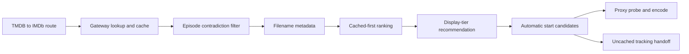

# Stream selection

Active contributors: VeroxAUS

## Purpose

Stream selection turns gateway results into URL-free quality options, ranks them for a device, and supplies automatic-start candidates. Actual probing, output codec decisions and encoding belong to [playback](../systems/playback/index.md) (`apps/server/src/streams/service.ts`, `apps/server/src/streams/rank.ts`).

## Discovery and parsing

`apps/server/src/routes/streams.ts` resolves TMDB details to IMDb before querying the [gateway](../systems/gateway.md). Missing IMDb identity or no relevant candidates produces an empty list with `recommendedId: null` and `reason: no_streams`. Upstream errors remain HTTP errors rather than successful empty results.

`apps/server/src/streams/episode.ts` rejects filenames with contradictory explicit episode/season markers, including episode ranges and `1x02` notation. Unmarked filenames remain eligible; filtering does not prove that an unmarked file is the right episode.

`parseStream` in `apps/server/src/streams/parse.ts` derives resolution, codec, HDR, source, audio/channels, language tags and a display label from filenames. Resolution buckets are 2160p/1080p/720p/480p/unknown; 576/360 collapse to 480p and explicit 1440p is unknown. Lower known tiers default to SDR without an HDR marker. These are filename hints, not probe results.

Structured gateway `cached` metadata wins when present, including explicit `false`; otherwise the legacy lightning-name marker supplies cache status. This is upstream metadata, not a fresh availability probe.

## Exact ranking and recommendation

`rankStreams` in `apps/server/src/streams/rank.ts` applies:

1. If any relevant option is cached, discard all uncached options.
2. Sort resolution descending: 2160p, 1080p, 720p, 480p, unknown.
3. Within a resolution, prefer **WEB-DL, BluRay, WEBRip, Remux, HDTV**, then unranked values.
4. Preserve gateway order for remaining ties.

WEB-DL precedes Remux to favor smaller/faster-starting sources, but the rule does not sort by measured size. Codec, HDR, language and audio do not break ranking ties.

Without a known device, recommendation is the first ranked option. With a registered profile, `deviceMaxRank` takes the lower width/height tier: 3840/2160 for 4K, 1920/1080 for 1080p, 1280/720 for 720p, otherwise the lowest tier. The first option at or below that tier wins; unknown resolution always fits. If none fits, choose the first-ranked option at the lowest available resolution. Codec/HDR support affects the later encoding decision, not this recommendation.

## Automatic fallback and placeholders

Clients send `streamId: "auto"`. `startCandidates` in `apps/server/src/streams/rank.ts` selects cached fitting options, or cached options at the lowest resolution if none fit. `apps/server/src/playback/manager.ts` tries at most **3**, cleaning up failed attempts. Invalid audio/subtitle requests and shutdown do not trigger another candidate. An explicit stream ID is accepted internally but gets one attempt; it is not a manual-picker product feature.

A successful session reports earlier `{streamId, code}` attempts. Exhausted cached candidates return 502 `all_streams_failed` with attempts in the error and top-level envelopes (`apps/server/src/errors.ts`, `packages/shared/src/playback.ts`). With no cached option, only the recommended uncached option is considered; it is not retried across releases. That path can return **202 downloading** instead of **201 session**; see [downloads](downloads.md).

Gateway placeholder clips must never be encoded as the title. `apps/server/src/playback/resolveUrl.ts` detects same-host `/static/<reason>.mp4` redirect targets before requesting them. On ordinary source resolution:

| Placeholder            | Error                      |
| ---------------------- | -------------------------- |
| `downloading`          | 409 `stream_not_cached`    |
| `store_limit_exceeded` | 409 `torbox_slots_full`    |
| `429`                  | 429 `gateway_rate_limited` |
| Other clip             | 502 `stream_unavailable`   |

The download-start probe interprets `downloading` as accepted tracking instead; it does not use the normal resolver's error mapping.

## Identity and cache integration

Public `StreamOption` has metadata and a 16-hex URL-hash ID, never the raw URL (`packages/shared/src/streams.ts`, `apps/server/src/gateway/types.ts`). `getStreamById` in `apps/server/src/streams/service.ts` finds the originating cache row, uses it while fresh, or refetches its lookup after expiry. Missing/disappeared IDs return null. A changed URL can change ID.

`GatewayCache` in `apps/server/src/gateway/cache.ts` persists nonempty lookups for 1 hour and empty lookups for 5 minutes. Expired rows remain traceable until purged, with a 7-day post-expiry retention window; they are not silently treated as fresh. Movie and episode lookup identities use IMDb, while [catalog](catalog.md) and local progress use TMDB.

`cachedList` never triggers or waits for network lookup. `refresh` bypasses list-cache freshness and updates it, which lets download completion recheck availability. [Prefetch](prefetch.md) shares the same recommendation policy.

The browser currently exposes neither a manual stream picker nor a working session-start flow. Its Play links reach `apps/web/src/pages/PlayerPage.tsx`, which reports that playback is not available yet. The server API and offline playback tests implement the handoff described here; see the [web app](../apps/web/index.md).

## Modification entry points

Change token heuristics in `apps/server/src/streams/parse.ts`, ordering/candidate policy in `apps/server/src/streams/rank.ts`, episode contradictions in `apps/server/src/streams/episode.ts`, and orchestration in `apps/server/src/streams/service.ts`. Extend regression tests and preserve the server-only URL boundary.

## Key source files

| File                                                     | Purpose                                                   |
| -------------------------------------------------------- | --------------------------------------------------------- |
| `apps/server/src/streams/service.ts`                     | Listing, refresh, cached reads and server-only URL lookup |
| `apps/server/src/streams/parse.ts`                       | Filename interpretation and labels                        |
| `apps/server/src/streams/rank.ts`                        | Ranking, display tiers and start candidates               |
| `apps/server/src/streams/episode.ts`                     | Episode contradiction filtering                           |
| `apps/server/src/routes/streams.ts`                      | TMDB/device HTTP adapter                                  |
| `packages/shared/src/streams.ts`                         | URL-free options and recommendation response              |
| `apps/server/src/gateway/cache.ts`                       | Persistent lookup freshness and stream-ID tracing         |
| `apps/server/src/playback/manager.ts`                    | Candidate attempts and cleanup                            |
| `apps/server/src/playback/resolveUrl.ts`                 | Placeholder-aware redirect resolution                     |
| `apps/server/test/streams/rank.test.ts`                  | Exact ranking/candidate policy                            |
| `apps/server/test/integration/streams-routes.test.ts`    | Route and identity integration                            |
| `apps/server/test/integration/playback-fallback.test.ts` | Offline automatic fallback                                |

## Measured scope

At the documented commit, recursively counting `*.ts` in `apps/server/src/streams/` gives **4 source files**; counting `*.test.ts` in `apps/server/test/streams/` gives **3 test files**, a **0.75 test-to-code file ratio** (3 / 4). Routes, gateway, resolver, shared/web, integration, GPU/live tests and fixtures are excluded. Default-branch history has **1 unique human committer**, excluding bots; no individual productivity comparison is implied.
