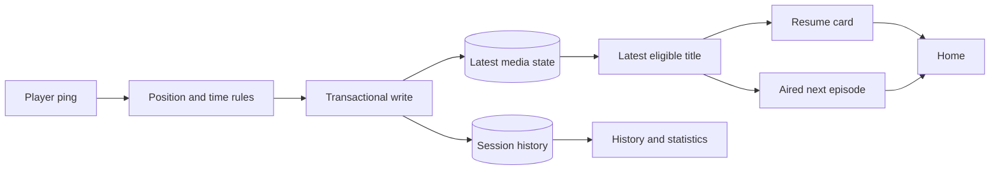

# Viewing progress

Active contributors: VeroxAUS

## Purpose

Viewing progress persists shared resume state and derives Continue Watching/up-next cards. `PlaybackManager.ping` in `apps/server/src/playback/manager.ts` writes progress/history; `ContinueWatchingService` in `apps/server/src/progress/service.ts` builds visible entries from that data.

## Identity and ping semantics

`mediaKeyFor` in `apps/server/src/db/plays.ts` uses movie ID or TV ID/season/episode identity. Resume state is shared by media key, not account/device. Individual play history retains session/device context.

`apps/server/src/routes/progress.ts` validates progress pings and media/show reads. Missing ping state means playing. Pings count as activity while paused or buffering too, preventing paused-but-connected sessions from timing out.

| Rule | Value/meaning |
| --- | --- |
| Saved position | Clamped to nonnegative/probed duration |
| Complete | At least **92%** of positive duration |
| Resumable | At least **60 seconds**, not complete |
| Watched time | Elapsed gap when **previous** ping state was playing |
| Gap cap | At most **30 seconds** per ping gap |

Pure rules live in `apps/server/src/progress/rules.ts`, shared thresholds in `packages/shared/src/progress.ts`. A pause credits preceding playing time; resume does not credit paused time. Seeking to the end can complete a title without crediting the skipped distance as watched time.

The manager transaction writes latest progress and play counters together. `apps/server/src/db/progress.ts` replaces current completion with the newest ping and clears hidden state. `apps/server/src/db/plays.ts` makes play-history completion sticky once reached in that session. These intentionally differ.

Reading resume does not implicitly change a new session start: callers send their chosen start position (`apps/server/src/playback/sessionStart.ts`). The browser player is implemented and owns its ping loop; see [web](../apps/web/index.md).

## Continue watching and hiding

`selectEntries` in `apps/server/src/progress/entries.ts` groups one entry per movie/show and chooses the newest eligible row. Eligible means resumable, completed or hidden. Hidden rows participate so removing a recent show's card does not resurrect an older episode.

Completed movies disappear. Completed TV episodes can become up-next entries with zero position/duration. `apps/server/src/progress/service.ts` limits visible results to **20**, newest first, with show/episode metadata and next still when available.

Removal hides progress, not history. An up-next entry with no play row gets a hidden marker. A later ping clears hidden state. Bulk show progress includes watched hidden episodes but excludes zero-position hidden markers (`apps/server/src/db/progress.ts`).

## Up next

`findNextEpisode` in `apps/server/src/progress/upNext.ts` chooses the next numbered episode of the current season, otherwise the first episode in up to **three later nonempty seasons**. It does not skip an unaired next episode to offer a later one.

Future air dates are suppressed relative to the server's local calendar day; absent air dates are accepted. Successful lookups including null cache for **one hour**. Failure omits that entry with debug logging instead of failing the whole row (`apps/server/src/progress/service.ts`).

## History and local statistics

`apps/server/src/routes/history.ts` exposes paginated history and summary/graph reads. `apps/server/src/db/history.ts` filters per-session plays, separately from resume rows. `apps/server/src/stats/aggregate.ts` builds counts, watched time, bytes and device/output/time buckets; `apps/server/src/stats/timeBound.ts` parses inclusive time bounds.

These are local operational/product records, not telemetry. Dashboard tabs remain placeholders even though server history/statistics APIs and Home/details progress are implemented. See [data models](../reference/data-models.md) and [API](../api/index.md).

## Modification entry points

Change completion/time accounting in `apps/server/src/progress/rules.ts`, title grouping in `apps/server/src/progress/entries.ts`, and next-episode traversal in `apps/server/src/progress/upNext.ts`. Coordinate write changes with the manager and DB queries. Keep position, watched duration, current completion and sticky history completion separate.

## Key source files

| File | Purpose |
| --- | --- |
| `apps/server/src/playback/manager.ts` | Ping and transactional write |
| `apps/server/src/progress/rules.ts` | Pure progress rules |
| `apps/server/src/progress/entries.ts` | Latest eligible title |
| `apps/server/src/progress/service.ts` | Cards and hiding |
| `apps/server/src/progress/upNext.ts` | Aired episode traversal |
| `apps/server/src/db/progress.ts` | Latest resume/hidden state |
| `apps/server/src/db/plays.ts` | Per-session history |
| `apps/server/src/routes/progress.ts` | Progress API |

## Measured scope

At `5eefa37`, scoped `git ls-files` counts **4 progress `.ts` source / 3 matching `*.test.ts` files**, ratio **0.75**. Stats, manager, DB/routes, integration/web/contracts and helpers are excluded. Default-branch history/CODEOWNERS identify **1 unique human author**, excluding bots. Tests were inspected, not executed.
