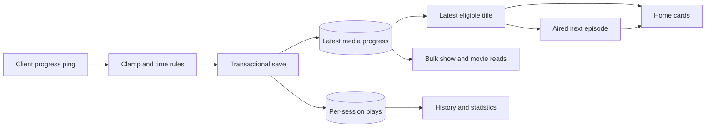

# Viewing progress

Active contributors: VeroxAUS

## Purpose

Viewing progress saves shared resume state and derives continue watching, aired next episodes, play history and local statistics (`apps/server/src/progress/service.ts`, `apps/server/src/routes/progress.ts`, `apps/server/src/routes/history.ts`). The browser displays Continue Watching and title/episode progress, but its player is not implemented and does not send playback pings (`apps/web/src/components/ContinueWatchingRow.tsx`, `apps/web/src/pages/PlayerPage.tsx`).

## Identity and persistence

`mediaKeyFor` in `apps/server/src/db/plays.ts` uses `movie:<tmdbId>` or `tv:<tmdbId>:<season>:<episode>`. Progress is keyed by media, not device or account; history records individual sessions and device context. Two devices playing the same title therefore write the same resume row (`apps/server/src/db/progress.ts`).

`POST /api/sessions/:id/progress` validates `positionSec` and optional `playing`/`paused`/`buffering` state; omitted state means playing. `PlaybackManager.ping` in `apps/server/src/playback/manager.ts` updates activity/playhead state and transactionally saves progress plus the session's play counters.

| Rule                  | Exact behavior                                               |
| --------------------- | ------------------------------------------------------------ |
| Saved position        | Clamped to the probed duration                               |
| Completed             | Position at least **92%** of a positive duration             |
| Resumable             | Position at least **60 seconds** and not completed           |
| Credited watched time | Wall-clock gap only when the previous ping state was playing |
| Silent-client cap     | At most **30 seconds** credited for one gap                  |

Constants/contracts are in `packages/shared/src/progress.ts`; pure rules are in `apps/server/src/progress/rules.ts`. A seek can change position/completion without adding that distance to watched time. A pause credits the preceding playing interval; a resume does not credit the paused interval.

Completion has two meanings: a later lower-position ping can clear the current progress row's completed flag, but `apps/server/src/db/plays.ts` keeps a play-history row completed once any ping in that session reached the threshold. The progress upsert also clears hidden state (`apps/server/src/db/progress.ts`).

`GET /api/progress/:mediaKey` returns the saved position/completion/resumability or 404. A client can read it and pass `startPositionSec` on a new session; playback does not automatically replace an omitted start position with saved progress (`apps/server/src/routes/progress.ts`, `apps/server/src/playback/manager.ts`).

## Bulk show progress

`GET /api/tv/:tmdbId/progress` returns `{items}` with the saved episodes of one show, sorted by season then episode. Each item adds season/episode to `ProgressResponseSchema`; `ShowProgressResponseSchema` is defined in `packages/shared/src/progress.ts`. `listShowProgress` in `apps/server/src/db/progress.ts` includes positions greater than zero or completed rows. It excludes zero-position hidden markers, but does not exclude an actually watched episode merely because its Continue Watching card is hidden. This read makes no TMDB lookup and returns an empty list when no episodes have progress.

`showProgressQuery` in `apps/web/src/api/queries.ts` fetches this single bulk response with stale time zero and refetch-on-mount. `ShowDetailsPage` in `apps/web/src/pages/ShowDetailsPage.tsx` indexes items by season/episode for episode rows and the selected episode panel. The movie equivalent converts a progress 404 to null. Progress errors do not block metadata from rendering.

`PlayActions` in `apps/web/src/components/PlayActions.tsx` displays Watched, Play, or Resume plus Start over. Resume navigation passes the floored position as `?start=`, but the placeholder player does not consume it into a session yet. Server support and visible navigation must not be mistaken for implemented browser playback.

## Continue watching

`selectEntries` in `apps/server/src/progress/entries.ts` groups eligible rows into one entry per movie or show. Eligibility includes resumable, completed and hidden rows. The most recently updated eligible episode wins for a show; deterministic media-key ordering breaks timestamp ties. Hidden rows participate so deleting a recent entry does not resurrect an older episode.

`ContinueWatchingService` in `apps/server/src/progress/service.ts` returns up to **20** visible entries, newest first:

- Incomplete/resumable entries resume at their saved position.
- Completed movies disappear.
- Completed TV episodes can become an up-next entry with position/duration zero.

Episode cards use the show title plus episode title; a next episode's still takes precedence over the show's backdrop. `GET /api/home` uses the same service, not an always-empty placeholder array (`apps/server/src/home/service.ts`). See [catalog](catalog.md) for featured selection.

Deleting `/api/continue-watching/:mediaKey` hides progress without deleting history. Repeating deletion returns `removed: false`. A generated up-next entry has no played row yet, so removal inserts a hidden marker. A new ping on that media clears its hidden flag (`apps/server/src/progress/service.ts`, `apps/server/src/db/progress.ts`).

The browser's `ContinueWatchingRow` in `apps/web/src/components/ContinueWatchingRow.tsx` links cards to title details, preserving season/episode selection for TV. Removal optimistically filters the Home Query snapshot, sends DELETE through the shared API client and invalidates Home on failure. It does not delete plays or statistics.

## Up next

`findNextEpisode` in `apps/server/src/progress/upNext.ts` takes the next numerically ordered episode in the current season, otherwise probes up to **3 later nonempty seasons** for their first episode. It does not skip an unaired next episode to offer a later one.

A future air date relative to the server's local calendar day suppresses the entry; an absent date is accepted. No next episode means no card. The continue-watching service caches successful next-episode lookups, including null results, for **1 hour**. Lookup failures omit that entry and are debug-logged rather than failing the whole row (`apps/server/src/progress/service.ts`).

## History and statistics

`GET /api/history` reads `plays` newest first by start time then ID. Filters include media type, device ID, literal title/show-title substring and inclusive start-time bounds. Pagination defaults to page 1, size 20, capped at 100. `%` and `_` in text are escaped rather than treated as wildcards (`apps/server/src/db/history.ts`, `packages/shared/src/progress.ts`).

Time bounds accept epoch milliseconds, ISO timestamps or local `YYYY-MM-DD`; a `to` day includes its final millisecond (`apps/server/src/stats/timeBound.ts`). History includes local device/network context and is not the sanitized outbound analytics payload. Treat access as LAN-local; see [security](../security.md).

`GET /api/stats/summary` and `/api/stats/graphs` default to **30 local calendar days**, including today, and accept 1–3650 days (`apps/server/src/routes/history.ts`, `packages/shared/src/progress.ts`).

`apps/server/src/stats/aggregate.ts` derives:

- Total plays, credited watched seconds and HLS media bytes.
- Top 10 movies/shows by play count then watched time; top devices by watched time.
- Zero-filled daily, 24-hour and Sunday-first weekday buckets.
- Device and encoded-output decision buckets: dynamic range, codec and resolution. Tone-mapped overrides SDR in the range label; missing decisions are unknown.

The window uses play start time, not a split of watched time across days. It is lower-bounded only: future-dated rows can count in totals/hour/weekday data even without a daily bucket. Stats read local history, not PostHog, and do not require TMDB calls.

The history and statistics endpoints are implemented server APIs. Their future dashboard presentation is separate from the working Home/details progress UI; see the [web app](../apps/web/index.md) and [API](../api/index.md).

## Modification entry points

Change thresholds/time accounting in `apps/server/src/progress/rules.ts`, title grouping in `apps/server/src/progress/entries.ts`, next-episode traversal in `apps/server/src/progress/upNext.ts`, and charts in `apps/server/src/stats/aggregate.ts`. Coordinate write changes with `apps/server/src/playback/manager.ts` and [data models](../reference/data-models.md). Keep watched time distinct from position and current progress distinct from sticky history completion.

## Key source files

| File                                                   | Purpose                                              |
| ------------------------------------------------------ | ---------------------------------------------------- |
| `packages/shared/src/progress.ts`                      | Thresholds and API/query/statistics contracts        |
| `apps/server/src/playback/manager.ts`                  | Ping handling and transactional writes               |
| `apps/server/src/db/progress.ts`                       | Latest resume row and hidden markers                 |
| `apps/server/src/db/plays.ts`                          | Media identity and per-session history writes        |
| `apps/server/src/db/history.ts`                        | History filtering and recommendation bases           |
| `apps/server/src/progress/rules.ts`                    | Completion, resume and watched-time rules            |
| `apps/server/src/progress/entries.ts`                  | Latest eligible movie/show selection                 |
| `apps/server/src/progress/service.ts`                  | Continue watching and removal                        |
| `apps/server/src/progress/upNext.ts`                   | Aired next-episode lookup                            |
| `apps/server/src/stats/aggregate.ts`                   | Pure statistics and bucket rules                     |
| `apps/server/src/stats/timeBound.ts`                   | Inclusive local date parsing                         |
| `apps/server/src/routes/progress.ts`                   | Ping, single-media, bulk-show and removal routes     |
| `apps/server/src/routes/history.ts`                    | Filtered history and local statistics routes         |
| `apps/web/src/api/queries.ts`                          | Fresh movie/show progress reads                      |
| `apps/web/src/components/ContinueWatchingRow.tsx`      | Detail navigation and optimistic removal             |
| `apps/server/test/integration/progress-routes.test.ts` | Offline end-to-end progress, Home, history and stats |

## Measured scope

At the documented commit, recursively counting `*.ts` in `apps/server/src/progress/` plus `apps/server/src/stats/` gives **6 source files**; counting `*.test.ts` in the matching `apps/server/test/progress/` and `apps/server/test/stats/` directories gives **5 test files**, a **0.83 test-to-code file ratio** (5 / 6). Manager/DB/routes/contracts/web, integration tests and fixtures are outside that count. Default-branch history has **1 unique human committer**, excluding bots; the measure is scoped file structure, not individual output or test coverage.
