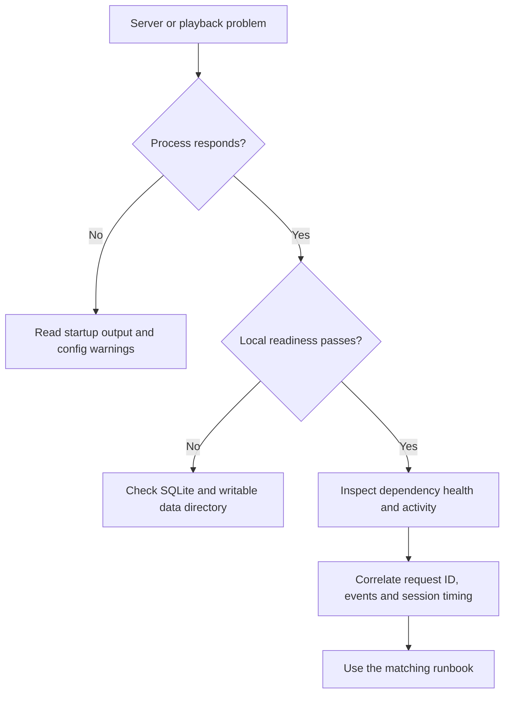

# Debugging

Start with local readiness, then identify configuration, upstream, playback, or storage failures. Request IDs connect API responses to local logs. Maintained procedures are indexed in `docs/runbooks/README.md`.



## First checks

Against an already-running local server:

```powershell
curl.exe http://localhost:8600/healthz
curl.exe http://localhost:8600/readyz
curl.exe http://localhost:8600/api/health
curl.exe "http://localhost:8600/api/logs?level=error&limit=50"
curl.exe http://localhost:8600/api/activity
```

Use `curl` on POSIX. Liveness only means the process responds; readiness checks SQLite and data-directory writability, not credentials, the transcode directory or encoding (`apps/server/src/routes/ops.ts`). `GET /api/health` returns the snapshot with refreshed live checks, but can run a full pass when no snapshot exists. `POST /api/health/run?fresh=1` bypasses the TorBox/FFmpeg caches and can contact services and test NVENC; do not loop it as a cheap probe (`apps/server/src/routes/health.ts`, `apps/server/src/health/service.ts`).

## Correlate evidence

Match response `X-Request-ID` to `reqId` in Pino JSON stdout or the log file under `DATA_DIR` (`apps/server/src/http/observability.ts`, `apps/server/src/logger.ts`). `/api/logs` reads persisted redacted events, not the complete Pino log (`apps/server/src/events/query.ts`). Enable `LOG_LEVEL=debug` before startup for startup-stage timing (`apps/server/src/playback/startTimeline.ts`). See [logging](../how-to-monitor/logging.md) and [tracing](../how-to-monitor/tracing.md).

| Symptom                         | Check                                                         | Maintained procedure                   |
| ------------------------------- | ------------------------------------------------------------- | -------------------------------------- |
| Server will not start           | Node major, writable storage, selected env file               | `docs/runbooks/README.md`              |
| Catalog works, sources fail     | Manifest, timeout, rate limiting and gateway health           | `docs/runbooks/gateway-down.md`        |
| Session start returns 202       | Download status and TorBox/gateway cached availability        | `docs/runbooks/torbox-expired.md`      |
| Encoder failure or memory limit | FFmpeg/NVENC, driver, GPU load and process cap                | `docs/runbooks/encoder-failing.md`     |
| Segment stall or disk warning   | Free space, transcode cap, read-ahead and parked state        | `docs/runbooks/disk-full-transcode.md` |
| FFmpeg survives stop            | Registry ownership and process-specific command-line evidence | `docs/runbooks/ffmpeg-orphans.md`      |
| Regression after release        | Separate worktree or history-preserving revert                | `docs/runbooks/rollback.md`            |
| Pass only after retry           | Shared state, timers, unawaited work and CPU pressure         | `docs/runbooks/flaky-tests.md`         |
| Error alert                     | Release/request ID and privacy review                         | `docs/runbooks/sentry-triage.md`       |

Never kill processes by executable name. A stuck encoder retains its slot and blocks replacement until exit; repeated starts are not a remedy (`apps/server/src/playback/sessionSlots.ts`, `apps/server/src/playback/stuckStop.ts`).

## Browser and desktop

A page on Vite port 8601 proves only that the dev UI is served; its proxy still targets 8600 (`apps/web/vite.config.ts`). Inspect the error envelope and request ID in the Network panel. Plain-HTTP LAN UUIDs use a fallback when the browser lacks `crypto.randomUUID` (`apps/web/src/api/client.ts`, `apps/web/src/lib/uuid.ts`).

The player is real. Check whether start returned a 201 session, 202 download, or an error before blaming decoding. Track changes can restart encoding; far-segment requests can trigger a seek. Progress pings, including paused pings, keep the session active (`apps/server/src/playback/manager.ts`, `apps/web/src/player/useSessionLifetime.ts`). Dashboard tabs alone remain placeholders (`apps/web/src/pages/dashboard/DashboardPlaceholder.tsx`). See [web](../apps/web/index.md) and [lifecycle](../systems/playback/lifecycle.md).

An outdated health pill may involve SSE reconciliation rather than a server check: stream open fetches a baseline through the health query, and pushed changes cancel older requests (`apps/web/src/events/serverEvents.ts`). Desktop tray and mini-player problems also involve the supervisor and activity monitor; attached servers differ from owned child processes (`apps/desktop/src/supervisor.ts`, `apps/desktop/src/monitor.ts`). See [desktop](../apps/desktop/index.md).

For Settings, distinguish the server-backed device-name registration from the browser-local spoiler preference. Missing or blocked storage defaults spoiler hiding to on; a blocked-storage choice lasts only for the page lifetime (`apps/web/src/pages/settings/DeviceCard.tsx`, `apps/web/src/lib/spoilers.ts`). The About view is read-only server information, not a server configuration editor (`apps/web/src/pages/settings/AboutPanel.tsx`). The sidebar in `docs/ideas.md` is a proposal, not a missing runtime panel. See [Settings and spoilers](../apps/web/settings-and-spoilers.md) and [search](../apps/web/search.md) for current state ownership and navigation behavior.

For telemetry, distinguish build-time missing keys, runtime opt-out, and content/idle deferral. Changing the running server cannot add keys to a built UI. Use isolated telemetry tests rather than production smoke reports (`apps/web/src/telemetry/config.ts`, `apps/web/src/telemetry/index.ts`).

## Measure carefully

`pnpm profile:server` launches a throwaway profiled server, default port 8602, and writes under `reports/profiles`. Its light local workload is not real playback validation and does not install the e2e outbound restriction (`scripts/profile-server.mjs`). Do not overlap it with Playwright. Follow `docs/runbooks/profiling.md` for workload selection, and `docs/runbooks/web-bundle-budget.md` for bundle diagnosis.

Logs, profiles and databases can contain local viewing or machine details. Share reviewed redacted excerpts and invented reproducers, not raw payloads, configuration or databases. See [testing](testing.md), [configuration](../reference/configuration.md), and [security](../security.md).
