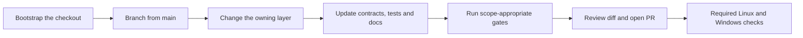

# Development workflow

Bootstrap once, branch from `main`, change code and contracts together, and run the checks appropriate to the change. Commands run from the repository root with Node 24 and pnpm 12 (`CONTRIBUTING.md`, `package.json`).



## Prepare

```powershell
node scripts/bootstrap.mjs
```

`scripts/bootstrap.mjs` checks tools, installs locked dependencies and hooks, preserves an existing `.env`, and builds shared contracts. A dev container uses the same entry point (`.devcontainer/devcontainer.json`). Larger changes start with an issue; no branch-name pattern is required by `CONTRIBUTING.md`.

For source development, run the server and Vite in separate terminals after building shared:

```powershell
pnpm --filter @homestream/shared build
pnpm --filter @homestream/server dev
pnpm --filter @homestream/web dev
```

The server uses tsx watch. Vite uses 8601 and proxies to server port 8600, not an arbitrary `PORT` override (`apps/server/package.json`, `apps/web/vite.config.ts`). Production Node imports use built shared output; tests alias shared source (`packages/shared/package.json`, `vitest.shared.ts`). See [getting started](../overview/getting-started.md).

## Change the owning layer

Keep handlers thin and shared schemas authoritative. Route changes follow `.factory/skills/homestream-add-api-route/SKILL.md` and update `apps/server/src/docs/routeDocs.ts`, tests, and `docs/openapi.json`. Append migrations in `apps/server/src/db/migrations.ts`; regenerate `docs/schema.sql` and update `docs/database.md`.

Telemetry changes follow `.factory/skills/homestream-telemetry/SKILL.md` and update `docs/PRIVACY.md` in the same patch. Resource ownership and serialization matter for both server encoders and desktop restart operations; see [conventions](patterns-and-conventions.md).

## Verify

The full code-change gate is listed in `AGENTS.md` and `.factory/skills/homestream-run-checks/SKILL.md`:

```powershell
pnpm format:check
pnpm lint
pnpm typecheck
pnpm knip
pnpm dup
pnpm deps:check
pnpm syncpack:lint
pnpm techdebt
pnpm check:large-files
pnpm check:secrets
pnpm test:ci
pnpm test:coverage
pnpm --filter @homestream/web build
pnpm --filter @homestream/web size
pnpm --filter @homestream/desktop build
pnpm --filter @homestream/desktop size
pnpm flags:check
pnpm openapi:check
pnpm db:schema:check
pnpm docs:check
pnpm agents:check
```

Markdown-only work needs format, docs, and agent checks. Generated `droid-wiki/` is excluded from normal formatting/link checks; wiki generation needs its own audit, and lasting corrections belong in source or maintained docs (`.prettierignore`, `scripts/check-docs.mjs`, `docs/wiki.md`). Build before measuring bundle size. Coverage and grandfathered complexity/line ceilings may only improve, not be relaxed to pass a change (`scripts/coverage-ratchet.mjs`, `scripts/code-limits.mjs`). GPU/live tiers are separate; root `pnpm test` is not the safe offline default. See [testing](testing.md).

Hooks run staged formatting, lint, secret/file-size scans, and relevant docs checks, not the complete test suite (`lefthook.yml`). Review the staged diff yourself. Do not stage `.env`, dependencies, builds, coverage, or reports.

## Commit and review

Use an imperative Conventional Commit subject and explain why in its body. Every AI-written commit ends with:

```text
Co-authored-by: factory-droid[bot] <138933559+factory-droid[bot]@users.noreply.github.com>
```

Open the pull request against `main` and fill in `.github/pull_request_template.md`. Report exact checks, skipped tiers, privacy implications, and hot-path measurements. Never rewrite published history or force-push (`CONTRIBUTING.md`).

Linux runs the broad static/docs/security and sequential coverage gates. Windows runs typechecking, selected path/process-sensitive server unit tests, and a real Electron launch smoke against built server/web/desktop outputs. That smoke is separate from the desktop Node tests and coverage; it is not optional within the required Windows job (`.github/workflows/ci.yml`, `apps/desktop/vitest.smoke.config.ts`).

Web e2e runs in a parallel, non-required job with stub upstreams and no real playback session. GPU/live never run in CI. Droid review is advisory and timing records for main runs may finish out of order; release planning skips commits already contained in a release tag (`docs/ci.md`, `scripts/next-version.mjs`). See [tooling](tooling.md#generated-wiki-lifecycle) for the special wiki-only merge and push-summary path.

## Key source files

| File                               | Purpose                        |
| ---------------------------------- | ------------------------------ |
| `scripts/bootstrap.mjs`            | Initial setup                  |
| `turbo.json`                       | Workspace task graph and cache |
| `lefthook.yml`                     | Staged checks                  |
| `.github/workflows/ci.yml`         | Cross-platform validation      |
| `.github/pull_request_template.md` | Review handoff                 |

PowerShell 5.1 has no `&&`; run commands separately or use `;` and check `$LASTEXITCODE`. Use `curl.exe` instead of its alias (`AGENTS.md`). See [tooling](tooling.md) and [deployment](../deployment.md).
