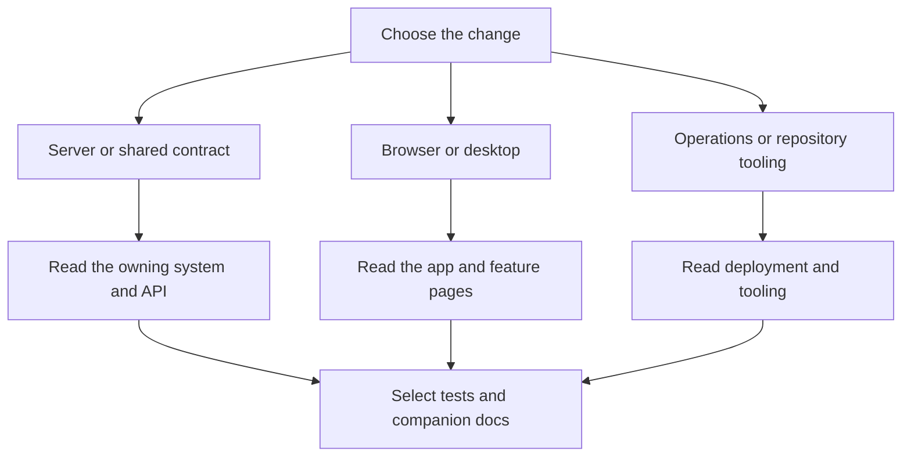

# Contributing

Start from `main`, keep changes focused, and finish with tests, current contracts, and an honest record of validation. `CONTRIBUTING.md` is the human guide; `AGENTS.md` supplies product constraints and agent rules.

## Pick up work

Discuss anything larger than a small fix in an issue first. Read the relevant [app](../apps/index.md), [feature](../features/index.md), or [system](../systems/index.md) page. `.github/CODEOWNERS` assigns all paths to VeroxAUS; there is no separate per-team ownership map. Security reports follow `SECURITY.md`, not public bug reports.

| Change        | Start here                                               | Companion work                                                                    |
| ------------- | -------------------------------------------------------- | --------------------------------------------------------------------------------- |
| HTTP          | `packages/shared/src`, `apps/server/src/routes`          | Schemas, thin handler, route docs, injection tests, regenerated OpenAPI           |
| Playback      | `apps/server/src/playback`                               | Pure-rule tests, lifecycle/fallback tests, hot-path measurements                  |
| Source access | `apps/server/src/gateway`, `apps/server/src/sourceproxy` | Stub upstreams and verify cleanup, shared ranges, and resource limits             |
| Browser       | `apps/web/src/pages`, `apps/web/src/player`              | Component tests, typed requests, focused browser cases, startup and bundle checks |
| Desktop       | `apps/desktop/src`                                       | Node tests for logic; separate real Electron launch smoke, also run by Windows CI |
| Persistence   | `apps/server/src/db/migrations.ts`                       | Append migration, update adapters and docs, regenerate schema                     |
| Configuration | `apps/server/src/config.ts`                              | Recognized key, `.env.example`, default and validation tests                      |
| Telemetry     | `packages/shared/src/analytics.ts`                       | Typed event, allowlist, privacy docs and scrubber tests                           |

The web player, Settings/About tabs and desktop shell are implemented; dashboard tabs remain placeholders and the TV app has no workspace (`apps/web/src/App.tsx`, `apps/web/src/pages/SettingsPage.tsx`, `apps/desktop/src/main.ts`, `pnpm-workspace.yaml`). The Settings sidebar mockup and central device-management ideas in `docs/ideas.md` are deferred proposals, not current requirements. See [Settings and spoilers](../apps/web/settings-and-spoilers.md) and [search](../apps/web/search.md) rather than older status summaries.

## Definition of done

- New behavior has a test; a bug fix has a regression test that failed before the fix.
- One logical change per commit and pull request, with Conventional Commits and the AI trailer when applicable.
- Shared field names, actionable errors, privacy, performance, and cleanup rules remain intact.
- Maintained docs and generated API/database documents match the code.
- Required checks pass; skipped GPU/live/browser checks and environment limits are stated.
- The pull request template is filled in (`.github/pull_request_template.md`).

`Linux` and `Windows` are the required CI job names recorded in `AGENTS.md` and defined in `.github/workflows/ci.yml`. Advisory Droid review, timing feedback, and code-health reports do not replace them. Hooks are a safety net, not the complete test gate (`lefthook.yml`, `docs/ci.md`).

## Boundaries

The PC always re-encodes video, clients request `streamId: "auto"`, devices are not accounts, and the server stays on a trusted LAN. Measure changes to Home rendering, focus, playback startup, and HLS serving (`AGENTS.md`).

Never include private settings, signed URLs, real stream fixtures, local databases, or machine identifiers in a patch or issue. Use invented `example.test` fixtures. Fix maintained source/docs for lasting corrections to the generated wiki (`docs/wiki.md`).

## Key source files

| File                                             | Purpose                                      |
| ------------------------------------------------ | -------------------------------------------- |
| `CONTRIBUTING.md`                                | Issue, branch, commit, PR and license rules  |
| `AGENTS.md`                                      | Product decisions and complete quality gates |
| `.github/CODEOWNERS`                             | Official review ownership                    |
| `.factory/skills/homestream-run-checks/SKILL.md` | Scope-based verification                     |
| `.github/workflows/ci.yml`                       | Required cross-platform checks               |

Continue with [development workflow](development-workflow.md), [testing](testing.md), [debugging](debugging.md), or [conventions](patterns-and-conventions.md).
