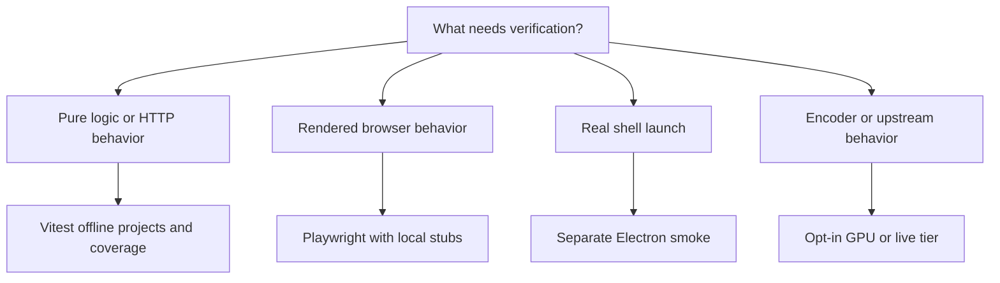

# Testing

Vitest separates offline unit/integration checks from real encoding and upstream calls. The safe all-workspace default is `pnpm test:ci`, not `pnpm test` (`package.json`, `apps/server/vitest.config.ts`).



## Test tiers

| Command                                   | Scope                                             | Requirements                                               |
| ----------------------------------------- | ------------------------------------------------- | ---------------------------------------------------------- |
| `pnpm test:unit`                          | Server unit project                               | No real upstream, GPU or keys                              |
| `pnpm test:integration`                   | Server integration project                        | Fastify injection, local stubs, fake encoders              |
| `pnpm test:ci`                            | All four workspaces, server offline projects only | No real upstream or GPU                                    |
| `pnpm test:coverage`                      | Sequential workspace V8 coverage                  | Same offline scope, threshold gates                        |
| `pnpm test:gpu`                           | Server GPU project                                | Real FFmpeg/NVENC and NVIDIA GPU                           |
| `pnpm test:live`                          | Server live project                               | Real configured services and limited network calls         |
| `pnpm --filter @homestream/web test:e2e`  | Built browser UI and isolated server              | Chromium and built server; local stub upstreams            |
| `pnpm --filter @homestream/desktop smoke` | Real Electron launch and shutdown                 | Electron binary, desktop session, built server/web/desktop |

Plain server `vitest run` selects all projects; root `pnpm test` therefore is not a safe substitute for `test:ci` (`apps/server/package.json`, `turbo.json`). Local HTTP stub servers are allowed in offline tests.

```powershell
pnpm --filter @homestream/server exec vitest run --project unit test/net.test.ts
pnpm --filter @homestream/server exec vitest run --project integration test/integration/progress-routes.test.ts
pnpm --filter @homestream/shared test
pnpm --filter @homestream/web test
pnpm --filter @homestream/desktop test
```

Server/shared tests live in their `test` directories; web tests sit beside source and use jsdom/Testing Library; desktop logic runs in Node. Configurations are `apps/server/vitest.config.ts`, `packages/shared/vitest.config.ts`, `apps/web/vite.config.ts`, and `apps/desktop/vitest.config.ts`. `vitest.shared.ts` aliases shared source, caps workers at the smaller of 8 and available CPUs, and gives ordinary tests/hooks 20-second defaults.

## Isolation and fakes

`makeTempDir`, `testConfig`, and `startTestApp` in `apps/server/test/helpers.ts` provide isolated directories, invented settings, and random ports. Set `HOMESTREAM_TEST_ROOT` to writable local storage, especially on non-Windows machines: the fallback is a Windows-oriented path. Close apps and stubs before removing files (`AGENTS.md`).

`buildApp` accepts injected DB, upstream services, telemetry, clocks, probe/resolver, encoder factory, timeouts, and health runners (`apps/server/src/app.ts`). Use `app.inject` for routes. `apps/server/test/playback/fakeEncoder.ts` models success, failure, or stalled processes without encoding. The more general playback harness can start real probes/encoders, so using it alone does not make a test offline (`apps/server/test/playback/harness.ts`).

Web helpers supply fresh Query clients and method/path fetch stubs. Player tests use fake HLS and DOM/media controls, and desktop renderer tests use a typed bridge fake (`apps/web/src/test/render.tsx`, `apps/web/src/test/fakeHls.ts`, `apps/web/src/test/player.tsx`, `apps/web/src/test/desktopBridge.ts`). SSE cases model reconnects and interleaved health answers, not a live telemetry service (`apps/web/src/events/events.test.tsx`).

Desktop unit tests exercise supervision, monitor races, IPC validation, settings, process launch, mini-player state, and telemetry without starting Electron. Its separate smoke command launches the real binary and uses CDP; it is not part of offline unit coverage. Windows CI builds all three apps, downloads Electron and runs this smoke in its required job (`.github/workflows/ci.yml`, `apps/desktop/package.json`, `apps/desktop/vitest.smoke.config.ts`).

The smoke checks the preload bridge, spawned-server status, first-run/tray state, persisted settings and second-instance `--quit`. It uses isolated user/data folders and fixed ports 8616/8617, so do not overlap smoke runs (`apps/desktop/test/smoke/launch.smoke.ts`). Node coverage excludes `apps/desktop/src/main.ts` and `apps/desktop/src/shell/`; a coverage pass alone does not prove the real shell launches (`apps/desktop/vitest.config.ts`). See [desktop](../apps/desktop/index.md).

## Browser e2e

```powershell
pnpm --filter @homestream/server build
pnpm --filter @homestream/web exec playwright install chromium
pnpm --filter @homestream/web test:e2e
```

`apps/web/e2e/build.mjs` builds plain and telemetry-stub UIs with explicit key isolation. `apps/web/playwright.config.ts` starts local hub/server processes on 8602–8607, with isolated data, absent private env files, telemetry disabled on servers, and random source-proxy ports. `apps/web/e2e/support/redirect-fetch.mjs` redirects TMDB to local stubs and rejects other non-loopback fetch targets.

The plain project selects nine spec files; the telemetry project selects `apps/web/e2e/telemetry.spec.ts`. The committed scope now includes:

| Area                                                                                 | Source cases                                                                  |
| ------------------------------------------------------------------------------------ | ----------------------------------------------------------------------------- |
| Home, deep links, device registration, no-key telemetry                              | `apps/web/e2e/smoke.spec.ts`                                                  |
| Resume/removal and clickable player overlays                                         | `apps/web/e2e/resume.spec.ts`, `apps/web/e2e/player-input.spec.ts`            |
| Cast/similar API shape, caching, rendering and image loading                         | `apps/web/e2e/details-api.spec.ts`, `apps/web/e2e/details-cast.spec.ts`       |
| Debounce, stale search cancellation, history, shortcuts and responsive navigation    | `apps/web/e2e/nav-search.spec.ts`                                             |
| Browser-local spoiler preference and progress-dependent artwork/descriptions         | `apps/web/e2e/spoilers.spec.ts`                                               |
| Settings/About content, keyboard tabs, hash/history, layout and desktop bridge views | `apps/web/e2e/settings-tabs.spec.ts`, `apps/web/e2e/settings-content.spec.ts` |

No real playback session starts in this suite. Resume and input cases intercept session/media responses in the browser; the hub gateway supplies no playable sources. Browser desktop cases inject a bridge fake, not an Electron runtime (`apps/web/e2e/resume.spec.ts`, `apps/web/e2e/player-input.spec.ts`, `apps/web/e2e/support/hub.mjs`). These are UI/API regressions, not NVENC, native-shell or real upstream validation. See [search](../apps/web/search.md) and [Settings and spoilers](../apps/web/settings-and-spoilers.md).

One Playwright worker prevents harness overlap; do not run two harnesses or a profiler using 8602 together. Failure screenshots and traces go to `apps/web/reports/e2e-results`; the HTML report goes to `apps/web/reports/e2e-report`. See [web checks](../apps/web/build-and-tests.md).

## Coverage and reports

These are configured minimum percentages, not fresh measured coverage:

| Workspace threshold file                   | Lines | Functions | Branches | Statements |
| ------------------------------------------ | ----: | --------: | -------: | ---------: |
| `apps/server/coverage-thresholds.json`     |    87 |        87 |       79 |         85 |
| `packages/shared/coverage-thresholds.json` |    98 |        98 |       98 |         98 |
| `apps/web/coverage-thresholds.json`        |    98 |        99 |       90 |         97 |
| `apps/desktop/coverage-thresholds.json`    |    97 |        91 |       99 |         96 |

`scripts/coverage-ratchet.mjs` measures and can raise thresholds; they may not fall. Its target is the floored measured percentage minus two points, applied only when higher than the existing threshold. `--no-run` reads existing summaries; `--check` writes nothing but can fail when a threshold could rise. File/line ratios in [statistics](../by-the-numbers.md) do not prove coverage or assertion quality.

The shared Vitest configuration retries failing cases twice in CI and writes package JUnit, JSON, and flaky reports under `reports`; local runs do not retry (`vitest.shared.ts`). The separate Electron smoke config does not use that retry/report setup; Playwright retries once in CI (`apps/desktop/vitest.smoke.config.ts`, `apps/web/playwright.config.ts`). `pnpm test:report`, `pnpm test:flaky-report`, `pnpm test:timing`, and `pnpm ci:summary` produce aggregate reports (`scripts/test-report.mjs`, `scripts/flaky-report.mjs`, `scripts/test-timing.mjs`, `scripts/ci-summary.mjs`). Investigate a retry pass through `docs/runbooks/flaky-tests.md`.

## GPU and live safety

Follow `.factory/skills/homestream-live-tests/SKILL.md`. Run one file at a time on an idle machine, never alongside a game. GPU config disables parallel files and caps workers at one (`apps/server/vitest.config.ts`). The Windows health gate fails closed on unreadable temperature/process ownership, new driver events, and unrounded free memory; unrelated FFmpeg does not exempt the idle check (`scripts/gpu-health.mjs`, `scripts/gpu-health-ffmpeg.mjs`).

Keep real-title bandwidth at `MAX_DOWNLOAD_MBPS=60` or lower, make few gateway calls, and never download full files for testing. End sessions gently with bodyless `DELETE /api/sessions/:id`, then stop owned servers by PID. Ordinary server tests use port 0; manually started services use 8600–8699 (`AGENTS.md`). Report skipped tiers honestly. See [debugging](debugging.md) and [playback](../systems/playback/index.md).

This wiki refresh inspected configuration and test sources only; it did not run application, browser, Electron, GPU or live suites.
