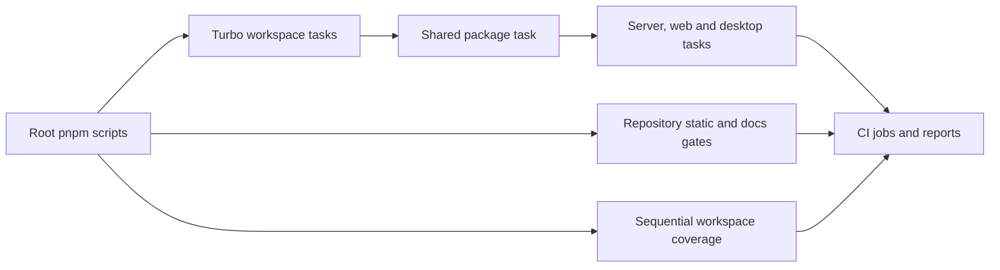

# Tooling

pnpm workspaces and Turbo coordinate builds and checks. Repository scripts add code-size, dependency, privacy, generated-doc, and automation gates (`package.json`). See [workflow](development-workflow.md) for when to run them.

## Setup and task graph

Node `>=24 <25` and pnpm `^12.16.0` are required; CI selects pnpm 12.18.0. Four workspaces exist, including the working Electron shell. TV has no package (`package.json`, `pnpm-workspace.yaml`, `.github/workflows/ci.yml`).

`scripts/bootstrap.mjs` installs locked dependencies, hooks, and shared output. `turbo.json` orders upstream builds and caches `dist`; root coverage instead runs packages sequentially. `test` is uncached, but `test:ci` is cacheable with no restored report output. Use direct workspace commands or coverage when a fresh run matters.

Turbo declares shared config/lockfile dependencies, but no general environment pass-through or repository `.env` cache input. Do not assume changing ignored env settings invalidates a cached build. For deliberate telemetry builds, invoke the web build directly and verify inputs without printing values (`turbo.json`, `apps/web/vite.config.ts`).

## Static gates

| Command                  | Source                                         | Boundary                                                 |
| ------------------------ | ---------------------------------------------- | -------------------------------------------------------- |
| `pnpm format:check`      | `.prettierrc`, `.prettierignore`               | Formatting; generated wiki excluded                      |
| `pnpm lint`              | `eslint.config.mjs`, `scripts/code-limits.mjs` | Naming, type imports, complexity, file/function ceilings |
| `pnpm knip`              | `knip.jsonc`                                   | Unused files, exports and dependencies                   |
| `pnpm dup`               | `.jscpd.json`                                  | Duplication budget                                       |
| `pnpm deps:check`        | `.dependency-cruiser.cjs`                      | Cycles and layer boundaries                              |
| `pnpm syncpack:lint`     | `.syncpackrc.json`                             | Dependency range consistency                             |
| `pnpm techdebt`          | `scripts/techdebt.mjs`, `techdebt.config.json` | Marker budget                                            |
| `pnpm check:large-files` | `scripts/check-large-files.mjs`                | Oversized tracked files                                  |
| `pnpm check:secrets`     | `scripts/pre-commit-secrets.mjs`               | Staged secrets and personal-path scan                    |

The line checker excludes comments/blanks, enforces 400 file lines and 80 function lines, exempts test functions, and rejects added or raised baseline entries. `--write` only lowers existing ceilings or removes unnecessary entries (`scripts/lib/code-limits.mjs`, `scripts/code-limits.mjs`). New code must split instead of adding exceptions.

Knip knows desktop main/preload/scripts/smoke entry points and the config-editor binary; there is no old Electron-skeleton ignore (`knip.jsonc`). Dependency-cruiser prevents app-to-app imports and production-to-test dependencies. Hooks run staged checks, not tests (`.dependency-cruiser.cjs`, `lefthook.yml`).

## Generated docs and instructions

| Command                                      | Source of truth                                             | Output                                                               |
| -------------------------------------------- | ----------------------------------------------------------- | -------------------------------------------------------------------- |
| `pnpm openapi:export` / `pnpm openapi:check` | Routes, shared schemas, `apps/server/src/docs/routeDocs.ts` | `docs/openapi.json`                                                  |
| `pnpm db:schema` / `pnpm db:schema:check`    | `apps/server/src/db/migrations.ts`                          | `docs/schema.sql`, table coverage in `docs/database.md`              |
| `pnpm docs:check`                            | `scripts/check-docs.mjs`                                    | Fences, relative links, anchors and maintained architecture diagrams |
| `pnpm agents:check`                          | `scripts/validate-agents-md.mjs`                            | Real commands, paths and API endpoints in agent docs/skills/runbooks |

The docs checker explicitly excludes generated wiki pages; its Mermaid checks are structural, not a full renderer. Wiki generation needs its own link, source-path, page-order, tree, and diagram audit (`scripts/check-docs.mjs`).

## Advisory automations

The required **Linux** job in `.github/workflows/ci.yml` now gates three parallel execution jobs: **Linux checks** for static/docs/bundle checks, **Linux tests** for software FFmpeg and sequential workspace coverage/reports, and **Linux secrets** for full-history Gitleaks. It runs even after dependency failure and passes only if all three succeeded. Required protection names remain **Linux** and **Windows**. See [deployment](../deployment.md#ci-and-releases) for cache fallback and limits; `apps/server/test/scripts/workflows.test.ts` guards the layout and command coverage.

`docs/ci.md` is the maintained guide. These do not replace required `Linux`/`Windows` checks:

- Droid PR review uses the pinned official action, then a cleanup job retains only the newest summary. Push review posts inline commit comments plus one summary, including a short generated-only summary without invoking Droid (`.github/workflows/droid-review.yml`, `scripts/droid-pr-cleanup.mjs`, `scripts/droid-push-review.mjs`).
- CI timing compares jobs/steps/tests with the median of ten successful main runs, reading test durations from the **Linux tests** `test-reports` artifact. Every main run has a distinct concurrency group and records timing on the orphan `ci-metrics` branch; PRs receive a sticky comparison (`.github/workflows/ci.yml`, `scripts/ci-timing.mjs`, `scripts/lib/metrics-branch.mjs`).
- Daily code health compares main with the SHA in one rolling issue, skips generated-only deltas, and updates that issue without pushing code. Dependencies are installed before the line-limit check (`.github/workflows/code-health.yml`, `scripts/code-health.mjs`).

Review and health scans restrict Droid to read tools; write-capable wrapper scripts publish only the specified reports. Missing keys or service failures remain advisory (`scripts/lib/droid.mjs`, `docs/ci.md`).

## Other tools

`scripts/next-version.mjs` plans Conventional Commit releases and skips a SHA already covered by a release tag. `scripts/readiness-audit.mjs` audits readiness. `scripts/flags.mjs` checks usage or creates missing remote flags; `scripts/sentry-alerts.mjs` plans/applies remote rules; `scripts/sentry-issues.mjs` syncs issues. Do not run sync/apply/smoke commands as ordinary offline checks. Package aliases for dry runs and report commands are in `package.json`.

GPU safety and process ownership helpers are in `scripts/gpu-health.mjs` and `scripts/gpu-health-ffmpeg.mjs`; follow [testing](testing.md) before real encodes.

## Generated wiki lifecycle

`.github/workflows/droid-wiki-refresh.yml` runs daily at 17:00 UTC or manually, skips unchanged source unless forced, restores the rolling wiki, and separates generation from PR publishing. `scripts/wiki-mirror.mjs` mirrors page removals, refuses artifacts without metadata, and preserves but never commits images/video (`docs/wiki.md`).

Ordinary CI ignores wiki-only changes. The publisher supplies not-applicable success statuses named `Linux` and `Windows` so generated-only PRs can merge; renaming required checks requires updating `REQUIRED_CHECKS` in `.github/workflows/droid-wiki-refresh.yml`.

With the built-in `GITHUB_TOKEN`, the merge starts no push-review workflow. The publisher now waits up to three minutes for the PR to become merged, fetches its merge commit at depth two, and runs `scripts/droid-push-review.mjs` on parent-to-merge. It deliberately supplies no Factory key: the wiki-only diff produces the short “no reviewable changes” commit summary without calling Droid. A delayed merge or posting failure is only a warning/tolerated failure, so a successful generation is not proof that a summary was posted.

When `FACTORY_WIKI_PR_TOKEN` is configured, downstream workflows can start and the publisher skips this fallback to avoid duplicate summaries (`.github/workflows/droid-wiki-refresh.yml`, `docs/ci.md`). See [deployment](../deployment.md), [dependencies](../reference/dependencies.md), and [debugging](debugging.md).
