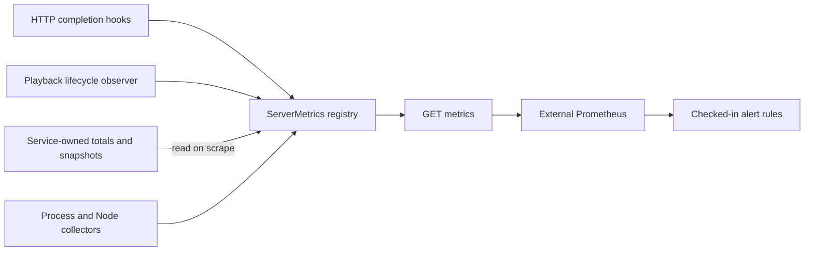

# Metrics

`ServerMetrics` in `apps/server/src/metrics/serverMetrics.ts` exposes **19 HomeStream metric families** through `GET /metrics`, plus Node/process defaults. Local metrics work with telemetry disabled; a scraper and any dashboard/notification backend are separate services (`apps/server/src/routes/ops.ts`).

## Collection model

`ServerMetrics` in `apps/server/src/metrics/serverMetrics.ts` receives HTTP observations and playback lifecycle counters. `apps/server/src/app.ts` attaches callbacks for playback activity, gateway/TMDB totals and source-cache counters. Scrapes read those service totals and increment pulled counters only by growth; gauges read current values. No upstream request or FFmpeg subprocess is started by a scrape.

The first render starts prom-client default collection once. Families include CPU, resident memory, event-loop lag and GC (`process_*`, `nodejs_*`). The response has the registry's text content type and `Cache-Control: no-store` (`apps/server/src/routes/ops.ts`).

Counters and gauges belong to the current process; they are not stored in SQLite and reset when it restarts. Pulled counters ignore a lower service total until it catches up with the previous observed total; do not replace a service's totals in-place and assume the registry handles that as a reset (`apps/server/src/metrics/serverMetrics.ts`). Historical rates/retention belong to the external metrics backend, not [data models](../reference/data-models.md).

## HomeStream families

All names below are literal metric families declared in `apps/server/src/metrics/serverMetrics.ts`.

| Metric                                      | Type      | Labels                      | Interpretation                                |
| ------------------------------------------- | --------- | --------------------------- | --------------------------------------------- |
| `homestream_http_requests_total`            | Counter   | `method`, `route`, `status` | Completed instrumented requests               |
| `homestream_http_request_duration_seconds`  | Histogram | `method`, `route`, `status` | Server response duration, not player startup  |
| `homestream_sessions_active`                | Gauge     | None                        | Current playback activity count               |
| `homestream_sessions_started_total`         | Counter   | None                        | Starts that produced a first segment          |
| `homestream_sessions_failed_total`          | Counter   | `stage`, `code`             | Start/running failures                        |
| `homestream_encoder_restarts_total`         | Counter   | `reason`                    | `retry`, `seek`, `tracks`, `resume`           |
| `homestream_encoder_speed_avg`              | Gauge     | None                        | Mean live encoder speed, 1 = real time        |
| `homestream_encoder_speed_min`              | Gauge     | None                        | Minimum live encoder speed                    |
| `homestream_gateway_requests_total`         | Counter   | None                        | Gateway stream lookups sent                   |
| `homestream_gateway_errors_total`           | Counter   | None                        | Failed gateway lookups                        |
| `homestream_gateway_cache_hits_total`       | Counter   | None                        | Gateway cache hits                            |
| `homestream_gateway_cache_misses_total`     | Counter   | None                        | Gateway cache misses                          |
| `homestream_tmdb_requests_total`            | Counter   | None                        | TMDB requests sent                            |
| `homestream_tmdb_errors_total`              | Counter   | None                        | Failed TMDB requests                          |
| `homestream_tmdb_cache_hits_total`          | Counter   | None                        | TMDB cache hits                               |
| `homestream_tmdb_cache_misses_total`        | Counter   | None                        | TMDB cache misses                             |
| `homestream_sourceproxy_cache_hits_total`   | Counter   | None                        | Block-cache reads served from cache           |
| `homestream_sourceproxy_cache_misses_total` | Counter   | None                        | Block-cache reads requiring upstream          |
| `homestream_sourceproxy_cache_bytes`        | Gauge     | None                        | Current block-cache bytes, not HLS disk usage |

Histogram buckets are **0.005, 0.01, 0.025, 0.05, 0.1, 0.25, 0.5, 1, 2.5, 5, 10, 30 seconds**, plus the normal infinity bucket. `_bucket`, `_sum` and `_count` are the histogram's exported series.

Both speed gauges return **0 when idle**. They are raw snapshots, not the health check's sustained filling-only slow-encoder detector. `apps/server/src/telemetry/playbackObserver.ts` feeds lifecycle metrics even when outbound telemetry is off.

## Labels and privacy

The HTTP hook supplies matched route templates, not raw URLs; unmatched paths share `unmatched`. Query strings are excluded. Failure `stage` is `start` or `running`; `code` must match `[a-z0-9_]{1,48}`, otherwise it becomes `other`. Restart reasons come from the fixed observer type (`apps/server/src/http/observability.ts`, `apps/server/src/playback/observer.ts`).

Do not introduce title/session/device IDs, IPs, filenames, source URLs or hosts as labels. Labels should remain small fixed vocabularies. HTTP methods and status strings are passed from Fastify by the hook rather than independently sanitized by the registry.

Per-request logging/metrics skip exactly `/hls/*`, `/metrics`, `/healthz`, `/readyz` and `/api/events`. Thus HTTP latency/error ratios do **not** measure HLS delivery, event-stream duration or probe availability. `/api/health` is counted. There is no exported GPU-temperature, disk-free-space or player-buffering metric; use [health](../systems/health.md) and session snapshots.

## Backend configuration and interpretation

`monitoring/prometheus/prometheus.yml` scrapes `127.0.0.1:8600/metrics` every **30 seconds**, under `job_name: homestream`, and loads the rules in `monitoring/prometheus/alerts.yml`. Change the target for your server/collector topology. No Grafana dashboard, Prometheus deployment or Alertmanager receiver is provisioned by that file.

The checked-in thresholds use 5xx share and p95 latency as useful signals, not a declared availability SLO or error-budget policy. See [alerting](alerting.md) for all boundaries and evaluation windows. The port is open to the same LAN as the API; do not expose it publicly.

For a latency chart, the checked-in alert uses `histogram_quantile(0.95, sum by (le) (rate(homestream_http_request_duration_seconds_bucket[5m])))`. This aggregates all instrumented routes. For a specific operation, retain/filter its route label rather than interpreting an aggregate p95 as every route's latency (`monitoring/prometheus/alerts.yml`). No checked-in Grafana dashboard or target percentage defines a service-level objective.

To add a metric, declare it in `apps/server/src/metrics/serverMetrics.ts`, attach a service source in `apps/server/src/app.ts` or a lifecycle observation, and extend `apps/server/test/integration/observability.test.ts`. Preserve scrape-time reads instead of adding work per media segment.

This **2026-11-08** refresh inspected the registry and rule sources at **`0a8f04f`**; it did not scrape a running server, run tests or benchmark collectors. See [configuration](../reference/configuration.md) for the server port and [telemetry](../systems/telemetry.md) for the separate optional outbound clients.

## Key source files

| File                                                 | Purpose                                                |
| ---------------------------------------------------- | ------------------------------------------------------ |
| `apps/server/src/metrics/serverMetrics.ts`           | Registry, buckets, label guards and default collectors |
| `apps/server/src/http/observability.ts`              | Route-template observations and exclusions             |
| `apps/server/src/telemetry/playbackObserver.ts`      | Lifecycle counter bridge                               |
| `apps/server/src/app.ts`                             | Service-source attachment                              |
| `apps/server/src/routes/ops.ts`                      | Metrics HTTP response                                  |
| `monitoring/prometheus/prometheus.yml`               | Example scrape target and interval                     |
| `monitoring/prometheus/alerts.yml`                   | Alert expressions                                      |
| `apps/server/test/integration/observability.test.ts` | Exposed families and label/privacy checks              |
| `apps/server/test/telemetry/telemetryUnits.test.ts`  | Pulled counters and gauge behavior                     |
