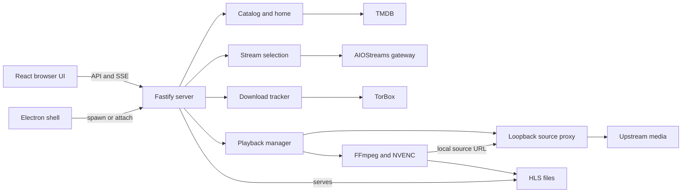
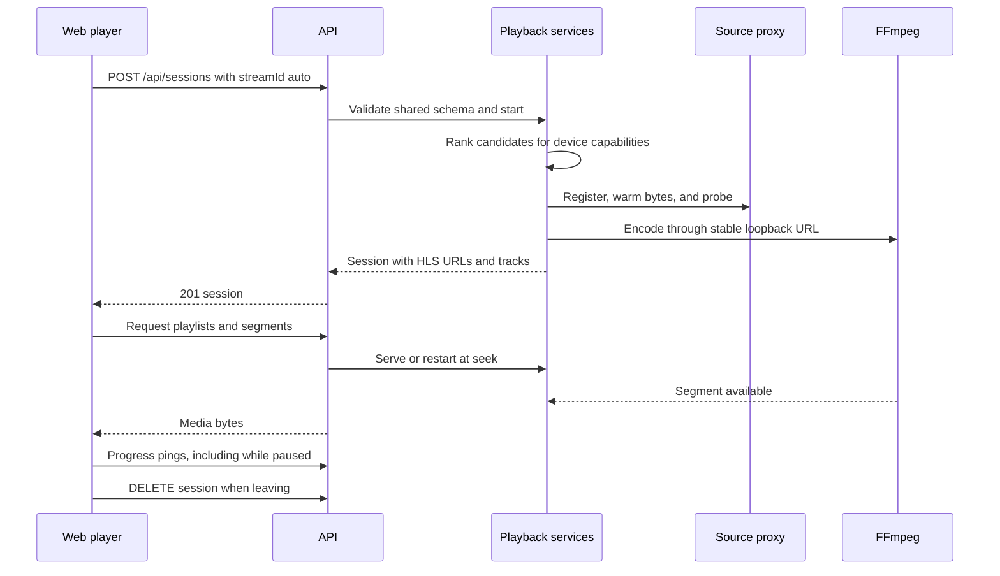

# Architecture

HomeStream runs a Fastify server, FFmpeg child processes, and thin LAN clients. `apps/server/src/app.ts` constructs services; `apps/server/src/index.ts` starts listeners and workers. The browser and Electron renderer share the web build, while the desktop main process supervises the server (`apps/web/src/main.tsx`, `apps/desktop/src/main.ts`).

## Runtime boundaries

The public listener defaults to port 8600 on all interfaces; the source proxy binds only to loopback, normally on 8650. The API has no authentication. Device registration records capabilities (`apps/server/src/config.ts`, `apps/server/src/sourceproxy/proxy.ts`, `apps/server/src/routes/devices.ts`). See [security](../security.md).

SQLite uses built-in `node:sqlite`, WAL, prepared statements, and numbered transactional migrations. HLS segments live separately under the transcode directory (`apps/server/src/db/index.ts`, `apps/server/src/db/migrations.ts`, `apps/server/src/playback/segmentStore.ts`). See [data models](../reference/data-models.md).

## Playback flow

The session request can instead return `202` with download tracking when no cached source is playable. A gateway downloading placeholder is never a valid movie. Prefetch warms source bytes and probe results without encoding (`apps/server/src/routes/sessions.ts`, `apps/server/src/playback/sessionStart.ts`, `apps/server/src/playback/placeholder.ts`, `apps/server/src/prefetch/service.ts`).

`PlaybackManager` is a facade over shared context, session slots, startup, encoder lifecycle, recovery, subtitle handoff, and HLS serving. Slot ownership remains held when an encoder fails to exit, preventing a replacement from overcommitting the machine (`apps/server/src/playback/manager.ts`, `apps/server/src/playback/sessionSlots.ts`, `apps/server/src/playback/stuckStop.ts`). See [playback](../systems/playback/index.md).

## Workspaces and languages

| Workspace | Responsibility |
| --- | --- |
| `apps/server` | API, persistence, upstream services, encoding, and monitoring |
| `apps/web` | React routes, HLS playback, Query cache, SSE, and desktop renderer views |
| `apps/desktop` | Electron windows, tray, server supervisor, IPC, and mini player |
| `packages/shared` | Zod contracts, desktop bridge, analytics catalog, flags, and sanitizers |

TypeScript and TSX implement the runtimes, JavaScript ESM implements repository scripts, CSS styles the UI, and YAML configures automation. The committed inventory has 60,820 physical TypeScript lines, 8,007 TSX lines, 5,734 JavaScript lines, and 3,133 CSS lines, including tests, blanks, and comments. [By the numbers](../by-the-numbers.md#size) defines the exclusions and distinguishes these counts from code-only LOC. Workspace membership comes from `pnpm-workspace.yaml`; apps must not import each other (`.dependency-cruiser.cjs`). Desktop and web communicate through shared bridge types rather than cross-app imports (`packages/shared/src/desktop.ts`).

## Startup and shutdown

The server loads settings and logging, constructs services, recovers orphaned encoders, starts the proxy and public listener, then starts health checks, download polling, and mDNS. Signals, IPC, and stdin share bounded shutdown handling (`apps/server/src/index.ts`, `apps/server/src/app.ts`, `apps/server/src/shutdown.ts`).

The web entry point prefetches Home while loading its route. Device registration, SSE, and telemetry wait for the content mark and idle time. Sentry and PostHog imports stay out of the initial bundle (`apps/web/src/main.tsx`, `apps/web/src/lib/startup.ts`, `apps/web/src/telemetry/index.ts`). On SSE open, health is reconciled through the health query; pushed updates cancel older requests so late answers cannot overwrite newer state (`apps/web/src/events/serverEvents.ts`).

The desktop entry point acquires a single-instance lock, loads settings, and creates the shell and supervisor. It can attach to an existing server instead of owning a child; windows and quit behavior distinguish these cases (`apps/desktop/src/main.ts`, `apps/desktop/src/supervisor.ts`). See [desktop](../apps/desktop/index.md) and [network controls](../systems/network.md).
