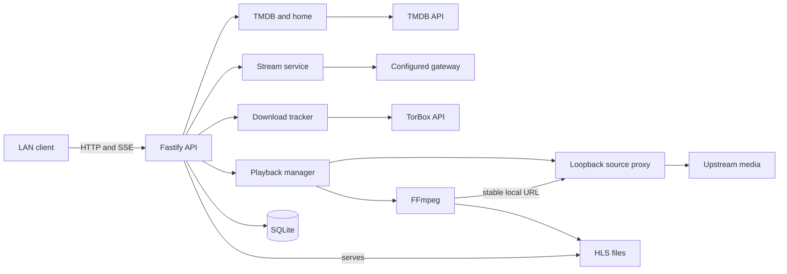
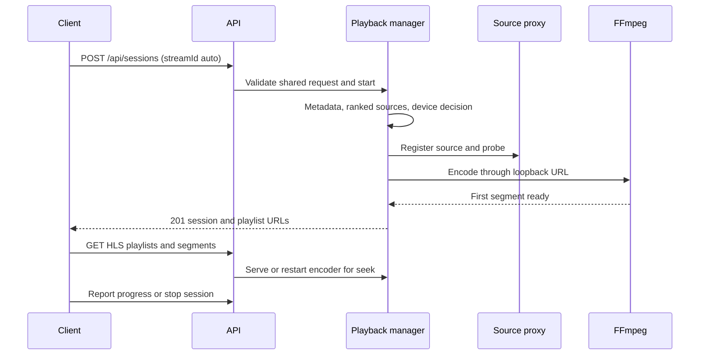

# Architecture

HomeStream runs one Node.js server process, FFmpeg child processes, and thin LAN clients. `apps/server/src/app.ts` composes the services; `apps/server/src/index.ts` owns process startup and shutdown. The browser application is currently a placeholder, and desktop/TV clients remain planned (`apps/web/src/App.tsx`, `README.md`).

## Boundaries

The public listener defaults to `0.0.0.0:8600`. The source proxy normally uses port 8650 and binds only to loopback (`apps/server/src/config.ts`, `apps/server/src/sourceproxy/proxy.ts`). The public API has no login or authorization layer. Device registration records capabilities, not trust. Optional Sentry and PostHog clients are disabled without their keys (`apps/server/src/telemetry/index.ts`).

SQLite uses the built-in `node:sqlite` API, WAL, a busy timeout, and transactional numbered migrations (`apps/server/src/db/index.ts`). HLS segments live in a separate transcode directory. Persistent progress, plays, download tracking, events, settings, devices, and upstream caches are documented in [data models](../reference/data-models.md).

## Playback flow

If no cached source is available, session creation can return `202` with a tracked download rather than a session (`apps/server/src/routes/sessions.ts`, `apps/server/src/downloads/service.ts`). Prefetch warms the source and probe before Play without starting an encoder (`apps/server/src/prefetch/service.ts`).

## Workspace boundaries

| Workspace         | Responsibility                                                 |
| ----------------- | -------------------------------------------------------------- |
| `apps/server`     | Fastify API, database, upstream services, encoders, monitoring |
| `apps/web`        | React placeholder and Vite development proxy                   |
| `packages/shared` | Zod contracts, telemetry catalog, flags, and sanitization      |

The runtime implementation is TypeScript/TSX; scripts use JavaScript ESM, and automation uses YAML. Exact language totals are in [by the numbers](../by-the-numbers.md). Dependencies flow toward shared contracts, never from shared into an app (`.dependency-cruiser.cjs`).

## Startup and ownership

Startup loads configuration and logging, builds services, recovers orphaned encoders, starts the source proxy and public listener, then starts health checks, download polling, telemetry, and mDNS (`apps/server/src/index.ts`). The app close hook stops services and releases resources it owns (`apps/server/src/app.ts`). Signal, IPC, and stdin shutdown requests share a bounded shutdown helper (`apps/server/src/shutdown.ts`).

Continue with [server](../apps/server.md), [network controls](../systems/network.md), and [monitoring](../how-to-monitor/index.md).
