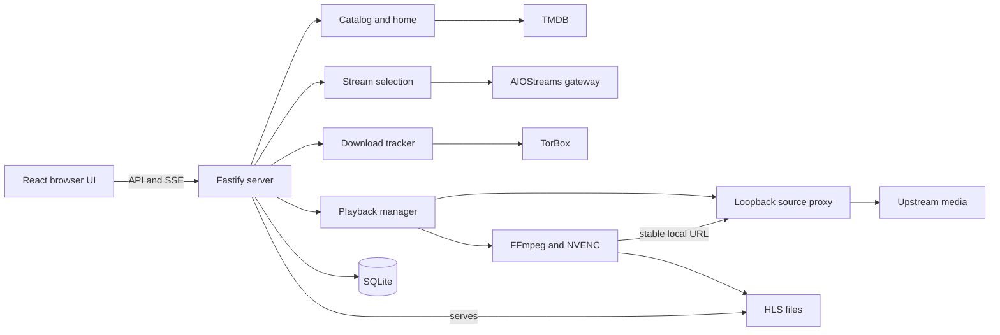
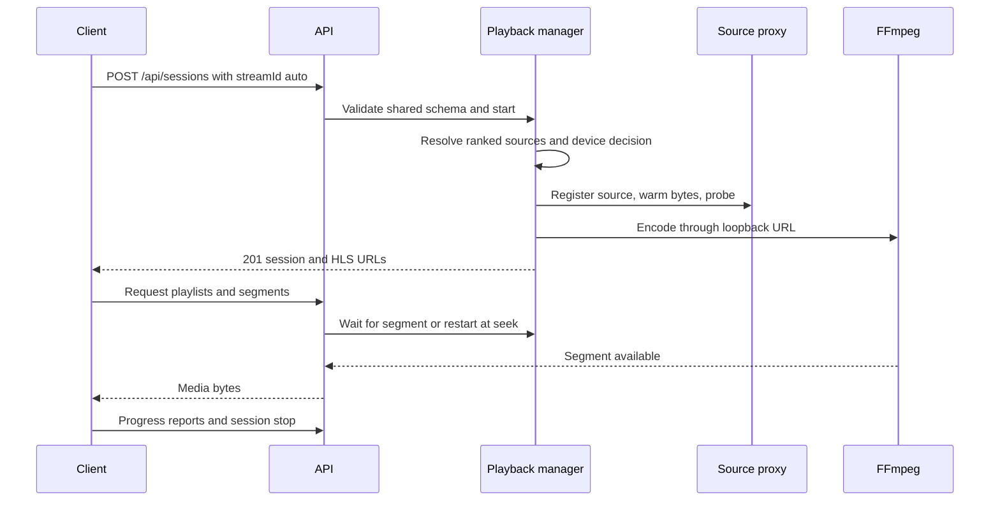

# Architecture

HomeStream has one server process, FFmpeg child processes, and thin LAN clients. `apps/server/src/app.ts` constructs the services, while `apps/server/src/index.ts` owns process startup. The browser UI is implemented separately; the Electron shell remains a skeleton (`apps/web/src/main.tsx`, `apps/desktop/src/index.ts`).

## Runtime boundaries

The public listener defaults to `0.0.0.0:8600`; the source proxy binds to loopback, normally on 8650. The API has no authentication. Device registration is capability bookkeeping (`apps/server/src/config.ts`, `apps/server/src/sourceproxy/proxy.ts`, `apps/server/src/routes/devices.ts`).

SQLite uses built-in `node:sqlite`, WAL, prepared statements, and numbered transactional migrations. HLS files live separately in the transcode directory (`apps/server/src/db/index.ts`, `apps/server/src/db/migrations.ts`, `apps/server/src/playback/segmentStore.ts`). See [data models](../reference/data-models.md).

## Playback flow

A session request can instead return `202` with a tracked download when no cached source is usable (`apps/server/src/routes/sessions.ts`, `apps/server/src/downloads/service.ts`). Prefetch warms bytes and probe results without starting an encoder (`apps/server/src/prefetch/service.ts`). The browser's current Play links reach a placeholder; they do not yet perform this playback sequence (`apps/web/src/pages/PlayerPage.tsx`).

## Workspaces and languages

| Workspace         | Responsibility                                                                  |
| ----------------- | ------------------------------------------------------------------------------- |
| `apps/server`     | Fastify API, SQLite, upstream clients, playback, and monitoring                 |
| `apps/web`        | React routes, Query cache, device identity, SSE updates, optional telemetry     |
| `apps/desktop`    | Main-process logging, request IDs, and telemetry support; shell not implemented |
| `packages/shared` | Zod contracts, analytics catalog, flags, identity, and sanitizers               |

TypeScript/TSX implements the runtimes, JavaScript ESM implements repository scripts, CSS styles the UI, and YAML configures automation. The committed snapshot contains 42,674 physical TypeScript lines, 3,513 TSX lines, 3,799 JavaScript lines, and 1,981 CSS lines, including comments, blanks, and tests. [By the numbers](../by-the-numbers.md#size) defines the exclusions and gives the complete breakdown. Imports point toward shared contracts; apps must not import each other (`.dependency-cruiser.cjs`).

## Startup and shutdown

The server loads config and logging, constructs services, recovers orphaned encoders, starts both listeners, then starts health checks, download polling, and mDNS. The close hook releases owned resources; signal, IPC, and stdin shutdown paths share a bounded helper (`apps/server/src/index.ts`, `apps/server/src/app.ts`, `apps/server/src/shutdown.ts`).

The browser prefetches Home data while loading its lazy route. Telemetry, device registration, and SSE wait for the content mark and idle time, with a fallback timeout (`apps/web/src/main.tsx`, `apps/web/src/lib/startup.ts`). Telemetry chunks contain the SDK imports, outside the initial bundle (`apps/web/src/telemetry/index.ts`). See [telemetry](../systems/telemetry.md) and [network controls](../systems/network.md).
