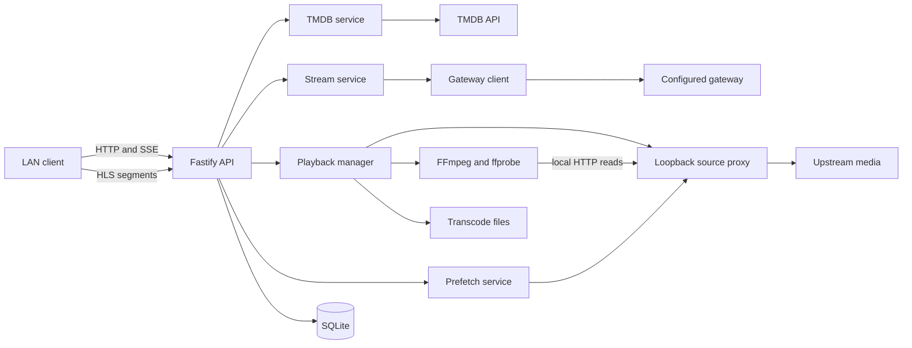

# Architecture

HomeStream has one implemented service runtime, one placeholder browser application, and a shared contract package. `apps/server/src/app.ts` is the composition root; `apps/server/src/index.ts` owns startup, discovery, and shutdown.

## Runtime boundaries

The public listener binds to `0.0.0.0`, with port 8600 by default. The internal source proxy is configured separately, normally at public port plus 50, and binds to loopback (`apps/server/src/config.ts`, `apps/server/src/sourceproxy/proxy.ts`). These are different trust boundaries, not two public APIs.

`buildApp` constructs the dependency graph and attaches `AppContext` to Fastify. Injectable database, logger, network services, probe, and URL resolver support isolated tests (`apps/server/src/app.ts`, `apps/server/src/context.ts`).

SQLite uses Node's built-in `node:sqlite`, WAL mode, and numbered transactional migrations (`apps/server/src/db/index.ts`, `apps/server/src/db/migrations.ts`). Sessions also create transient encoded files under the configured transcode directory.

## Workspace boundaries

| Workspace | Responsibility |
| --- | --- |
| `apps/server` | Fastify routes, SQLite, metadata, gateway, source caching, FFmpeg |
| `apps/web` | React entry point and placeholder; Vite proxies API/HLS in development |
| `packages/shared` | Zod contracts and inferred TypeScript types |

The implementation language is TypeScript/TSX; configuration also uses JavaScript and YAML. [By the numbers](../by-the-numbers.md) contains measured language totals and their counting rules.

## Startup and ownership

`apps/server/src/index.ts` loads configuration, opens logging, builds the app, recovers orphaned encoders, starts the proxy, starts the public listener, and advertises mDNS. Shutdown stops discovery and closes the app. `apps/server/src/app.ts` closes playback and proxy resources and only closes injected-capable dependencies when it owns them.

See [server](../apps/server.md), [source proxy](../systems/source-proxy.md), and [security](../security.md) for implementation details.
