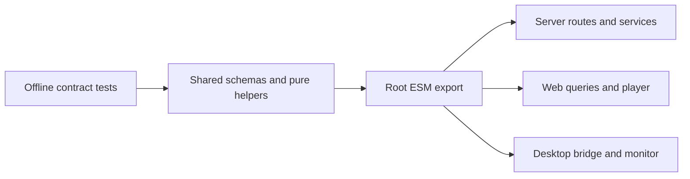

# Packages

Active contributors: VeroxAUS

## Purpose

The repository has one internal package, [shared](shared.md), consumed by the [server](../apps/server.md), [web UI](../apps/web/index.md) and working [desktop shell](../apps/desktop/index.md). It holds cross-runtime contracts and pure policy, not application services.

## Layout and boundary

| Path                           | Responsibility                                                             |
| ------------------------------ | -------------------------------------------------------------------------- |
| `packages/shared/src/index.ts` | Public barrel for schemas, inferred types, desktop bridge and pure helpers |
| `packages/shared/src/`         | Fourteen implementation modules plus the barrel                            |
| `packages/shared/test/`        | Offline contract, privacy and policy tests                                 |
| `packages/shared/package.json` | ESM runtime/declaration exports and Zod dependency                         |

`@homestream/shared` imports resolve to compiled JavaScript and declarations through `packages/shared/package.json`. Source aliases in Vite/Vitest allow development and tests against source; aliases do not replace the package export boundary. The package is private, not an independently published SDK. There are four application/package workspaces in `pnpm-workspace.yaml`, but only shared lives under `packages/`.

The package has no HTTP client, SQLite connection, Electron runtime or telemetry SDK. Types describe transport shapes; consumers still choose where runtime validation occurs. Typed event/flag definitions are not telemetry initialization: see [telemetry](../systems/telemetry.md).

## Compatibility and integration

Catalog details now include bounded cast/similar arrays. Missing arrays from older servers default to empty in `packages/shared/src/catalog.ts`; consumers parse the additive shape through their existing details queries. Desktop handover already carries volume/mute state in `packages/shared/src/desktop.ts`, so mini-player controls do not require a second IPC contract. Browser-local spoiler protection is not a server setting or shared progress field. See [catalog](../features/catalog.md), [screens](../apps/web/screens.md) and [shared contract semantics](shared.md).

## How to modify

Add cross-runtime schemas or pure rules in `packages/shared/src/`, export additions through `packages/shared/src/index.ts`, and extend tests and affected consumers together. Desktop IPC types live here, but privileged implementation remains in the desktop app. Keep filesystem/process operations, upstream secrets and runtime SDKs out.

HTTP contract changes also require route documentation and generated OpenAPI updates; see [API](../api/index.md). Full module families, semantic distinctions and testing entry points are in [Shared contracts](shared.md).

## Key source files

| File                                  | Purpose                             |
| ------------------------------------- | ----------------------------------- |
| `pnpm-workspace.yaml`                 | Workspace membership                |
| `packages/shared/package.json`        | Root ESM/declaration export         |
| `packages/shared/src/index.ts`        | Public import surface               |
| `packages/shared/tsconfig.build.json` | Compilation boundary                |
| `packages/shared/vitest.config.ts`    | Offline tests and coverage settings |

## Measured scope

At `0a8f04f`: **15 production files / 10 test files**, test/source file ratio **0.67**, **1 unique human contributor**. Method: `git ls-tree -r --name-only 0a8f04fd81cfaa7ca5d1689550ad207e7fc0d3ae`, counting `.ts` under `packages/shared/src/` and `*.test.ts` under `packages/shared/test/`; include the barrel, exclude configs/outputs. Scoped `origin/main` author history excludes bots and agrees with `.github/CODEOWNERS`. File ratios do not measure coverage; no application tests were run.
