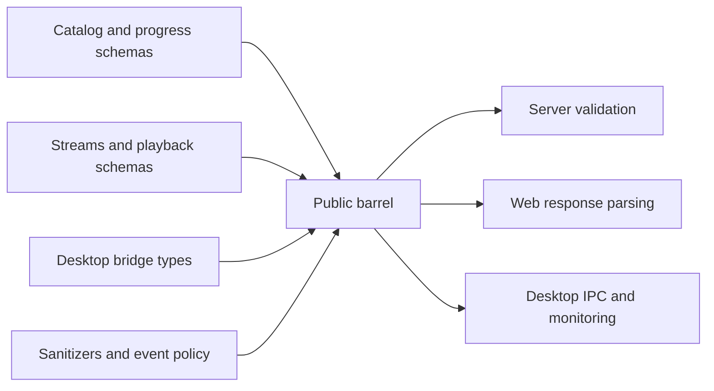

# Shared contracts

Active contributors: VeroxAUS

## Purpose and import boundary

`@homestream/shared` exposes runtime Zod schemas, inferred TypeScript types and pure cross-runtime helpers through `packages/shared/src/index.ts`. The root export in `packages/shared/package.json` targets compiled ESM and declarations. There are no application imports, privileged desktop operations, network clients, database connections or telemetry SDKs.

## Schema families and layout

| Source module                      | Contract family                                                                                                            |
| ---------------------------------- | -------------------------------------------------------------------------------------------------------------------------- |
| `packages/shared/src/schemas.ts`   | Device capabilities/registration/listing, server identity, event levels/sources, error envelopes and failed-start attempts |
| `packages/shared/src/catalog.ts`   | Movie/show/season/episode metadata, Home rows, featured reasons, continue watching and bounded search                      |
| `packages/shared/src/streams.ts`   | URL-free discovered options, recommendation, discovery failures and device query                                           |
| `packages/shared/src/playback.ts`  | Session start/patch, prefetch, decision, source HDR, audio/subtitle tracks, encoder stats, activity and session responses  |
| `packages/shared/src/downloads.ts` | Tracking state/status, HTTP 202 start, details extensions and download SSE events                                          |
| `packages/shared/src/progress.ts`  | Progress pings/resume/completion, episode progress, continue-watching removal, history filters and statistics              |
| `packages/shared/src/network.ts`   | Aggregate/per-session download rate, cap/read-ahead details and typed network check                                        |
| `packages/shared/src/health.ts`    | Dependency health/check IDs, logs queries and log events                                                                   |
| `packages/shared/src/ops.ts`       | Liveness/readiness success envelopes                                                                                       |
| `packages/shared/src/desktop.ts`   | Preferences/update validation, handover, lightweight activity, bridge, diagnostics and restart schedule                    |
| `packages/shared/src/analytics.ts` | Typed event catalog, bounded properties and page-route templates                                                           |
| `packages/shared/src/flags.ts`     | Import-free typed flag registry, defaults and remote-value coercion                                                        |
| `packages/shared/src/sanitize.ts`  | Text/object/breadcrumb/Sentry filtering and stack-root relativization                                                      |
| `packages/shared/src/identity.ts`  | Injected host/user word collection and whole-word scrubbing                                                                |

## Additive catalog details

`CastMemberSchema`, `MAX_CAST`, `MAX_SIMILAR`, `MovieDetailsSchema` and `ShowDetailsSchema` in `packages/shared/src/catalog.ts` define the details extras:

| Field       | Contract                                                                                              |
| ----------- | ----------------------------------------------------------------------------------------------------- |
| `cast`      | At most **15** members; nonempty name, character string (possibly empty), nullable profile URL string |
| `similar`   | At most **20** media summaries                                                                        |
| Both arrays | Missing/undefined values default to `[]` for clients talking to an older server; null is invalid      |

These schema bounds reject oversized arrays; they do not truncate them. The current server always emits both arrays, normalizes cast billing order and caps results before responding. Movie details append `external_ids,credits,recommendations,similar`; show details append `external_ids,aggregate_credits,recommendations,similar` in `apps/server/src/tmdb/service.ts`. The public `similar` array prefers normalized/deduplicated recommendations, falling back to the appended similar list only when no recommendations survive; it is not a combined list (`apps/server/src/tmdb/normalize.ts`). See [catalog](../features/catalog.md) for exact source normalization and cache-version behavior.

`MovieDetailsWithDownloadSchema` and `ShowDetailsWithDownloadsSchema` in `packages/shared/src/downloads.ts` extend these schemas, so the defaults also apply to the browser's existing details parsers in `apps/web/src/api/queries.ts`. `packages/shared/test/catalog.test.ts` verifies compatibility, array limits and nameless-member rejection.

## Important wire semantics

Device kinds describe capability registration, not accounts, authentication or proof that a TV application exists (`packages/shared/src/schemas.ts`). Capability IDs/names are trimmed and bounded to 128 characters, dimensions to 16384, and audio channels to 1–8. Device/history responses may contain operational IP/device information; those API shapes are **not** analytics allowlists.

Stream discovery exposes 16-character lowercase hexadecimal IDs, metadata and labels, never raw upstream URLs. Resolutions include 1440p (`packages/shared/src/streams.ts`). Session start accepts a bounded nonempty stream string, including `auto`; the product rule is still for clients always to send `auto`, not expose a manual picker.

TV start and prefetch require season/episode. For start, absent subtitle selection asks for the server default; `null` explicitly means Off. For patch, absence means unchanged and `null` clears selection. A patch must supply an audio index, subtitle choice or both; it need not differ from the current choice. Text subtitles can expose rendition URL, completed WebVTT URL and extraction state; bitmap tracks have no text URL (`packages/shared/src/playback.ts`).

Session creation may return a session or a distinct HTTP 202 downloading envelope, not a half-created session. Download wire states separate pending/downloading/ready/failed; stored status combines the first two as pending. Progress is a 0–1 fraction, start time is epoch milliseconds, and download failures distinguish service error, stalled and timeout (`packages/shared/src/downloads.ts`). See [downloads](../features/downloads.md).

Completion is **0.92** of duration and minimum resumable position is **60 seconds**, defined by `COMPLETION_RATIO` and `RESUME_MIN_SEC` in `packages/shared/src/progress.ts`. Missing ping state means playing. History filters accept bounded query strings and pagination; graph buckets use server-local calendar time. Transport objects are not raw SQLite rows; see [data models](../reference/data-models.md).

Spoiler protection is a browser-local display preference, not a shared schema or DB field. It consumes completion state without changing the progress API. Settings/About and mini-player volume controls reuse existing server-info/device and desktop handover contracts; see [screens](../apps/web/screens.md), [HLS player](../apps/web/player.md) and the [desktop shell](../apps/desktop/index.md).

A read-ahead state of waiting means the encoder is ahead and downloading is held; filling means the window is being replenished (`packages/shared/src/network.ts`). Health check times are strings intended as ISO timestamps, while log times are epoch milliseconds. General health details remain an unknown-value record, unlike the more specific network-check schema (`packages/shared/src/health.ts`, `packages/shared/src/network.ts`). Do not claim stronger runtime timestamp/details validation than the schemas implement.

## Desktop contract

`HomestreamBridge` in `packages/shared/src/desktop.ts` is the typed shape of the preload's 20-member surface: desktop/mini/version markers plus promise-based startup controls, restart/status/retry/quit, fixed logs/config actions, preferences, playback reports, mini controls, a handover subscription and read-only shell diagnostics.

`DesktopSettingUpdateSchema` in `packages/shared/src/desktop.ts` validates the five editable key/value variants. Defaults enable minimized startup, tray close, notifications and hardware acceleration; the remembered close-notice field is shell-owned, not renderer-editable.

`HandoverSchema` in `packages/shared/src/desktop.ts` bounds the session/playlist strings, position, volume and title; it requires a structured movie/episode media key and carries pause/mute/audio/subtitle choices. Its playlist value is a bounded string, **not** a URL-origin validator. Privileged callers still validate trust at the IPC boundary.

Lightweight session/activity schemas intentionally select only the fields the desktop monitor needs. Tray/power modes and diagnostics are shared types; not every exported interface has a corresponding runtime Zod schema. `parseServerStatus` and `restartDelaySec` in `packages/shared/src/desktop.ts` keep the renderer aligned with fixed supervisor status lines and the five-restart, 1/2/5-second schedule.

See [desktop supervision](../apps/desktop/supervisor.md) and [windows/IPC](../apps/desktop/windows-and-ipc.md) for ownership, races and trust checks.

## Events, flags and privacy helpers

`ANALYTICS_EVENTS` in `packages/shared/src/analytics.ts` declares seven events: server startup, playback start/end/failure, page view, desktop startup and prefetch request. `sanitizeEventProperties` in `packages/shared/src/analytics.ts` drops unknown events/properties and invalid values. Strings normally must survive scrubbing unchanged; media titles may retain scrubbed text. `PAGE_ROUTES` in `packages/shared/src/analytics.ts` allows route templates, never concrete title paths or search text.

`FLAGS` in `packages/shared/src/flags.ts` declares active prefetch-on-details (default true) and banner-rotation-interval (variants 9s/12s, default 9s). Unknown/malformed remote values use local defaults. The module stays import-free because scripts load it directly.

`sanitizeText`, `sanitizeValue` and `sanitizeSentryEvent` in `packages/shared/src/sanitize.ts` provide pattern-based text filtering, denied-field removal, cycle/depth protection and Sentry-specific context/request/IP safeguards. These helpers are not a guarantee that arbitrary user text is anonymous. `identityWordsFrom` and `createWordScrubber` in `packages/shared/src/identity.ts` use an injected identity source and case-insensitive whole-word matching; they do not create analytics/device IDs.

SDK initialization, persistence, capture and opt-out behavior belong to [telemetry](../systems/telemetry.md), not this package. Shared catalogs constrain consumers; declaring an event does not send it.

## Integrations and modification entry points

The server explicitly validates route inputs; browser queries parse response bodies; desktop IPC and monitoring validate their own boundaries. Exporting a schema does not automatically validate every request/response in every app.

Change the owning family, export additions through `packages/shared/src/index.ts`, and update consumers/tests together. API changes follow [route conventions](../how-to-contribute/patterns-and-conventions.md) and update route documentation/generated OpenAPI; see [API](../api/index.md). Event additions also update `docs/PRIVACY.md`; flag changes update the registry and its checks. Preserve absent-versus-null semantics and avoid importing Node/Electron or SDK effects.

`packages/shared/vitest.config.ts` includes `packages/shared/test/**/*.test.ts` and applies V8 coverage to production sources with the checked-in thresholds. The suite checks runtime schemas and pure policies, not real network, Electron windows or FFmpeg execution.

## Key source files and tests

| File                                     | Purpose                                                      |
| ---------------------------------------- | ------------------------------------------------------------ |
| `packages/shared/src/index.ts`           | Public export surface                                        |
| `packages/shared/src/catalog.ts`         | Bounded details extras and compatibility defaults            |
| `packages/shared/src/playback.ts`        | Session/prefetch and subtitle semantics                      |
| `packages/shared/src/desktop.ts`         | Desktop contracts and pure status helpers                    |
| `packages/shared/src/analytics.ts`       | Event/property allowlist                                     |
| `packages/shared/src/sanitize.ts`        | Cross-runtime privacy filters                                |
| `packages/shared/test/desktop.test.ts`   | Settings, handover, lightweight activity and restart parsing |
| `packages/shared/test/catalog.test.ts`   | Older-server details defaults and array bounds               |
| `packages/shared/test/playback.test.ts`  | Media discriminants and subtitle patch cases                 |
| `packages/shared/test/downloads.test.ts` | Tracking/progress/event constraints                          |
| `packages/shared/test/sanitize.test.ts`  | Cycles, adversarial strings and Sentry safeguards            |
| `packages/shared/test/analytics.test.ts` | Event/property restrictions                                  |
| `packages/shared/test/flags.test.ts`     | Defaults and coercion                                        |

## Measured scope

At `0a8f04f`: **15 source files / 10 test files**, test/source file ratio **0.67**, **1 unique human contributor**. Method: `git ls-tree -r --name-only 0a8f04fd81cfaa7ca5d1689550ad207e7fc0d3ae`, counting `.ts` under `packages/shared/src/` and `*.test.ts` under `packages/shared/test/`; include the barrel, exclude configs/outputs. Human count uses scoped `origin/main` author history excluding bots, consistent with `.github/CODEOWNERS`. File ratios are not coverage. Source/tests were inspected; no application tests were run for this documentation.
