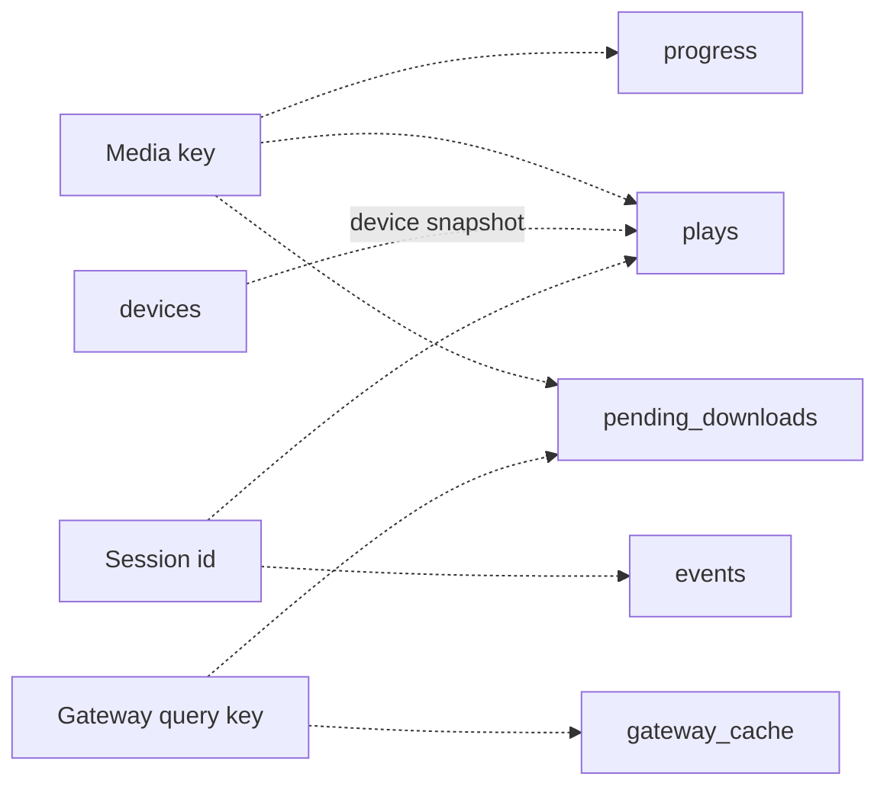

# Data models

SQLite stores durable state; active sessions, source-cache bytes, metrics, and HLS files have separate lifecycles. Shared Zod models define the public API rather than exposing SQL row shapes directly (`apps/server/src/db/index.ts`, `packages/shared/src/index.ts`). See [shared contracts](../packages/shared.md).

## Connection and migrations

`openDatabase` in `apps/server/src/db/index.ts` creates `homestream.db` under `DATA_DIR`, or uses memory for the `:memory:` sentinel. It enables WAL, a 5000 ms busy timeout, and foreign-key mode. Built-in synchronous `node:sqlite` avoids a native npm dependency.

Migrations run in numeric order, each in its own transaction with `PRAGMA user_version`; failure rolls back both schema and version. There are four versions and eight application tables. Foreign-key mode is on, but the migrations declare no foreign keys or cascades (`apps/server/src/db/migrations.ts`).

| Version | Change                                                                       |
| ------- | ---------------------------------------------------------------------------- |
| 1       | Progress, plays, devices, events, TMDB cache and gateway cache               |
| 2       | Rebuild events to admit prefetch source                                      |
| 3       | Rebuild events to admit downloads; add download queue and partial uniqueness |
| 4       | Add server settings key/value store                                          |

Dashed edges are logical correlations, not enforced SQL relations. Identity nodes are not tables (`apps/server/src/db/migrations.ts`, `apps/server/src/db/plays.ts`).

## Table map

| Table               | Key and content                                                                                                   | Adapter                                                               |
| ------------------- | ----------------------------------------------------------------------------------------------------------------- | --------------------------------------------------------------------- |
| `progress`          | Media key; title identity, position/duration, completion, hidden state and display metadata                       | `apps/server/src/db/progress.ts`                                      |
| `plays`             | Unique session id; device/client snapshot, source/decision, time watched, byte/speed/bitrate summaries and status | `apps/server/src/db/plays.ts`, `apps/server/src/db/history.ts`        |
| `devices`           | Client id; name, kind, capability JSON, last IP and seen time                                                     | `apps/server/src/db/devices.ts`                                       |
| `events`            | Id/time, level/source/message, optional details and session id                                                    | `apps/server/src/events/record.ts`, `apps/server/src/events/query.ts` |
| `tmdb_cache`        | Key, response JSON and expiry                                                                                     | `apps/server/src/tmdb/cache.ts`                                       |
| `gateway_cache`     | Query key, server-side stream JSON and expiry                                                                     | `apps/server/src/gateway/cache.ts`                                    |
| `pending_downloads` | Id, media/query identity, coarse status, detailed state, progress/ETA, poll/readiness/notification times          | `apps/server/src/downloads/store.ts`                                  |
| `settings`          | Text key/value and updated time, currently analytics install identity                                             | `apps/server/src/db/settings.ts`                                      |

The complete columns and indexes are in `docs/schema.sql`. Timestamps generally use epoch milliseconds, booleans use 0/1, and JSON is text. Device API `lastSeen` is converted to ISO text (`apps/server/src/db/devices.ts`).

The `settings` table is server-owned state, not the Settings page's preferences. Spoiler choice is browser-local; desktop preferences live in `desktop-settings.json` under Electron user data (`apps/web/src/lib/spoilers.ts`, `apps/desktop/src/main.ts`, `apps/desktop/src/settings.ts`). There is no spoiler migration or server settings API. See [configuration](configuration.md) and [Settings and spoilers](../apps/web/settings-and-spoilers.md).

## Identity and transitions

`mediaKeyFor` in `apps/server/src/db/plays.ts` produces `movie:<tmdbId>` or `tv:<tmdbId>:<season>:<episode>`. Progress is global by media key, not per device. Gateway queries use IMDb-based identity instead; downloads retain a query key rather than a playback URL (`apps/server/src/gateway/types.ts`, `apps/server/src/db/migrations.ts`).

Progress writes update position, completion and display metadata and clear hidden state. Removing Continue Watching hides progress or inserts an episode marker; it does not delete history. The eligibility query includes hidden rows so removal can override older episodes (`apps/server/src/db/progress.ts`). See [viewing progress](../features/viewing-progress.md) for completion and next-episode rules.

Play rows snapshot device details rather than depending on a join. Finalization updates only rows not already ended, and completion stays set once reached within a play (`apps/server/src/db/plays.ts`). History uses newest start time and id as a stable tie-breaker, parameterized filters, and escaped LIKE text (`apps/server/src/db/history.ts`).

A partial unique index allows only one `status='pending'` download per media key, while terminal rows can coexist. Coarse status and detailed state are separate; readiness notification time is persisted (`apps/server/src/db/migrations.ts`). See [downloads](../features/downloads.md).

## Lifetime and sensitivity

Do not confuse expiry/freshness with physical deletion. Progress, plays, devices and settings have no general TTL in their adapters; session directories and byte-cache eviction are separate from SQLite retention.

| State          | Freshness/removal policy                                                                                                                    | Implementation                       |
| -------------- | ------------------------------------------------------------------------------------------------------------------------------------------- | ------------------------------------ |
| TMDB cache     | Lists 1h, search 10m, details/config/recommendations 24h. Expired or invalid JSON is deleted on read; explicit expiry purge also exists     | `apps/server/src/tmdb/cache.ts`      |
| Gateway cache  | Nonempty results fresh 1h, empty results 5m. Expired rows remain readable for ID resolution; purge removes rows expired at least 7 days ago | `apps/server/src/gateway/cache.ts`   |
| Events         | Every 200 writes, remove rows older than 30 days and rows beyond newest 10,000; not a continuous expiry timer                               | `apps/server/src/events/record.ts`   |
| Download queue | Explicit cancellation deletes a row. Finished nonpending rows older than 30 days by update time are eligible for prune                      | `apps/server/src/downloads/store.ts` |

The **v2 movie/show cache keys** carry raw appended TMDB details containing cast/recommendations/similar data. This is a cache-shape version, not SQLite migration version 2: no table change was needed (`apps/server/src/tmdb/service.ts`). The API's bounded `cast`/`similar` arrays and backward-compatible `[]` defaults live in `packages/shared/src/catalog.ts`; see [catalog](../features/catalog.md).

The gateway cache serializes server-only stream objects whose type includes a source URL. Download rows avoid playback links, but this is not a guarantee that the whole database contains none, despite the broad no-URL statement in `docs/database.md` (`apps/server/src/gateway/types.ts`, `apps/server/src/gateway/cache.ts`). Local state also contains viewing history, device/IP data and source descriptions. Restrict local databases and backups; telemetry scrubbing does not anonymize these tables. See [security](../security.md) and [telemetry](../systems/telemetry.md).

The optional analytics install id is a persisted random UUID, not a hardware fingerprint (`apps/server/src/db/settings.ts`).

## Modification entry points

Append migrations; never rewrite applied versions. Update adapters, shared contracts and consumers together, run `pnpm db:schema`, document tables in `docs/database.md`, and check `pnpm db:schema:check`. Use `docs/schema.sql` for exhaustive DDL and [API](../api/index.md) for external models.

This inventory was source-checked against four migrations and eight application tables at **`0a8f04f`, 2026-11-08**. It did not inspect a user's database or execute migration/application tests.
