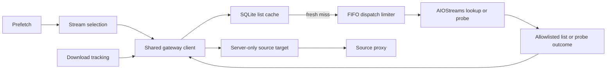

# Gateway

Active contributors: VeroxAUS

`GatewayClient` in `apps/server/src/gateway/client.ts` shares cached, rate-limited AIOStreams discovery and placeholder-aware playback probes. Real source URLs remain server-side; clients receive metadata and stable URL-derived IDs.

## Purpose

Find candidate files and distinguish actual media from gateway “downloading” clips before playback. Discovery, playback probing and CDN body reads have different deadlines and side effects. See [stream selection](../features/stream-selection.md) for ranking and [downloads](../features/downloads.md) for remote caching.

## Layout and discovery

`parseGatewayResponse` in `apps/server/src/gateway/client.ts` requires a streams array, retains HTTP(S) entries and deduplicates by ID. It chooses filename/video-size hints with URL/structured-data fallbacks. Its allowlist retains cached boolean, validated 40-hex torrent hash, nonnegative integer file index, kind and size; unrelated upstream fields are dropped.

`streamId` in `apps/server/src/gateway/types.ts` uses the first 16 hex characters of a SHA-256 URL hash. `queryKey` in that file identifies movie IMDb IDs or TV IMDb/season/episode tuples; provider paths use Stremio movie/series endpoints. Requests use the AIO-prefixed user agent so AIOStreams includes structured stream data.

Structured `cached: false` is meaningful and overrides legacy cached name markers in `apps/server/src/streams/parse.ts`. Parsing/ranking does not substitute for the actual media probe used by [playback](playback/index.md).

## Cache and dispatch

`GatewayCache` in `apps/server/src/gateway/cache.ts` stores normalized server-side list JSON, including secret-bearing URLs, in SQLite. Nonempty lists are fresh for **60 minutes**, empty lists for **five minutes**. Expired rows remain reverse-ID lookup material until purged seven days after expiry; they are not fresh responses.

Identical concurrent misses share work. Forced-fresh requests use a separate in-flight key and update the same row, letting downloads confirm newly cached sources. Statistics count list dispatches/errors and cache hits/misses; they are not a universal count of every upstream HTTP hop.

`RateLimiter` in `apps/server/src/gateway/rateLimiter.ts` starts FIFO tasks with **five starts per five seconds plus 150 ms margin**. It limits dispatch starts, not active concurrency or upstream traffic from other processes. `buildApp` in `apps/server/src/app.ts` shares one client across services.

List requests have a **30-second dispatched timeout**, with queue time outside it and no automatic lookup retry. Missing configuration yields 503 `config_missing`; transport/status/JSON failures become redacted 502 gateway errors with hints.

## Placeholder-aware playback probes

`probePlaybackLink` in `apps/server/src/gateway/playbackProbe.ts` manually follows one-byte ranged GETs, cancelling bodies and checking each Location before requesting it. The default probe deadline is **60 seconds** across the chain. It bounds the loop to nine requests, rather than following redirects indefinitely.

`placeholderName` in `apps/server/src/playback/placeholder.ts` recognizes a path ending `/static/<reason>.mp4`, regardless of host, prefix, relative redirect or query. A recognized clip is not fetched. The same module rejects direct positive sizes below **10% of a listing ≥20 MiB**; for 206 responses, the total comes from Content-Range, not the requested byte's Content-Length.

| Outcome        | Interpretation                                                               |
| -------------- | ---------------------------------------------------------------------------- |
| `available`    | Secret-bearing target handed to proxy, never public/logged                   |
| `placeholder`  | Named downloading, slots-full, rate-limit or other clip                      |
| `timeout`      | First-hop timeout; an uncached probe may already have triggered a remote add |
| `rate_limited` | First-hop HTTP 429                                                           |
| `failed`       | Unusable first response or exhausted redirect chain                          |

An inconclusive later hop defers judgment to the source proxy by returning the current target as available. This is not proof that the target will ultimately play. Debug logs contain redirect shape/status only, not the URL, host, token or filename.

`createUrlResolver` in `apps/server/src/playback/resolveUrl.ts` is a separate ordinary playback resolver: it maps placeholders to errors. `UpstreamClient` in `apps/server/src/sourceproxy/upstream.ts` also rejects redirect clips during body transport. These paths do not all run through the discovery client's limiter.

An uncached playback probe can initiate a TorBox add through AIOStreams; it is not a harmless metadata read. [Downloads](../features/downloads.md) interprets downloading/timeouts as tracking handoff and confirms true cached availability later.

## Modification entry points

Change parsing/in-flight sharing in `apps/server/src/gateway/client.ts`, persistent TTL/reverse IDs in `apps/server/src/gateway/cache.ts`, probe classification in `apps/server/src/gateway/playbackProbe.ts`, and clip semantics in `apps/server/src/playback/placeholder.ts`. Preserve the shared limiter, secret-bearing target boundary and [proxy](source-proxy.md) integration.

## Key source files

| File                                                  | Purpose                                       |
| ----------------------------------------------------- | --------------------------------------------- |
| `apps/server/src/gateway/client.ts`                   | Discovery/probe facade and statistics         |
| `apps/server/src/gateway/cache.ts`                    | Persistent list TTL and reverse IDs           |
| `apps/server/src/gateway/rateLimiter.ts`              | FIFO dispatch starts                          |
| `apps/server/src/gateway/types.ts`                    | Source identities, query paths and user agent |
| `apps/server/src/gateway/playbackProbe.ts`            | Redirect/size outcome classification          |
| `apps/server/src/playback/placeholder.ts`             | Clip detection and actionable errors          |
| `apps/server/test/integration/gateway-client.test.ts` | Parsing, caching, sharing and error paths     |
| `apps/server/test/gateway/probePlayback.test.ts`      | Redirect/size detection and safe debug output |
| `apps/server/test/gateway/rateLimiter.test.ts`        | Dispatch-window behavior                      |

## Measured scope

At **`0a8f04f`**, scoped `git ls-tree` counts **5 gateway `.ts` source / 2 matching `*.test.ts` files**, ratio **0.40**. Scope is only `apps/server/src/gateway/` and `apps/server/test/gateway/`; integration, downloads, live tests and helpers are excluded even where relevant above. CODEOWNERS and supplied default-branch history identify **1 unique human**, excluding bots, not an ownership guarantee. No gateway requests or tests were run.
