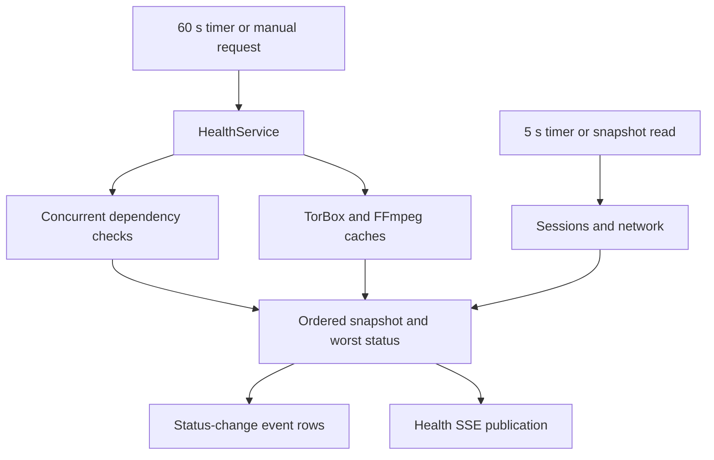

# Health

Active contributors: VeroxAUS

## Purpose

Health combines dependency checks with live playback and download state. It answers whether the server can do useful work, while the cheaper liveness/readiness probes answer narrower process and local-storage questions (`apps/server/src/health/service.ts`, `apps/server/src/routes/ops.ts`).

## Interfaces and layout

| Interface                         | Meaning                                                                                      |
| --------------------------------- | -------------------------------------------------------------------------------------------- |
| `GET /api/health`                 | Latest full snapshot, with sessions/network refreshed; runs all checks if no snapshot exists |
| `POST /api/health/run`            | Manual full pass, retaining TorBox/FFmpeg caches                                             |
| `POST /api/health/run?fresh=1`    | Bypass both caches; `fresh=true` also works                                                  |
| SSE `health` on `GET /api/events` | Initial publication, changed statuses, and manual-run snapshots                              |
| `GET /api/logs`                   | Persisted status-change events, not raw process logs                                         |
| `GET /healthz`                    | Process answers HTTP; no dependency checks                                                   |
| `GET /readyz`                     | SQLite answers `SELECT 1` and a temporary file can be written/deleted in `DATA_DIR`          |
| `GET /metrics`                    | In-memory/service counters and process metrics; no upstream health calls                     |

The HTTP adapters are `apps/server/src/routes/health.ts`, `apps/server/src/routes/ops.ts` and `apps/server/src/routes/events.ts`. Readiness returns `503 not_ready` on unusable database/data directory, and is limited to **300 requests per minute per client address**. It does not test the transcode directory, GPU, upstream credentials or playback. Application health reports failures inside a successful snapshot response rather than making `/healthz` fail. See [monitoring](../how-to-monitor/index.md).

`apps/server/src/health/` contains the scheduler and process/disk adapters; `apps/server/src/health/checks/` contains individual outcomes. The network outcome comes from `apps/server/src/network/check.ts`.

## Scheduling and publication

`HealthService` in `apps/server/src/health/service.ts` starts one non-awaited full pass, repeats it every **60 seconds**, and refreshes sessions/network every **5 seconds**. Timers are unreferenced. The process entry starts scheduling after listening; constructing the app alone does not (`apps/server/src/index.ts`).

Non-fresh concurrent runs share the in-flight promise. A fresh request can start another pass; it is not a cheap polling endpoint. Each check is caught independently, timed, given an ISO `checkedAt`, and redacted. `overall` is the worst of `ok`, `warn`, `error`; all non-OK checks receive an actionable hint.

TorBox results other than errors are cached for **5 minutes**. FFmpeg non-error results are cached for **10 minutes**, and an existing cached result is retained beyond that while any playback activity exists. Errors are retried on the next full pass. A first check or an explicit fresh pass can still encode while playback is active. Cached checks retain their original measurement timestamps (`apps/server/src/health/service.ts`).

Status changes create one event per changed check. Initial OK checks are silent; initial problems and later recoveries are recorded. Full snapshots are emitted on first publication, status changes or a manual run; changing a numeric reading alone does not force SSE. `stop()` clears timers but does not explicitly await an already-running full pass. App close calls it before disposing services (`apps/server/src/app.ts`).

## Check rules

| Check      | Work and exact boundary                                                                                                                                                                 | Source                                      |
| ---------- | --------------------------------------------------------------------------------------------------------------------------------------------------------------------------------------- | ------------------------------------------- |
| `config`   | Missing gateway/TMDB setting is error; otherwise any config warning is warn. Lists key presence, never values                                                                           | `apps/server/src/health/checks/config.ts`   |
| `gateway`  | Fetch manifest only, **10 s** timeout. Missing config, failed request/status or invalid manifest is error; reachable manifest plus last stream-lookup error is warn                     | `apps/server/src/health/checks/gateway.ts`  |
| `torbox`   | Calls the account endpoint, **10 s** timeout. Missing optional key is warn; bad key/unreachable/inactive or expired subscription is error; fewer than **7 full days** remaining is warn | `apps/server/src/health/checks/torbox.ts`   |
| `tmdb`     | Calls the service's `/configuration` ping; missing/rejected token or unreachable service is error                                                                                       | `apps/server/src/health/checks/tmdb.ts`     |
| `ffmpeg`   | Version checks and encoder inventory require `h264_nvenc` and `hevc_nvenc`; normally runs **1 s, 1280×720, 30 fps H.264 NVENC** test to the null muxer                                  | `apps/server/src/health/checks/ffmpeg.ts`   |
| `gpu`      | First `nvidia-smi` CSV GPU reading; failed/unreadable is error, temperature **>85 °C** is warn; utilization alone is not a warning                                                      | `apps/server/src/health/checks/gpu.ts`      |
| `disk`     | Reads data/transcode volumes; tighter distinct volume **<5 GiB** free is error, **<20 GiB** is warn; cache bytes above cap also warn                                                    | `apps/server/src/health/checks/disk.ts`     |
| `sessions` | Any qualifying playback error in **15 minutes**, or a falling-behind session, warns                                                                                                     | `apps/server/src/health/checks/sessions.ts` |
| `network`  | Shared download cap binding continuously for **>30 s** warns                                                                                                                            | `apps/server/src/network/check.ts`          |

FFmpeg version/inventory commands and `nvidia-smi` have **10 s** timeouts; the encode has **20 s**. `HEALTH_NVENC_TEST=off` disables only the test encode, not version/inventory checks (`apps/server/src/health/checks/ffmpeg.ts`).

Disk values called GB in responses are calculated with `1024³` and free space is rounded to two decimals before comparison. Same-root data/transcode drives are not counted twice. Disk probing climbs to the nearest existing parent, so an OK disk-space result is not proof that the configured directory is writable (`apps/server/src/health/checks/disk.ts`, `apps/server/src/health/exec.ts`).

Session errors include `error` events from `session`/`ffmpeg`, excluding rows marked `details.check`; at most five recent examples accompany the count (`apps/server/src/events/query.ts`). Falling-behind detection requires **0 < speed < 1** for **>30 s** while filling the read-ahead window. Waiting, finished/idle or zero-speed observations break the streak (`apps/server/src/playback/fallingBehind.ts`). This is more selective than the Prometheus slow-encoder rule; see [alerting](../how-to-monitor/alerting.md).

TorBox copies only plan/subscription/expiry fields, not account IDs, email or referrals. Local health still exposes operational paths, session IDs and hardware details. Secret redaction is not anonymization of every local field; do not publish snapshots without review.

## Modification entry points

Add check IDs and wire shapes in `packages/shared/src/health.ts`, implement the outcome, then update ordering, display names and event-source mapping in `apps/server/src/health/service.ts`. Use injected fetch/command/disk/clock adapters in tests; do not make offline tests run real encoders or contact services. Keep [network controls](network.md) and [playback lifecycle](playback/lifecycle.md) policies separate from display checks.

## Key source files

| File                                                  | Purpose                                                |
| ----------------------------------------------------- | ------------------------------------------------------ |
| `apps/server/src/health/service.ts`                   | Scheduling, caches, aggregation and status publication |
| `apps/server/src/health/exec.ts`                      | Bounded child processes and volume probing             |
| `apps/server/src/health/checks/types.ts`              | Common outcome and failure helpers                     |
| `apps/server/src/network/check.ts`                    | Live cap-binding warning                               |
| `apps/server/src/playback/fallingBehind.ts`           | Sustained slow-encoder rule                            |
| `apps/server/src/routes/health.ts`                    | Health/run/log query adapters                          |
| `apps/server/src/routes/ops.ts`                       | Independent probes and metrics                         |
| `packages/shared/src/health.ts`                       | Ordered IDs, response and log schemas                  |
| `apps/server/test/health/checks.test.ts`              | Stubbed check boundary tests                           |
| `apps/server/test/integration/health-service.test.ts` | Cache, scheduling/publication and redaction behavior   |
| `apps/server/test/integration/health-routes.test.ts`  | Logs and health SSE integration                        |

## Measured scope

At `bb48e6d`, **11 tracked TypeScript source files** under `apps/server/src/health/`, **3 directly scoped test files** (the health test directory plus integration files prefixed `health-`), and **0.27 test-to-code file ratio**. Helpers, network/playback source and cross-cutting observability tests are excluded. Default-branch ownership/history has **1 unique human author**, VeroxAUS, excluding bots. These are file counts, not coverage or executed-test results.
