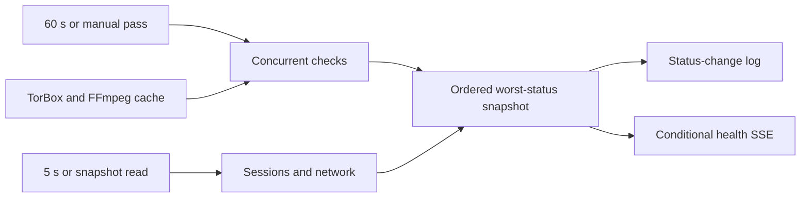

# Health

Active contributors: VeroxAUS

`HealthService` in `apps/server/src/health/service.ts` combines dependency checks with live playback/network state. It is richer and more expensive than liveness/readiness. See [monitoring](../how-to-monitor/index.md).

## Interfaces and scheduling

| Surface | Meaning |
| --- | --- |
| GET `/api/health` | Latest snapshot with live checks refreshed; first read can run all checks |
| POST `/api/health/run` | Manual pass, normally retaining caches |
| POST `/api/health/run?fresh=1` | Bypass TorBox/FFmpeg caches; `fresh=true` also works |
| SSE `health` | First service publication, status changes and manual-run snapshots |
| GET `/api/logs` | Durable selected events, including health status transitions |
| GET `/healthz` | Cheap HTTP liveness |
| GET `/readyz` | DB `SELECT 1` plus data-directory write/remove probe |
| GET `/metrics` | Counters/process data, not a dependency test |

The HTTP adapters are `apps/server/src/routes/health.ts`, `apps/server/src/routes/ops.ts` and `apps/server/src/routes/events.ts`. Readiness returns 503 when DB/storage is unusable, is limited to **300 requests/minute/address**, and does not test transcode writes, GPU or upstreams. All three root ops routes avoid upstream calls.

`start()` launches a non-awaited full pass, repeats it every **60 seconds**, and refreshes in-memory sessions/network every **5 seconds**. Entry startup enables scheduling after listening (`apps/server/src/index.ts`); app construction alone does not. Timers are unreferenced.

Non-fresh concurrent runs share an in-flight promise; fresh runs can start another pass. Each check has independent failure handling, latency and ISO `checkedAt`. `overall` is the worst `ok`/`warn`/`error`; non-OK checks receive hints. A degraded snapshot is still a successful API response.

## Cache and publication rules

TorBox non-error results cache for **5 minutes**. FFmpeg non-error results cache for **10 minutes**, and an existing result remains reusable beyond that while playback activity exists. Errors retry on the next full pass. First checks and fresh passes can still encode during playback; do not use fresh as a polling mechanism. Cached measurements keep their original timestamps.

Initial OK checks do not create log rows. Initial problems, later status changes and recoveries do. Numeric reading changes alone do not force publication. Manual runs force health SSE even without a status transition.

A new SSE connection receives heartbeat, **not a health baseline**. A steady server may therefore emit no health change after connection. `reconcileHealth` in `apps/web/src/events/serverEvents.ts` runs a snapshot through the health query on every open, cancelling older requests; a pushed newer snapshot cancels pending reads too. See [web data and startup](../apps/web/data-and-startup.md).

`stop()` clears timers but does not await an already-running full pass. Local snapshots may contain hardware, paths and session information; secret redaction does not make them public-safe.

## Nine checks

| ID | Work and boundary | Implementation |
| --- | --- | --- |
| `config` | Missing gateway/TMDB setting is error; configuration warnings produce warn | `apps/server/src/health/checks/config.ts` |
| `gateway` | Manifest request, 10-second timeout; unreachable/invalid is error, last stream-lookup failure can warn after reachable manifest | `apps/server/src/health/checks/gateway.ts` |
| `torbox` | Account request, 10-second timeout; absent optional key warns, rejected/unreachable/inactive/expired errors, fewer than seven full subscription days warns | `apps/server/src/health/checks/torbox.ts` |
| `tmdb` | Service configuration ping; missing/rejected token or failure errors | `apps/server/src/health/checks/tmdb.ts` |
| `ffmpeg` | Version/inventory requires H.264 and HEVC NVENC; normally a one-second 720p H.264 test encode | `apps/server/src/health/checks/ffmpeg.ts` |
| `gpu` | First `nvidia-smi` GPU reading; unreadable errors, temperature above 85°C warns | `apps/server/src/health/checks/gpu.ts` |
| `disk` | Fuller relevant volume below fixed 5 GiB errors; below configurable warning threshold warns; over-cap transcode usage also warns | `apps/server/src/health/checks/disk.ts` |
| `sessions` | Qualifying session/FFmpeg errors in last 15 minutes or sustained falling behind warns | `apps/server/src/health/checks/sessions.ts` |
| `network` | Shared download cap binding continuously for more than 30 seconds warns | `apps/server/src/network/check.ts` |

`HEALTH_NVENC_TEST=off` disables only the encode, not FFmpeg version/inventory. Version/inventory and GPU commands have 10-second limits; encode has 20 seconds. Full checks contact upstreams and may use the GPU.

`checkDisk` in `apps/server/src/health/checks/disk.ts` probes data/transcode volumes, avoids counting the same reported root twice and uses the tighter free-space reading. GB-named fields use `1024³`; free space rounds to two decimals before comparison. The warning setting is **`DISK_WARN_FREE_GB`, default 20**; `DISK_ERROR_FREE_GB` remains **5** (`apps/server/src/config.ts`). Nonnegative warning values at or below five are accepted with a configuration warning, not silently clamped: disk health then goes directly from OK to error at the fixed boundary. The independent configuration check can still warn.

Disk also compares finished live-session segment bytes with `TRANSCODE_MAX_GB`. Probing climbs to an existing parent, so a free-space OK is not proof the configured directory is writable (`apps/server/src/health/exec.ts`).

`apps/server/src/playback/fallingBehind.ts` requires positive speed below one for more than 30 seconds while filling the read-ahead window; waiting/idle/zero observations break the streak. Recent-error queries exclude health-generated rows marked `details.check` (`apps/server/src/events/query.ts`). This differs from the raw minimum-speed [Prometheus rule](../how-to-monitor/alerting.md).

## Change entry points and tests

Add IDs/wire shapes in `packages/shared/src/health.ts`, then implement outcomes and update ordering/name/event-source maps in the service. Inject HTTP, command, disk and clock adapters for offline tests. Keep playback/network policy in its own subsystem rather than hiding behavior changes inside display checks.

Tests cover outcome boundaries, configurable disk thresholds, caching/expiry, active-playback retention, manual publication, independent failures, redaction and SSE/log queries. This refresh inspected source; it did not execute tests or contact services.

## Key source files

| File | Purpose |
| --- | --- |
| `apps/server/src/health/service.ts` | Scheduler, cache, aggregation and transitions |
| `apps/server/src/health/exec.ts` | Bounded processes and disk probing |
| `apps/server/src/health/checks/types.ts` | Outcome helpers |
| `packages/shared/src/health.ts` | IDs and response/log schemas |
| `apps/server/test/health/checks.test.ts` | Stubbed dependency/check boundaries |
| `apps/server/test/health/disk.test.ts` | Disk threshold/cap regressions |
| `apps/server/test/integration/health-service.test.ts` | Service caches and publication |
| `apps/server/test/integration/health-routes.test.ts` | Log/SSE route integration |

## Measured scope

At `5eefa37`, `apps/server/src/health/` has **11 production `.ts` files**; `apps/server/test/health/` has **2 `.test.ts` files**, excluding its helper. Test/source file ratio: **0.18**. Integration tests and network/playback modules are outside this count, though relevant above. Scoped default-branch history has **1 unique human author**, VeroxAUS. These counts are inventory, not coverage or executed-test results.
