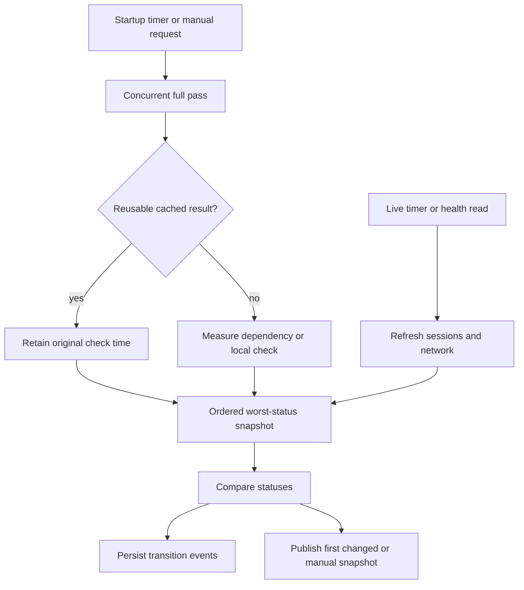

# Health

Active contributors: VeroxAUS

`HealthService` in `apps/server/src/health/service.ts` combines dependency checks with live playback/network state. It is richer, slower and potentially more consequential than HTTP liveness/readiness.

## Purpose

Explain operational problems with actionable hints while keeping credentials out of results/events. Health is feedback, not a prerequisite that blocks every API request. See [monitoring](../how-to-monitor/index.md) for logs, metrics and alerts.

## Interfaces and scheduling

| Surface                        | Behavior                                                                  |
| ------------------------------ | ------------------------------------------------------------------------- |
| GET `/api/health`              | Latest snapshot with live checks refreshed; first read can run all checks |
| POST `/api/health/run`         | Manual pass, normally retaining caches                                    |
| POST `/api/health/run?fresh=1` | Bypass TorBox/FFmpeg caches; `fresh=true` also works                      |
| SSE `health`                   | First publication, status transitions and manual-run snapshots            |
| GET `/api/logs`                | Durable selected events, including status transitions                     |
| GET `/healthz`                 | Cheap HTTP liveness                                                       |
| GET `/readyz`                  | DB SELECT and data-directory write/remove probe; failure is 503           |
| GET `/metrics`                 | Local Prometheus registry; not a health-check run                         |

`registerHealthRoutes` in `apps/server/src/routes/health.ts` exposes the health/log APIs. `registerOpsRoutes` in `apps/server/src/routes/ops.ts` keeps root probes independent of TMDB, gateway and TorBox. Readiness alone is rate-limited to **300/minute per address**; playback/HLS is not globally throttled.

`main` in `apps/server/src/index.ts` starts health after listeners open. The service runs a full pass immediately and every **60 seconds**, plus cheap session/network refreshes every **five seconds**. Building the app alone does not activate these timers. Full-pass checks run concurrently; overall status is the worst of ok/warn/error in the shared check order.

Nonfresh calls can join an in-flight full pass. A fresh request can start a new pass even if one is running; do not describe all runs as globally serialized. A manual run forces publication even if statuses do not change.

## Checks and boundaries

| Check         | Implementation and meaning                                                                                                                                                                      |
| ------------- | ----------------------------------------------------------------------------------------------------------------------------------------------------------------------------------------------- |
| Configuration | `checkConfig` in `apps/server/src/health/checks/config.ts`: required gateway/TMDB key presence, optional TorBox presence, settings warnings and selected config-file metadata; never key values |
| Gateway       | `checkGateway` in `apps/server/src/health/checks/gateway.ts`: addon manifest only, **10 s** timeout, plus last list-lookup status; never a stream lookup                                        |
| TorBox        | `checkTorbox` in `apps/server/src/health/checks/torbox.ts`: account request, **10 s** timeout; plan/subscription/expiry only, no email/account/referral fields                                  |
| TMDB          | `checkTmdb` in `apps/server/src/health/checks/tmdb.ts`: configured token plus service ping to `/configuration`                                                                                  |
| FFmpeg/NVENC  | `checkFfmpeg` in `apps/server/src/health/checks/ffmpeg.ts`: executable versions, H.264/HEVC NVENC names and optional real one-second H.264 NVENC test                                           |
| GPU           | `checkGpu` in `apps/server/src/health/checks/gpu.ts`: first nvidia-smi CSV GPU reading, **10 s** timeout, nullable unavailable measurements                                                     |
| Disk          | `checkDisk` in `apps/server/src/health/checks/disk.ts`: free data/transcode volume space and finished-segment cap usage                                                                         |
| Sessions      | `checkSessions` in `apps/server/src/health/checks/sessions.ts`: active count, recent playback errors and genuinely falling-behind sessions                                                      |
| Network       | `buildNetworkCheck` in `apps/server/src/network/check.ts`: current aggregate cap/rate and per-session lead/read-ahead                                                                           |

TorBox warns when unconfigured, errors when rejected/inactive/expired, and warns for fewer than **seven days** remaining. A missing optional TorBox key can therefore make overall health warn while cached playback still works.

FFmpeg version/encoder commands have **10-second** timeouts; its real encode has **20 seconds**. `HEALTH_NVENC_TEST=off` disables that encode, not version/encoder inspection. A “fresh health run” may touch the GPU and real services; it is not equivalent to a safe monitoring scrape.

GPU temperature warns strictly above **85°C**. Disk uses binary GiB despite GB labels, warns below configurable default **20 GB**, errors below **5 GB**, and can warn above the transcode cap. `diskSpace` in `apps/server/src/health/exec.ts` climbs to an existing parent if a configured directory is not yet created.

Session errors cover the last **15 minutes**, excluding health's own check-transition errors. `FallingBehindWatch` in `apps/server/src/playback/fallingBehind.ts` requires known positive recent speed below 1× for more than **30 seconds** while filling. Waiting at read-ahead, finished or parked video does not count. Network limiting warns only after more than **30 seconds** of binding; it is not itself an error.

## Caches, publication and privacy

Nonerror TorBox results cache for **five minutes**; nonerror FFmpeg results for **ten minutes**. Errors are retried on the next pass. An existing FFmpeg result remains reused beyond TTL while playback activity exists, unless fresh is requested. The check is not universally skipped whenever playback is active: initial/fresh passes can still run it.

The service adds timing/name/id, deep-redacts results and converts thrown check failures into error outcomes. A status transition writes one event with check/status/previous/hint under the appropriate event source; initial ok checks stay out of durable transition logs. Numeric detail changes alone do not produce repeated events/SSE snapshots. Manual passes still publish.

`registerEventRoutes` in `apps/server/src/routes/events.ts` carries bus publications over SSE with heartbeats; it does not replay a health snapshot to every new connection by itself. Clients reconcile fetched health and SSE; see [web data and startup](../apps/web/data-and-startup.md). Local operational output is distinct from [telemetry](telemetry.md).

## Modification entry points

Add/change check IDs and response contracts in [shared](../packages/shared.md), implement a focused check module and wire it in `apps/server/src/health/service.ts`. Preserve result redaction, actionable non-ok hints, expensive-check cache policy and the cheap root-probe boundary. Operational response changes also require the [API](../api/index.md) documentation.

## Key source files

| File                                                  | Purpose                                                 |
| ----------------------------------------------------- | ------------------------------------------------------- |
| `apps/server/src/health/service.ts`                   | Scheduling, caches, aggregation and transitions         |
| `apps/server/src/health/checks/types.ts`              | Common outcomes and failure helper                      |
| `apps/server/src/health/exec.ts`                      | Bounded commands and disk-space seam                    |
| `apps/server/src/routes/health.ts`                    | Health/manual/log adapters                              |
| `apps/server/src/routes/ops.ts`                       | Independent probes/metrics and readiness limit          |
| `packages/shared/src/health.ts`                       | Check IDs and wire/log schemas                          |
| `apps/server/test/health/checks.test.ts`              | Stubbed check parsing/failure boundaries                |
| `apps/server/test/health/disk.test.ts`                | Free-space and cache-cap policy                         |
| `apps/server/test/integration/health-service.test.ts` | Caches, publication, failure isolation and secret audit |
| `apps/server/test/integration/health-routes.test.ts`  | Logs and SSE integration                                |

## Measured scope

At **`0a8f04f`**, scoped `git ls-tree` counts **11 `.ts` production files in `apps/server/src/health/`** and **2 `*.test.ts` files in `apps/server/test/health/`**, ratio **0.18**. Helpers, integration tests and adjacent network/playback/routes are excluded even where discussed. CODEOWNERS and supplied default-branch history identify **1 unique human**, excluding bots, not an ownership guarantee. Source/tests were inspected; no health runs, application tests, real encodes or upstream requests were executed.
