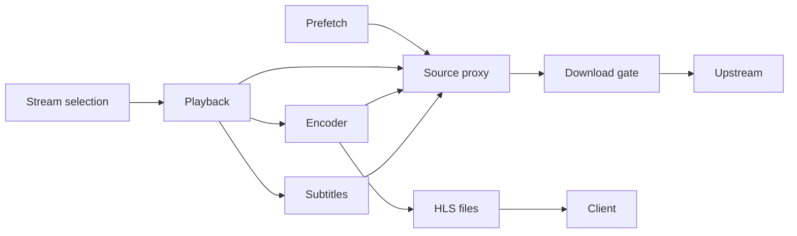

# Systems

Active contributors: VeroxAUS

## Purpose

These systems separate process ownership, source-byte delivery and operational feedback. The composition root is `apps/server/src/app.ts`; clients receive HLS while media tools read opaque loopback source handles.

## System map

| System | Responsibility |
| --- | --- |
| [Playback](playback/index.md) | Start, slots, encoder lifecycle, recovery, HLS and subtitles |
| [Source proxy](source-proxy.md) | Shared ranged cache, stable handles and reader ownership |
| [Network](network.md) | Aggregate download cap, priorities and read-ahead |
| [Gateway](gateway.md) | Cached discovery and placeholder-aware playback probes |
| [Health](health.md) | Dependency and live operational snapshots |
| [Telemetry](telemetry.md) | Optional scrubbed errors, analytics and flags |

## Integration and modification

`PlaybackManager` in `apps/server/src/playback/manager.ts` is a facade over focused modules, not the implementation of every playback operation. `SourceProxy` in `apps/server/src/sourceproxy/proxy.ts` shares bytes without sharing each session's read-ahead state. `DownloadGate` in `apps/server/src/network/downloadGate.ts` schedules actual remote media bytes; cached reads do not consume its tokens.

Start changes at the owning page. A stopped reader, a bandwidth hold, a disk park and an encoder failure are different states with different recovery rules. For user workflows, follow [features](../features/index.md); for shared practices, follow [conventions](../how-to-contribute/patterns-and-conventions.md).

## Key source files

| File | Purpose |
| --- | --- |
| `apps/server/src/app.ts` | Composition |
| `apps/server/src/playback/manager.ts` | Route-facing playback facade |
| `apps/server/src/playback/context.ts` | Shared playback dependencies |
| `apps/server/src/sourceproxy/proxy.ts` | Source ownership and listener |
| `apps/server/src/network/downloadGate.ts` | Remote-byte scheduling |

## Measured scope

At `5eefa37`, committed playback/proxy/network source directories contain **58 `.ts` files**. Matching test directories plus `apps/server/test/encode/` contain **55 `*.test.ts` files**, ratio **0.95**. Method: scoped `git ls-files`; excludes routes, helpers and integration tests elsewhere. Default-branch history/CODEOWNERS identify **1 unique human author**, excluding bots. This overlapping media-pipeline count is not coverage.
