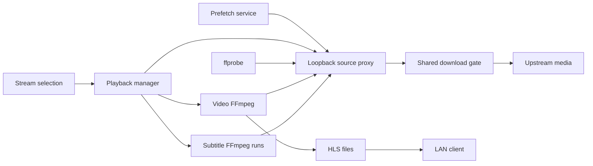

# Systems

Active contributors: VeroxAUS

HomeStream separates playback orchestration from upstream byte transport. The server owns both: clients receive HLS and track metadata, while FFmpeg and ffprobe read opaque loopback URLs (`apps/server/src/app.ts`).

## Layout and responsibilities

| System           | Responsibility                                                       | Read next                       |
| ---------------- | -------------------------------------------------------------------- | ------------------------------- |
| Playback         | Start/fallback, device output, encoders, HLS, subtitles and teardown | [Playback](playback/index.md)   |
| Source proxy     | Shared resolved sources, probes and ranged byte cache                | [Source proxy](source-proxy.md) |
| Network controls | Global download budget, lead-aware priority and read-ahead holds     | [Network controls](network.md)  |
| Gateway          | Source discovery and gateway request policy                          | [Gateway](gateway.md)           |
| Health           | Dependency checks and local operational state                        | [Health](health.md)             |
| Telemetry        | Optional, scrubbed errors and product events                         | [Telemetry](telemetry.md)       |

Catalog, ranking, speculative warming, downloads and progress are [features](../features/index.md); they are callers or integrations of this media pipeline, not separate encoders.

The arrows to the proxy are reads. The download gate controls delivery of received upstream chunks before readers consume more; local files and memory hits do not spend that budget. See `apps/server/src/sourceproxy/serve.ts` and `apps/server/src/network/downloadGate.ts`.

## Main abstractions and integration

- `PlaybackManager` reserves capacity, tries sources and returns a session only after the first segment exists. A `SessionRecord` owns the video encoder, subtitle controller, output directory and one source lease (`apps/server/src/playback/manager.ts`, `apps/server/src/playback/session.ts`).
- A `SourceEntry` shares a resolved location, successful probe, pinned head/tail and rolling blocks by exact raw gateway URL. Source leases survive encoder restarts (`apps/server/src/sourceproxy/proxy.ts`, `apps/server/src/sourceproxy/sourceEntry.ts`).
- `DownloadGate` is one aggregate budget per proxy. `ReadAheadWindow` stops a reader once enough media is buffered, with a lower threshold for resuming (`apps/server/src/network/downloadGate.ts`, `apps/server/src/network/readAhead.ts`).
- Public playlists describe a full VOD timeline even when most segments do not exist yet. Requests can regenerate missing video or steer subtitle extraction (`apps/server/src/playback/playlist.ts`, `apps/server/src/playback/manager.ts`).

For a start failure, inspect candidate selection and first-segment readiness before tuning FFmpeg. For stalled reads, separate [read-ahead waiting](network.md) from an upstream error. For disk or RSS limits, use [lifecycle](playback/lifecycle.md). [Server composition](../apps/server.md), [API routes](../api/index.md), [shared contracts](../packages/shared.md) and [monitoring](../how-to-monitor/index.md) cover their own boundaries.

## Measured scope

Snapshot at `bb48e6d`, 2026-11-06. Counts are recursive physical TypeScript files, not lines or test cases.

| Scope                                                 | Source `.ts` | `*.test.ts` | Test/code file ratio | Test helpers |
| ----------------------------------------------------- | -----------: | ----------: | -------------------: | -----------: |
| Playback source; playback and encode test directories |           27 |          24 |                 0.89 |            4 |
| Source-proxy source/test directories                  |            6 |           7 |                 1.17 |            2 |
| Network source/test directories                       |            7 |           7 |                 1.00 |            1 |
| Combined media pipeline                               |           40 |          38 |                 0.95 |            7 |

Playback tests comprise 15 under `apps/server/test/playback` and 9 under `apps/server/test/encode`, including the prefetch/encoder-wrapper integration files. Dedicated integration tests elsewhere, routes, shared schemas and generated output are excluded. Focused playback pages reuse this overlapping footprint rather than claim disjoint allocations.

Scoped author history on `origin/main` has **1 unique human author, VeroxAUS**, excluding bot names; this is a history count, not a substitute for ownership review. Tests were inspected, not executed for this documentation.

## Key source files

| Repository-root path                                     | Role                                           |
| -------------------------------------------------------- | ---------------------------------------------- |
| `apps/server/src/app.ts`                                 | Constructs services and wires limits/observers |
| `apps/server/src/playback/manager.ts`                    | Session orchestration and HLS serving          |
| `apps/server/src/playback/session.ts`                    | Owned state and public projections             |
| `apps/server/src/sourceproxy/proxy.ts`                   | Shared-source lifetime and loopback listener   |
| `apps/server/src/sourceproxy/serve.ts`                   | Cache/range transport                          |
| `apps/server/src/network/downloadGate.ts`                | Global bandwidth scheduling                    |
| `apps/server/test/integration/playback-fallback.test.ts` | Offline startup and cleanup regressions        |
| `apps/server/test/sourceproxy/readAheadWindow.test.ts`   | Window holds and shared-owner lead tests       |
