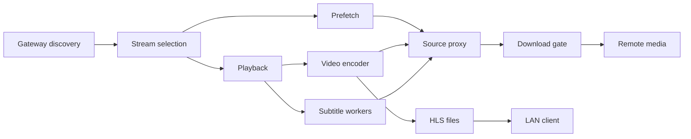

# Systems

Active contributors: VeroxAUS

HomeStream separates session/process ownership, shared media-byte delivery and operational feedback. The composition root is `buildApp` in `apps/server/src/app.ts`.

## Purpose

The server does the expensive work; clients receive device-compatible HLS rather than secret-bearing upstream URLs. Follow [features](../features/index.md) for user workflows and [server](../apps/server.md) for process startup.

## System map

| System                             | Main boundary                                                     |
| ---------------------------------- | ----------------------------------------------------------------- |
| [Playback](playback/index.md)      | Session admission, first-segment readiness, encoding and HLS      |
| [Encoding](playback/encoding.md)   | Probe-driven compatibility, NVENC and timestamp policy            |
| [Lifecycle](playback/lifecycle.md) | Checked stops, serialized replacement and disk protection         |
| [Subtitles](playback/subtitles.md) | Progressive text coverage and bitmap burn-in                      |
| [Source proxy](source-proxy.md)    | Stable loopback handles, shared ranged cache and reader ownership |
| [Network controls](network.md)     | Aggregate byte grants, read-ahead and LAN discovery addresses     |
| [Gateway](gateway.md)              | Cached/rate-limited discovery and placeholder-aware probes        |
| [Health](health.md)                | Dependency checks and live operational snapshots                  |
| [Telemetry](telemetry.md)          | Optional scrubbed errors, analytics and flags                     |

## Integration and invariants

`PlaybackManager` in `apps/server/src/playback/manager.ts` is a facade over startup, recovery, HLS and worker modules. `PlaybackContext` in `apps/server/src/playback/context.ts` shares slots, watchdog and PID registry without merging their responsibilities.

`SourceProxy` in `apps/server/src/sourceproxy/proxy.ts` shares a source's bytes/probe results, but preserves each session's reader windows. `DownloadGate` in `apps/server/src/network/downloadGate.ts` governs actual remote media grants, not cached reads, outbound HLS or all machine traffic.

A bandwidth hold, a disk-parked encoder, a discarded reader and a failed session are different states. A completed stop call is also not proof that its process exited: a surviving video child still consumes capacity and blocks unsafe replacement. These distinctions drive the regression tests.

## Modification entry points

Start at the owning system page and its test table. Keep HTTP validation in routes and wire changes in [shared contracts](../packages/shared.md). Preserve no-overlap process ownership, bounded reads, redaction and the always-re-encode policy; see [conventions](../how-to-contribute/patterns-and-conventions.md).

## Key source files

| File                                                               | Purpose                                |
| ------------------------------------------------------------------ | -------------------------------------- |
| `apps/server/src/app.ts`                                           | Service graph and resource ownership   |
| `apps/server/src/playback/manager.ts`                              | Route-facing playback API              |
| `apps/server/src/playback/context.ts`                              | Shared playback dependencies           |
| `apps/server/src/sourceproxy/proxy.ts`                             | Source handles and private listener    |
| `apps/server/src/network/downloadGate.ts`                          | Remote-byte scheduling                 |
| `apps/server/test/integration/playback-manager-stuck-stop.test.ts` | Process-survival ownership regressions |

## Measured scope

At **`0a8f04f`**, committed `apps/server/src/playback/`, `apps/server/src/sourceproxy/` and `apps/server/src/network/` contain **58 `.ts` source files**. Their matching test directories plus `apps/server/test/encode/` contain **55 `*.test.ts` files**, ratio **0.95**. Method: scoped `git ls-tree` inventory; routes, helpers and integration tests elsewhere are excluded. This overlapping media-pipeline scope is not coverage. CODEOWNERS and supplied default-branch history identify **1 unique human**, excluding bots; this is not an ownership guarantee.
