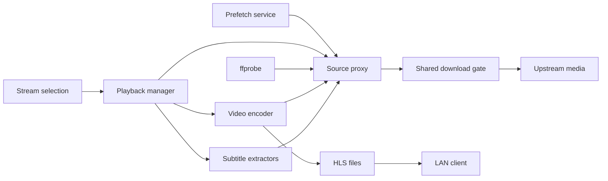

# Systems

Active contributors: VeroxAUS

HomeStream separates playback orchestration from upstream byte transport. The server owns both: clients receive HLS and track metadata, while FFmpeg and ffprobe read opaque loopback URLs (`apps/server/src/app.ts`).

## Responsibilities

| System                          | Responsibility                                                                       |
| ------------------------------- | ------------------------------------------------------------------------------------ |
| [Playback](playback/index.md)   | Source startup/fallback, device output decisions, encoding, HLS, subtitles, teardown |
| [Source proxy](source-proxy.md) | Shared source leases, resolved links, probes, and byte-range cache                   |
| [Network controls](network.md)  | Global download budget, read-ahead holds, and reader priority                        |
| [Gateway](gateway.md)           | Upstream discovery, caching, rate limits, and error classification                   |
| [Health](health.md)             | Dependency checks and operational snapshots                                          |
| [Telemetry](telemetry.md)       | Optional scrubbed errors, catalog events, and feature flags across runtimes          |

Catalog, stream ranking, warming, downloads, and progress are [features](../features/index.md). SQLite is covered under [data models](../reference/data-models.md); HTTP composition is in [server](../apps/server.md).

The proxy read path meters remote bytes and reuses cached blocks. Memory/file cache hits do not need a new upstream download (`apps/server/src/sourceproxy/serve.ts`, `apps/server/src/network/downloadGate.ts`).

## Modification entry points

Use the owning system page before changing scheduling or limits. A slow source, an intentional read-ahead hold, an encoder stall, and a full transcode directory have different causes. Keep explicit lifetimes for encoders and shared source leases (`apps/server/src/playback/session.ts`, `apps/server/src/sourceproxy/sourceEntry.ts`). Measure playback startup and segment serving when changing these paths (`AGENTS.md`).

## Key source files

| File                                      | Role                                  |
| ----------------------------------------- | ------------------------------------- |
| `apps/server/src/app.ts`                  | Composition, limits, and observers    |
| `apps/server/src/playback/manager.ts`     | Session orchestration and HLS serving |
| `apps/server/src/playback/session.ts`     | Session-owned state                   |
| `apps/server/src/sourceproxy/proxy.ts`    | Loopback listener and shared sources  |
| `apps/server/src/sourceproxy/serve.ts`    | Cache/range transport                 |
| `apps/server/src/network/downloadGate.ts` | Aggregate bandwidth scheduling        |
| `apps/server/src/telemetry/index.ts`      | Optional server telemetry composition |

## Measured scope

The playback, source-proxy and network source directories contain **40 TypeScript files**. Matching test directories plus the encoder tier contain **38 test files**, a **0.95 test-to-code file ratio**. This overlapping media-pipeline scope excludes routes, shared contracts, and dedicated integration tests elsewhere. File ratios are not coverage. Human author count on the default branch is one, excluding bots; see [statistics](../by-the-numbers.md).
