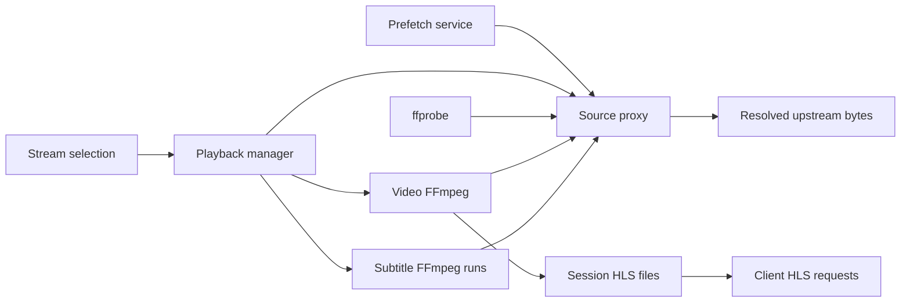

# Systems

Active contributors: VeroxAUS (origin/main sole human)

HomeStream's server separates discovery/control from the media byte pipeline. This section describes the implemented playback, source-cache, and gateway systems; it does not imply a shipped playback UI.

## Layout and responsibilities

| System | Purpose | Read next |
| --- | --- | --- |
| Playback | Own sessions, select output, run FFmpeg, serve on-demand HLS and subtitles | [Playback](playback/index.md) |
| Source proxy | Keep remote links internal; share resolved sources, probes, and cached bytes | [Source proxy](source-proxy.md) |
| Gateway | Discover upstream stream options and enforce gateway request policy | [Gateway](gateway.md) |

Catalog lookup, stream ranking, and speculative warming are [features](../features/index.md), rather than alternate media pipelines.

## Key abstractions and flow

`PlaybackManager` converts a title, stream choice, and device profile into a `SessionRecord`. The record holds one shared `SourceHandle`, output decision, video process, segment store, and independent progressive subtitle extractor. FFmpeg and ffprobe read opaque loopback URLs, not CDN URLs. A proxy `SourceEntry` is shared by exact raw gateway URL; its ownership outlives a single encoder run.

Playback generates a complete VOD timeline immediately, then creates missing segments on demand. A playlist is therefore a promise of seekable positions, not proof those files already exist. [Lifecycle](playback/lifecycle.md) explains seek restarts, failures, and disk pressure; [encoding](playback/encoding.md) explains the hardware-dependent output.

## Integrations and modification entry points

- Change session orchestration in `apps/server/src/playback/manager.ts`, not route handlers.
- Change byte transport or cache policy in `apps/server/src/sourceproxy/`; preserve shared ownership and extractor priority.
- Change discovery policy through [gateway](gateway.md) and [stream selection](../features/stream-selection.md).
- Public contracts and persistence are documented separately in the [API](../api/index.md) and [data models](../reference/data-models.md).

## Measured scope

Working-tree recursive `*.ts` file enumeration: playback has **20 source files**, **16 `*.test.ts` files** across playback/encode tests, and **2 test helper files**. Source proxy has **5 source files**, **2 `*.test.ts` files**, and **1 test helper file**. The combined assigned media-pipeline scope is **25 source / 18 test / 3 helper files**, excluding routes, configuration, shared contracts, dependencies, and generated output. Gateway is outside this count.

Each of playback and source proxy has **1 unique committer**, VeroxAUS, deduplicating `git log origin/main --format="%cn <%ce>" -- <source-and-test-directories>`. These are scoped history counts, not an ownership policy. Tests cited here were read as evidence, not executed for this documentation.

## Key source files

| Repository-root path | Role |
| --- | --- |
| `apps/server/src/app.ts` | Composition and shutdown ownership |
| `apps/server/src/playback/manager.ts` | Media lifecycle coordinator |
| `apps/server/src/playback/session.ts` | Internal state and response projections |
| `apps/server/src/sourceproxy/proxy.ts` | Shared-source ownership and loopback listener |
| `apps/server/src/playback/playlist.ts` | Generated HLS timeline |
| `apps/server/test/encode/lifecycle.test.ts` | Integration expectations for seeks and recovery |
